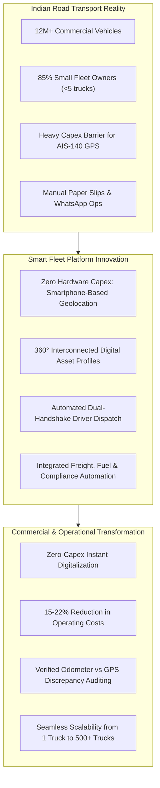
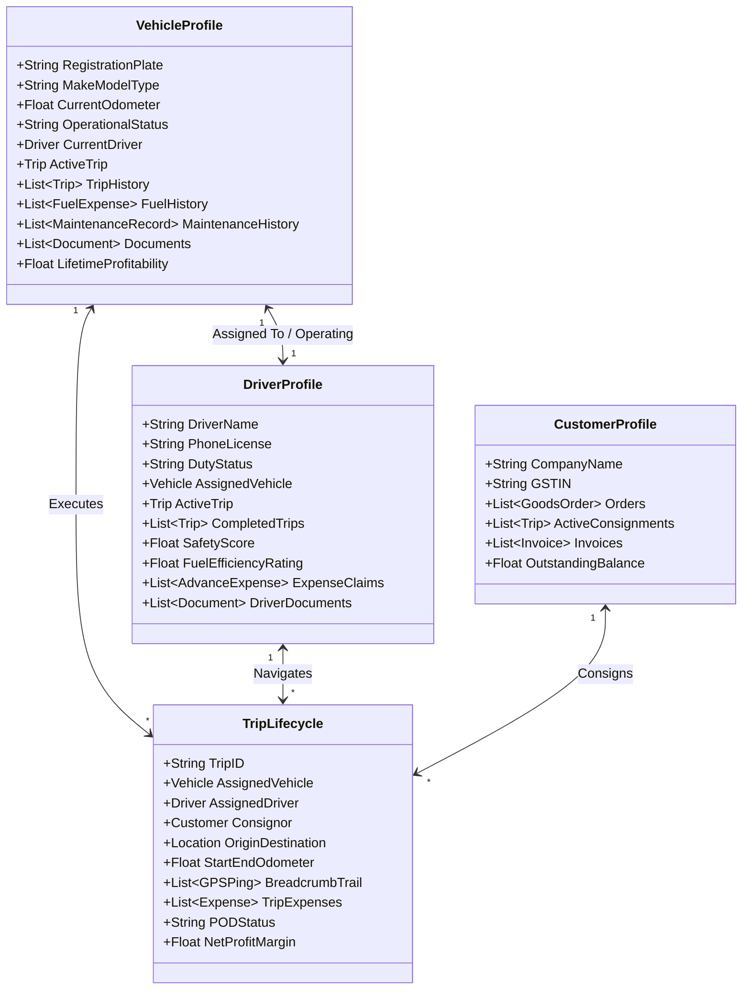
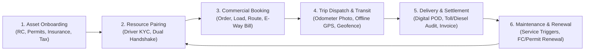

# 01. Product Vision & Strategy: Smart Fleet Management & Transport Business Automation Platform

**Document Version:** 1.0.0  
**Status:** Approved Architecture Blueprint  
**Target Market:** India & Emerging Logistics Corridors (with Global Applicability)  
**Author:** Product Architecture & Engineering Strategy Group  

---

## 1. Executive Summary & Strategic Mission

The commercial road transport sector is the circulatory system of the economy. In India, road freight accounts for over **66% of all freight movement** and **71% of total transport sector GDP contribution**. Yet, more than **85% of India's 12+ million commercial vehicles** are owned by small, unorganized fleet operators owning fewer than 5 trucks.

These truck owners operate in an environment characterized by severe capital constraints, razor-thin operating margins (5%–8%), rampant diesel theft, arbitrary police/RTO harassment, chronic driver turnover (>40% annually), and zero-visibility highway runs. Existing commercial fleet management solutions (Telematics SaaS) require **heavy upfront capital expenditures** (₹4,000–₹8,000 per truck for AIS-140 GPS hardware, OBD-II dongles, digital fuel rod sensors, and wire-splicing installation) accompanied by stiff lock-in annual software fees. Consequently, millions of lorry owners are locked out of digital fleet operations, managing their multi-lakh rupee assets using crumpled paper trip sheets, disconnected WhatsApp calls, and manual cash registers.

### The Strategic Mission
> **To democratize enterprise-grade fleet intelligence, real-time tracking, and automated transport business operations for every commercial vehicle owner—starting with zero upfront hardware cost using standard smartphones, and scaling into a complete, end-to-end transport business automation operating system.**

---

## 2. Core Problem Statement: The Indian Trucking Paradox

Commercial vehicle ownership in India and emerging markets presents a deep operational paradox: while the vehicle itself is a high-value capital asset (ranging from ₹15 Lakhs for an Intermediate Commercial Vehicle to ₹45+ Lakhs for a multi-axle 28T–40T tractor-trailer), the operational oversight is almost entirely blind once the lorry leaves the terminal.

### Key Pain Points

1. **The Capital Barrier (Hardware Trap):**
   Traditional telematics companies demand upfront payments for GPS trackers and installation. If an owner with 4 trucks is asked for ₹24,000 upfront plus ₹600/month/vehicle, they reject it. If a tracker fails, service technicians take days to arrive, leading to lost tracking.
2. **The Driver-Owner Friction & Trust Deficit:**
   Drivers resist invasive surveillance. Meanwhile, owners suspect drivers of unnecessary detours, fraudulent fuel receipts, unauthorized passenger ferry ("personal taxi"), and exaggerated trip expenses. 
3. **Information Silos:**
   A truck's tracking is in one GPS app (e.g., WheelsEye/LocoNav), driver salary is in a paper notebook, FASTag toll deductions are on an ICICI/Paytm portal, tyre changes are noted on a calendar, and customer e-Way bills are stored on WhatsApp. Nothing talks to each other.
4. **Dead Mileage & Empty Return Trips (Backhauls):**
   Over **35% of Indian truck kilometres are run completely empty** because owners lack direct digital linkages to return freight, leaving them dependent on exploitative roadside brokers who take 15–20% commissions.
5. **Regulatory Non-Compliance Risk:**
   Missing a Fitness Certificate (FC), National Permit (NP), Insurance renewal, or Pollution Under Control (PUC) date results in crippling court fines (up to ₹20,000 under the amended Motor Vehicles Act) or impounding of the vehicle.

---

## 3. Target Stakeholder Matrix & Persona Ecosystem

The platform is designed around 7 core personas whose daily workflows intersect around the commercial vehicle.

| Stakeholder Persona | Profile & Fleet Size | Primary Goals | Key Pain Points to Solve | Value Proposition |
| :--- | :--- | :--- | :--- | :--- |
| **Independent Truck Owner (Single-Lorry Owner)** | 1–2 Lorries (often driving themselves or hiring 1 village driver) | Maximize daily earnings, prevent breakdown, keep documents valid, track location. | Cannot afford GPS hardware; struggles with cash advances; lost paper bills. | 100% Free or ultra-low-cost smartphone tracking, digital document locker, instant trip P&L. |
| **Small-to-Medium Fleet Operator (Transporter)** | 3–20 Lorries (Mix of 16T, 28T, 40T trailers; inter-state runs) | Driver accountability, real-time consignment tracking, fuel theft prevention, FASTag auditing. | High driver turnover; constant phone calls asking "Where are you?"; fuel slip tampering. | Automated dispatch handshake, real-time live map with trail playback, fuel vs mileage analytics. |
| **Large Fleet Enterprise / Logistics Company** | 20–200+ Lorries (Dedicated contracts with FMCG, Cement, Steel, Auto) | Fleet utilization (>85%), SLA compliance, preventive maintenance, multi-branch control. | High maintenance downtime; unauthorized detention at mills; dispatch scheduling chaos. | Role-Based Access Control (RBAC), multi-branch oversight, automated invoicing, REST APIs. |
| **Commercial Vehicle Driver** | Employed or contract driver; semi-literate; smartphone-equipped (Android) | Transparent wage/bata payment, clear trip assignments, proof of delivery, emergency safety. | Blamed for delays outside their control; harassment for expense slips; invasive 24/7 tracking. | Vernacular UI, transparent duty toggle (tracked ONLY when on duty), 1-tap expense upload, SOS button. |
| **Logistics Broker / Consignment Agent** | Intermediary matching loads with lorries | Finding available lorries quickly, tracking transit status for client shippers. | Inability to track unorganized market trucks; endless check calls to drivers. | Shareable live tracking links (WhatsApp/SMS), verified vehicle availability status. |
| **Consignor / Shipper (Customer)** | Factory, distributor, or agricultural producer sending goods | On-time delivery, cargo safety, accurate ETA, digital Proof of Delivery (POD). | Lack of real-time shipment visibility; delayed paper delivery receipts (PODs). | Customer tracking portal, real-time ETA, digital POD sign-off on driver's mobile screen. |
| **Workshop / Maintenance Service Provider** | In-house mechanic or partner garage network | Scheduled preventive servicing, spare parts inventory control, job cards. | Servicing done reactively after catastrophic highway breakdown; disputed repair bills. | Digital service job cards, automated odometer-based maintenance triggers, spare parts audit. |

---

## 4. The Core Architectural Philosophy: Interconnected Digital Profiles

Most software treats vehicles, drivers, and trips as isolated rows in disconnected database tables. In this platform, **every operational entity is a living, interconnected digital profile with bi-directional relational navigation**.

### The Principle of Universal Interconnection

### Contextual Bi-Directional Traversal Examples:
- **Vehicle $\rightarrow$ Driver $\rightarrow$ Trips $\rightarrow$ Financials:** Clicking on lorry `TN 09 AB 1234` immediately reveals its assigned driver (`Murugan K`), current trip (`Chennai to Bangalore`), fuel efficiency over the last 30 days (`3.8 km/L`), upcoming insurance expiry in 12 days, and net operating profit this quarter.
- **Driver $\rightarrow$ Vehicles $\rightarrow$ Driving Behavior $\rightarrow$ Trip History:** Clicking on driver `Murugan K` reveals his valid Heavy Commercial Driving Licence, previous lorries driven, average transit speed (54 km/h), trip completion score (98.2%), pending cash advance balances (₹4,500), and phone battery health during active runs.
- **Trip $\rightarrow$ All Stakeholders:** Clicking on Trip `#TRP-8492` displays origin/destination, real-time map trail, odometer start/end photos, loaded cargo weight, freight rate, toll deductions, diesel slips, consignor contact, and live driver location.

---

## 5. End-to-End Asset & Operational Lifecycle

The platform models the complete real-world lifecycle of a commercial vehicle from initial procurement to eventual decommissioning.

1. **Asset Onboarding & Compliance Setup:** Registration with chassis/engine number, unladen weight, gross vehicle weight (GVW), permit type (State vs National Permit Form 48), fitness certificate validity, road tax schedules, and FASTag wallet ID.
2. **Resource Pairing & Assignment:** Driver onboarding via Sarathi driving licence verification, Aadhaar KYC, medical fitness check, followed by an automated **Dual-Handshake Assignment** where the driver must explicitly accept the vehicle on their mobile app.
3. **Commercial Booking & Trip Setup:** Goods order creation with freight terms (per-tonne, per-trip, or fixed rate), e-Way bill attachment, route checkpoints, loading slip generation, and cash advance disbursement.
4. **Dispatch, Live Geotracking & Incident Monitoring:** Trip start triggered by the driver with initial odometer photo upload; zero-hardware continuous tracking via smartphone GPS with offline sensor caching; automated detour and unauthorized stop alerts; panic/SOS handling.
5. **Delivery, Proof-of-Delivery & Accounting Settlement:** Consignee signs digital POD on the driver's phone with cargo condition notes; final odometer photo taken; fuel bills and FASTag tolls audited against GPS-estimated distance; automated GST-compliant invoice generated.
6. **Preventive Health, Servicing & Compliance Automation:** Automated odometer increments trigger service schedules (engine oil at 20,000 km, hub greasing at 40,000 km, tyre rotation at 15,000 km); expiry engines trigger WhatsApp renewal alerts 30, 15, and 3 days before document lapse.

---

## 6. The Non-Hardware Strategic Innovation (Zero Capex Tracking)

The platform's decisive competitive advantage is **eliminating the hardware requirement**. 

While legacy providers force owners to wait for an installation engineer to physically rewire the truck's dashboard, our platform activates full fleet tracking in **under 2 minutes**:
1. Fleet Owner adds lorry plate number on the Web Dashboard.
2. Fleet Owner adds Driver name and mobile number.
3. Driver receives an SMS / WhatsApp link with an install invite.
4. Driver logs into the Android / iOS App via secure OTP.
5. Driver taps **"Start Duty"** when starting the vehicle.
6. Real-time telemetry, location coordinates, battery status, and movement speeds stream instantly to the Owner's live map.

### Key Technical Differentiator: Resilient Offline-First Architecture
Because Indian national and state highways frequently cross zero-connectivity zones (Western Ghats, Chambal ravines, remote mining belts, rural loading sidings), the driver app implements a local embedded buffer (`WatermelonDB` / `SQLite`). When mobile data drops, GPS coordinates continue collecting from satellite hardware at 10-second intervals with high precision timestamps. The second 4G/5G connectivity resumes, the batch is compressed and synchronized without dropping a single meter of trail history.

---

## 7. Product Vision Beyond Tracking: Full Transport Business Automation

Tracking is merely the diagnostic anchor; **business automation is the financial engine**. 

The long-term vision scales the platform from operational telemetry into the primary operating system for logistics companies:
- **Intelligent Freight Matching (Eliminating Empty Backhauls):** Matching idle lorries with verified return loads from reputable consignors.
- **Automated Toll & FASTag Auditing:** Ingesting National Electronic Toll Collection (NETC) transactions and validating whether the vehicle was physically present at that toll plaza at that exact minute, eliminating toll fraud.
- **Government Gateway Integrations:** Direct API handshakes with GST e-Way Bill system, Vahan (vehicle registration database), and Sarathi (driver licensing portal).
- **Automated P&L per Lorry:** Providing owners with a single financial statement showing whether a specific truck is making money or losing money after diesel, driver bata, maintenance, tyre wear, tolls, and financing EMI.

---

## 8. Summary of Architectural Design Principles

- **Zero Cognitive Clutter:** The interface displays actionable operational summaries by default, reserving granular telemetry for contextual drill-downs.
- **High Data Density for Power Users:** Fleet managers monitoring 50+ vehicles need compact, information-dense tables with keyboard shortcuts, quick filters, and status badges.
- **Resilient to Emerging Market Infrastructure:** Built for low-bandwidth 3G/4G networks, low-cost Android smartphones (₹6,000–₹10,000 category), and intermittent GPS satellite locks.
- **Strict Privacy & Driver Dignity:** No clandestine 24/7 background snooping. The driver is explicitly tracked **only** during active duty, with clear visual indicators and automated off-duty privacy guarantees.

