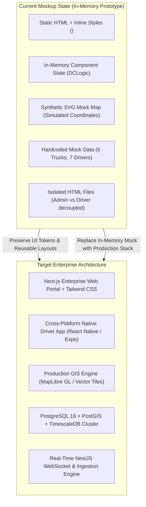
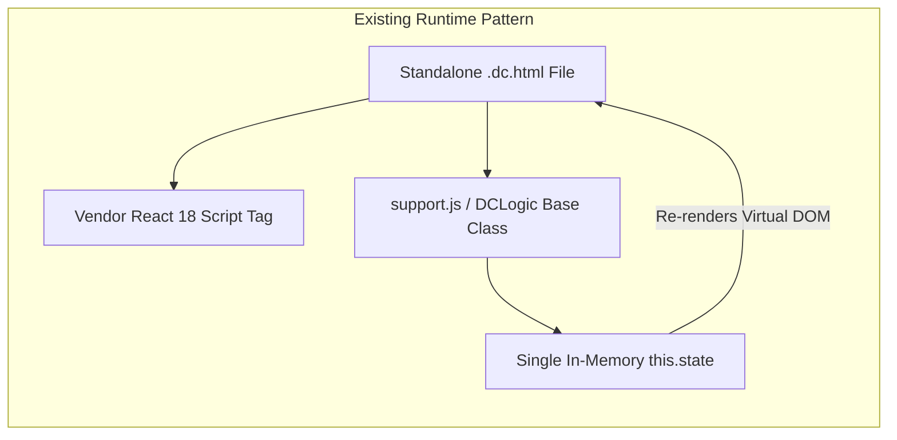

# 02. Existing Application Audit & Codebase Assessment

**Document Version:** 1.0.0  
**Status:** Completed Diagnostic Assessment  
**Audited Codebase Artifacts:**  
- Admin Dashboard Mockup (`mockups/admin_dashboard/Main.dc.html`, `support.js`, `vendor/react.js`, `vendor/react-dom.js`)
- Driver App Mockup (`mockups/driver_app/Driver.dc.html`, `support.js`, `vendor/react.js`, `vendor/react-dom.js`)

---

## 1. Executive Summary of Codebase Audit

The existing application consists of two decoupled browser-based visual mockups exported from a component design environment (Design Component / `<x-dc>` format). 

The mockups establish an **excellent visual design foundation**, clean design tokens, high data-density UI patterns, and intuitive core operational flows. However, they are **purely client-side UI prototypes** executing entirely in-memory with static mock data arrays. There is currently no persistent database, no REST or WebSocket API backend, no real GPS or hardware telematics integration, no user authentication or session management, and no backend business logic.

The goal of this audit is to systematically dissect the existing assets to ensure that all high-quality design work, layout structures, and domain tokens are **reused and evolved**, while identifying the extensive architectural layers required to reach commercial production readiness.

---

## 2. Detailed Screen-by-Screen Breakdown

### 2.1 Admin Dashboard (`mockups/admin_dashboard/Main.dc.html`)

The Admin Dashboard provides a desktop-optimized web interface (1440x900 viewport target) structured into a persistent dark sidebar navigation and a high-density operational workspace.

| Screen / View | Components Observed | Current Mock Functionality | Production Limitations |
| :--- | :--- | :--- | :--- |
| **Global Layout & Navigation** | Dark persistent sidebar (`#12202B`), Logo & brand badge, 4 main nav items, Org profile footer (`Bharath Swift Logistics Pvt. Ltd`). | Tab switching changes top-level `state.screen` between `'live'`, `'vehicles'`, `'drivers'`, and `'assign'`. | Hardcoded tenant name; no user login/logout; no profile settings; no multi-tenant branch selector. |
| **Live Map Screen (`screen: 'live'`)** | - Metric KPI Bar (Vehicles, Moving, Idle, Offline, Fleet Distance Today). - Vehicle Filter Tabs (All, Moving, Idle, Offline) with live count badges. - Vehicle List Column with plate, driver, status chip, speed, and time. - Synthetic SVG Map with landmark labels (Chennai, Gudur, Krishnagiri, Chengalpattu), animated pulse markers, and polyline trails. - Selected Vehicle Drawer showing odometer breakdown (Today, Week, Month), driver info, phone link, GPS accuracy, battery level, and trail toggle. | - Filter buttons update list items. - Selecting a truck highlights marker and shows trail on SVG map. - Period tabs (Today, Week, Month) update km figures. - "Change driver" redirects to assignment tab with vehicle pre-selected. | - Map is a static SVG vector graphic; cannot pan, zoom, cluster, or load satellite/hybrid tiles. - Trail points are arbitrary percentage coordinates (`[34, 60]`). - No live WebSocket streaming—data is static. - No geofencing alerts, route deviations, or reverse geocoding addresses. |
| **Vehicles Screen (`screen: 'vehicles'`)** | - Header action: "Add vehicle" button. - Collapsible Add Vehicle form (Plate, Model, Type dropdown, Driver selection). - Vehicle Inventory Table: Plate, Model, Type, Assigned Driver, Status Badge, Km Today, and "View on Map" action button. | - Form allows adding a vehicle to in-memory `state.vehicles` array. - Optional driver assignment triggers conflict resolution. - "View on map" switches tab to Live Map and focuses that vehicle. | - Form lacks critical commercial vehicle fields (Chassis, Engine, GVW, RC number, Insurance, FC, Tax, Permit). - No document upload or validation. - No pagination or search/filtering for fleets with >50 vehicles. |
| **Drivers Screen (`screen: 'drivers'`)** | - Header action: "Add driver" button. - Collapsible Add Driver form (Name, Phone, License number, Expiry date). - Driver Directory Table: Name, Phone, License, Expiry status badge (with amber warning if $<30$ days), Assigned Vehicle, Duty status, "Assign vehicle" action. | - Form validates required fields and appends to `state.drivers` array. - License expiry dynamically flags `soon: true`. - "Assign vehicle" pre-fills assignment screen. | - No Aadhaar/KYC or Sarathi license API verification. - No photo upload, emergency contacts, or salary structure. - Lacks driver performance metrics, safety scores, and violation history. |
| **Assign Driver Screen (`screen: 'assign'`)** | - 3-Step Assignment Wizard: 1. Choose Vehicle, 2. Choose Driver, 3. Conflict Confirmation Panel. - Assignment History Table: Vehicle, Driver, From date, To date ("Current" badge). | - Wizard dynamically inspects existing pairings. - Explains conflict impact: *"Selvam R will be removed from TN 22 CD 5678"*; updates historical records when confirmed. | - Unilateral assignment without driver acceptance handshake. - No assignment scheduling (start/end dates in future). - No multi-driver support for long-distance two-driver runs. |

### 2.2 Driver Mobile Application (`mockups/driver_app/Driver.dc.html`)

The Driver App is designed for a mobile portrait viewport (390x844 target) emphasizing high-contrast, oversized touch targets for field operators.

| Screen / State | Visual & Interactive Components | Mock Logic & Behavior | Production Limitations |
| :--- | :--- | :--- | :--- |
| **Off-Duty State (`onDuty: false`)** | - Dark header with greeting ("Good morning, Murugan K"). - Assigned vehicle card with plate (`TN 09 AB 1234`), model, and "Off duty" gray badge. - Status card: "You are off duty. Your location is not being shared." - Massive primary CTA button: "Start duty" (blue, 56px height). - Privacy footer disclaimer. | Clicking "Start duty" sets `state.onDuty = true`. | - No authentication (driver is pre-logged in). - No pre-trip inspection or odometer photo capture. - No check for active assigned trip or cargo loading slip. |
| **On-Duty State (`onDuty: true`)** | - Pulsing active blue radar dot + "You are on duty" header. - 4-Metric Grid: Duty started time (06:12), Distance today (214.6 km), Last location sent (3 s ago), GPS accuracy (8 m). - Persistent OS foreground service notice: "Fleet Tracker is sharing your location. This notification stays visible...". - Secondary CTA button: "End duty". | Clicking "End duty" sets `state.onDuty = false`. | - Does not invoke native device GPS (`navigator.geolocation` or native location providers). - No background geolocation service or wakelock. - No offline location queue or sync engine. - No trip navigation, delivery confirmation, or expense logging. |

---

## 3. Existing Architecture & Technology Stack Assessment

1. **Rendering Engine:** The mockups use `<x-dc>`, a proprietary or visual-builder runtime pattern implemented in `support.js`. It wraps React 18 (`React.createElement` and synthetic DOM updates) inside a custom web component `<x-dc>`.
2. **State Management:** A single monolithic JavaScript class (`Component extends DCLogic`) holds the entire application state in `this.state`. When state changes occur (`this.setState(...)`), the full component evaluates `renderVals()` and triggers a re-render.
3. **Styling Paradigm:** Heavily reliant on inline CSS strings (`style="display:flex; ..."`) with global CSS resets inside `<helmet><style>`. Color tokens and typography are consistent but hardcoded inline rather than tokenized in utility classes or CSS variables.
4. **Data Persistence:** **Zero persistence.** Refreshing the browser page resets all added vehicles, drivers, and modified assignments back to the initial 6 vehicles and 7 drivers.
5. **Decoupling:** The Admin Dashboard and Driver App have no shared communication bridge. Tapping "Start duty" in the Driver App does not alter the vehicle status in the Admin Dashboard.

---

## 4. Comprehensive Gap Analysis: What is Implemented vs. What is Missing

### Matrix of Functional Pillars

| Operational Module | Current Mockup Implementation | Production Gap (What Must Be Built) |
| :--- | :--- | :--- |
| **1. Authentication & RBAC** | Non-existent; hardcoded single tenant and driver. | Multi-tenant auth, JWT/OAuth2, OTP login for drivers, 8 distinct role permissions, session revocation. |
| **2. Vehicle Profile Management** | 4 basic fields (plate, model, type, driver); static cards. | 35+ technical/statutory vehicle fields, digital document vault, chassis/engine validation, FASTag integration. |
| **3. Driver Profile Management** | 4 basic fields (name, phone, license, expiry date). | Driver KYC (Aadhaar/PAN), Sarathi driving license API verification, safety scores, wage/bata structure, emergency contacts. |
| **4. Assignment Engine** | Unilateral admin assignment with basic conflict reassignment. | Dual-handshake workflow (Push $\rightarrow$ Driver Accept/Reject), temporary assignments, multi-driver dispatch, automated conflict locking. |
| **5. Live Tracking Engine** | Static SVG vector drawing with hardcoded percentages. | Production GIS (MapLibre GL / Mapbox), real GPS telemetry ingestion, 10s streaming, distance dead-reckoning, geofencing. |
| **6. Smartphone Geolocation** | Simulated state boolean (`onDuty: true/false`). | Native Android/iOS background service, wakelock management, aggressive OEM battery optimization bypass, mock GPS detection. |
| **7. Offline-First Ingestion** | Disclaimer note only. | Local SQLite/WatermelonDB storage queue, exponential backoff synchronization, idempotent server batch ingestion. |
| **8. Trip Lifecycle Management** | Mentioned in text only (`since: '06:12'`). | Complete commercial trip entity: booking, loading weight, origin/dest geofences, odometer photos, waypoints, digital POD. |
| **9. Distance & Mileage Analytics** | Hardcoded km counters (`today`, `week`, `month`). | GPS polyline distance calculation algorithms, verified odometer cross-auditing, daily/monthly aggregation tables, PDF/Excel export. |
| **10. Fuel & Expense Auditing** | Non-existent. | Driver expense claim submission, fuel receipt OCR/photo capture, FASTag toll sync, trip cash advance reconciliation, P&L reporting. |
| **11. Maintenance & Health** | Non-existent. | Scheduled service triggers by odometer/calendar, repair job cards, breakdown logging, spare parts tracking, vendor management. |
| **12. Compliance & Documents** | Basic license expiry date with text alert. | Vahan/Sarathi automated document polling, automated SMS/WhatsApp alerts (30, 15, 3 days), digital document upload & verification. |
| **13. Freight Business Automation**| Non-existent. | Goods booking, customer quotation, load matching, empty return trip discovery, automated e-Way bill sync, GST invoicing. |

---

## 5. Features Requiring Modification

These existing components contain valuable UI/UX foundations but require architectural and algorithmic refactoring:

1. **The Driver Assignment Flow:**
   - *Current:* Admin selects vehicle and driver, clicks "Assign driver", and the vehicle is immediately reassigned.
   - *Required Modification:* Admin issues an **Assignment Offer**. The driver receives an instant push notification on their mobile phone. The assignment enters a `PENDING_ACCEPTANCE` state. The driver reviews vehicle details and taps "Accept". Only then is the pairing activated in production records. If rejected with a reason (e.g., "Sick", "Vehicle needs repair"), the admin is alerted immediately.
2. **Vehicle Operational Status Logic:**
   - *Current:* Fixed enum (`'moving'`, `'idle'`, `'offline'`) bound purely to simulated telemetry.
   - *Required Modification:* Multi-layered state machine separating **Telematics Status** (`MOVING`, `IDLE_ENGINE_ON`, `STOPPED`, `OFFLINE`) from **Business Operational Status** (`AVAILABLE`, `ON_TRIP`, `UNDER_MAINTENANCE`, `IMPOUNDED`, `DECOMMISSIONED`).
3. **Driver Expiry Badge & Verification:**
   - *Current:* Checks if expiry is within 30 days and shows amber text.
   - *Required Modification:* Connect to Parivahan Sarathi API to verify license authenticity, endorse badge classes (LMV, HGMV, TRANS, HAZMAT), and track state-wise permit jurisdictions.
4. **Distance Reporting System:**
   - *Current:* Direct scalar integers on the vehicle object (`km.today`).
   - *Required Modification:* Distinguish between **GPS-Calculated Haversine/Vincenty Distance** and **Physical Odometer Sensor Readings**, providing an automated discrepancy variance report.

---

## 6. Features That Can Be Reused & Preserved

To maintain continuity and capitalize on the excellent visual design already established, the following core assets and patterns will be preserved in the production frontend:

1. **Design System & Visual Tokens:**
   - **Primary Dark Canvas / Sidebar:** `#12202B` (deep slate navy, offering superior contrast and professional enterprise aesthetic).
   - **Action & Highlight Blue:** `#1769E0` (high-visibility blue used for primary actions, active tabs, and GPS pulse rings).
   - **Background Neutral:** `#F3F5F7` (soft cool-gray minimizing eye fatigue during long monitoring shifts).
   - **Border & Divider Lines:** `#DDE3E8` and `#EEF1F4`.
   - **Typography System:** `IBM Plex Sans` for UI prose, headings, and labels; `IBM Plex Mono` for vehicle registration plates, odometer readings, and numerical telemetry.
2. **Information Architecture & Density:**
   - The compact KPI stat cards on top of the Live Map.
   - The split-view layout (Vehicle list on the left with instant status filter counts, map on the right, contextual drawer on the bottom/side).
   - The chip badge styling for vehicle operational states:
     - Moving: `#DCEBFF` background with `#0A4A9E` text.
     - Idle: `#FFEBC2` background with `#6B4100` text.
     - Offline: `#E4E7EB` background with `#44505B` text.
3. **Driver Mobile App UI Patterns:**
   - The high-contrast, distraction-free driver card layout.
   - The two-state binary duty switch ("Start duty" / "End duty") preventing driver confusion.
   - The persistent notification banner educating the driver on background location behavior.

---

## 7. Features That Should Be Redesigned

1. **Synthetic SVG Map $\rightarrow$ Production Geospatial Map Engine:**
   - The static SVG map with simulated percentage coordinates (`polyline points="34,60 ..."`) must be completely replaced with an enterprise GIS engine (MapLibre GL JS / Deck.gl) backed by OpenStreetMap / Mapbox vector tiles, supporting true GPS latitude/longitude projections, spatial clustering, polyline antialiasing, street-level zoom, and traffic overlays.
2. **In-Memory State $\rightarrow$ Server-Driven Modular Architecture:**
   - The monolithic `DCLogic` class must be replaced with a modern React 19 / Next.js architecture utilizing server-side rendering, React Query / SWR for data synchronization, Zustand for client state, and code-splitting across lazy-loaded route chunks.
3. **Decoupled Architecture $\rightarrow$ Unified Real-Time Event Bus:**
   - The Admin Web Dashboard and Driver Mobile App must communicate over a bidirectional WebSocket cluster (Redis Pub/Sub + Socket.io), enabling an admin to see a driver's location move on the map within 1.5 seconds of the driver's phone capturing a GPS coordinate.

---

## 8. Assessment Conclusion & Evolution Strategy

The existing application is **not to be discarded**, but rather used as the **definitive visual and UX reference** for the front-end design system. By translating the design values, color tokens, and layout density into a scalable Next.js and React Native component architecture, we ensure complete continuity of the user experience while building the enterprise-grade foundation required for commercial operation.

