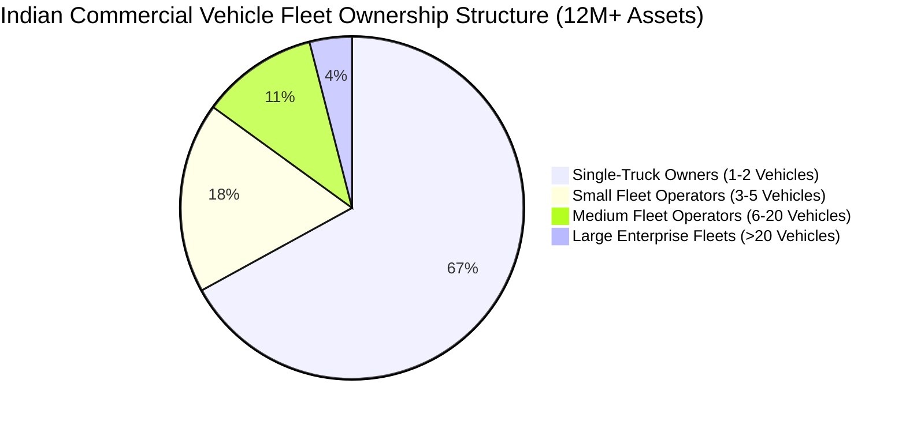
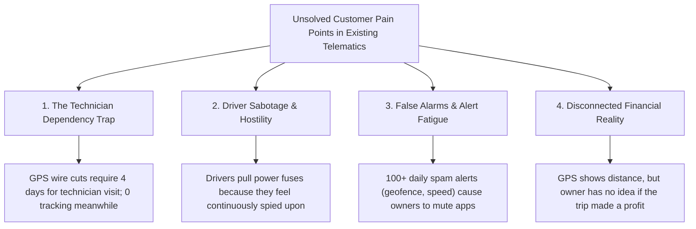
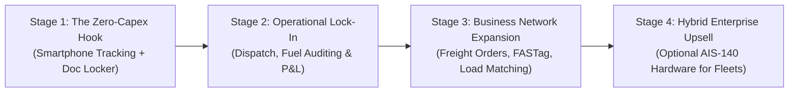

# 03. Industry & Competitor Case Study: Fleet Telematics & Transport Automation

**Document Version:** 1.0.0  
**Research Date:** Q4 2026  
**Primary Focus:** Indian Commercial Road Transport Sector & Global Best Practices  
**Benchmarked Competitors:** Fleetx, WheelsEye, LocoNav, Intangles, BlackBuck, Samsara, Motive, Verizon Connect, Fleet Complete  

---

## 1. Industry Landscape & Market Realities

The commercial fleet management market in India represents an inflection point. Driven by government mandates such as **AIS-140** (Automotive Industry Standard for Intelligent Transportation Systems), **FASTag** (electronic toll collection), and the **Goods and Services Tax (GST) e-Way Bill system**, fleet operations are digitizing at an unprecedented pace. However, the market remains sharply polarized between capital-heavy hardware telematics and unserved small fleet owners.



### Critical Findings on Indian Road Logistics
1. **The Overwhelming Long-Tail (85%):** 85% of commercial vehicles in India belong to operators with 5 or fewer trucks. These operators operate on razor-thin operating margins (5–8%) and cannot absorb upfront hardware capital expenditures.
2. **Fuel Dominates Cost Structure:** Diesel accounts for **52% to 60% of total operating expenses** of a heavy commercial vehicle (HCV). A single percentage point improvement in fuel economy or theft prevention directly dictates whether an owner can make their monthly bank loan EMI.
3. **Severe Driver Shortage & High Churn:** India faces a **deficit of over 27% commercial truck drivers** (Ministry of Road Transport and Highways report). Turnover exceeds 40% annually. Solutions that antagonize drivers or invade their personal off-duty privacy lead to drivers actively tampering with GPS equipment or abandoning vehicles.
4. **Empty Return Mileage (The Deadhead Problem):** 35% to 40% of trips run empty on return legs, crushing asset utilization and net profitability.

---

## 2. In-Depth Competitor Analysis

### 2.1 Indian Market Competitors

```mermaid
quadrantChart
    title Competitor Positioning: Capex vs Enterprise Feature Depth
    x-axis Low Feature Depth (Basic Tracking) --> High Feature Depth (Full Automation)
    y-axis High Hardware Capex (Proprietary Devices) --> Zero Hardware Capex (Smartphone-First)
    quadrant-1 "Disruptive Opportunity (Target Platform)"
    quadrant-2 "Niche Mobile Apps"
    quadrant-3 "Legacy Budget Telematics"
    quadrant-4 "Enterprise Hardware Players"
    "WheelsEye": [0.35, 0.25]
    "LocoNav": [0.55, 0.35]
    "Fleetx": [0.82, 0.20]
    "Intangles": [0.88, 0.15]
    "BlackBuck": [0.65, 0.70]
    "Target Platform": [0.85, 0.88]
```

#### 1. Fleetx.io
- **Market Segment:** Mid-market to large enterprise transport and logistics fleets (50–2,000+ trucks).
- **Architecture & Tracking:** Proprietary AIS-140 GPS trackers, digital fuel rod sensors, dashcams, and CAN-bus/OBD-II telematics.
- **Strengths:** Excellent dispatch planning, automated electronic proof of delivery (e-POD), fuel theft algorithms, comprehensive maintenance modules.
- **Weaknesses & Customer Complaints:** Prohibitively expensive for small operators (₹6,000+ device cost + ₹400/vehicle/mo SaaS); complex UI requiring dedicated data entry operators; lengthy onboarding cycles; zero support for smartphone-only tracking without hardware.
- **Pricing:** ₹4,500–₹8,000 hardware capex + ₹350–₹600/month/vehicle.

#### 2. WheelsEye
- **Market Segment:** Small to mid-sized Indian truck owners (3–20 trucks).
- **Architecture & Tracking:** Low-cost hardwired GPS devices (plugged into truck battery) paired with basic SIM cards.
- **Strengths:** Aggressive field sales force across Indian transport nagars; vernacular Hindi/English app; basic FASTag integration and insurance renewal alerts.
- **Weaknesses & Customer Complaints:** Frequent device failure reported on Google Play Store; battery drainage of dormant trucks; aggressive telemarketing; hardware wire cutting by drivers; rudimentary accounting with no transport order matching.
- **Pricing:** ₹3,500–₹4,500 device + ₹2,400–₹3,600 annual subscription.

#### 3. LocoNav
- **Market Segment:** Global emerging markets (India, Southeast Asia, Middle East, Africa).
- **Architecture & Tracking:** White-labeled OBD and hardwired GPS devices, basic dashcams, multi-lingual web portal.
- **Strengths:** Broad geographic distribution, video telematics (ADAS), FASTag recharge within the app, driver expense wallet integration.
- **Weaknesses & Customer Complaints:** Inconsistent customer service response during device breakdown; slow mobile app loading times; inaccurate mileage estimation when cellular signal is intermittent.
- **Pricing:** ₹3,000–₹5,000 upfront + ₹250–₹450/month/vehicle.

#### 4. Intangles
- **Market Segment:** Advanced enterprise telematics, bus operators, and OEMs.
- **Architecture & Tracking:** Proprietary edge-AI hardware reading high-frequency J1939 CAN-bus telemetry.
- **Strengths:** Market leader in predictive engine diagnostics (predicting gearbox failure, coolant overheating, injector clogging days before failure).
- **Weaknesses & Customer Complaints:** Requires late-model electronic engine trucks (BS-IV / BS-VI); completely inaccessible to older mechanical engine trucks; high enterprise pricing.
- **Pricing:** Enterprise custom contracts (₹12,000+ per asset/year).

---

### 2.2 Global Market Leaders (Best Practice Benchmarks)

#### 1. Samsara (NYSE: IOT)
- **Scale & Focus:** World leader in Connected Operations Cloud for Fortune 500 fleets.
- **Tracking & Tech:** Hardwired Vehicle Gateways (VG-series), dual-facing AI dashcams, cloud infrastructure processing 100+ billion data points annually.
- **Key Lessons for Our Platform:** 
  - **Modular Architecture:** Samsara organizes its software into decoupled, clean tiles (Safety, Maintenance, Dispatch, Fuel).
  - **Contextual Workflows:** Clicking on a safety alert immediately isolates the associated vehicle, driver, and preceding 30-second driving event.
  - **Driver-Centric Mobile Experience:** The Samsara Driver App is clean, respects privacy, and provides drivers with clear duty timers.

#### 2. Motive (Formerly KeepTruckin)
- **Scale & Focus:** North American leader in ELD (Electronic Logging Devices) and fleet automation.
- **Key Lessons for Our Platform:**
  - Began originally as a smartphone-based electronic logbook before expanding into hardware telematics.
  - Proven playbook for viral driver adoption: when drivers love the mobile app because it simplifies their day, fleet owners adopt the software bottom-up.
  - Integrated spend management with automated corporate fuel cards.

---

## 3. Comprehensive Competitor Feature & Architecture Matrix

| Feature / Dimension | Fleetx | WheelsEye | LocoNav | Samsara | Target Platform (Our Vision) |
| :--- | :--- | :--- | :--- | :--- | :--- |
| **Tracking Method** | Hardwired GPS / AIS-140 | Battery Hardwired GPS | OBD-II / Hardwired | High-Res Gateway | **Smartphone GPS (Zero Capex) + Future AIS-140** |
| **Initial Upfront Hardware Cost** | ₹5,000 – ₹8,000 | ₹3,500 – ₹4,500 | ₹3,500 – ₹5,000 | \$300 – \$500 | **₹0 (Zero Upfront Capex)** |
| **Setup Time** | 3–7 Days (Technician) | 2–5 Days | 2–4 Days | 1–3 Days | **Under 2 Minutes (Self-Serve)** |
| **Driver Privacy Protection** | Weak (24/7 Hardwired) | Weak (24/7 Hardwired) | Weak (24/7 Hardwired) | Moderate (Driver Mode) | **Strict On-Duty Tracking Only** |
| **Offline Tracking Buffer** | Hardware Flash (Limited)| Basic SIM Buffer | Basic | High (Edge Storage) | **Mobile SQLite/WatermelonDB High-Res Sync** |
| **Driver Assignment Handshake** | Manual Admin Override | Admin Entry Only | Admin Entry Only | Dispatch Assignment | **Automated Dual-Handshake (Push/Accept)** |
| **FASTag Toll Reconciliation** | Add-on Service | Integrated Wallet | Integrated Recharge | N/A (US Focused) | **Automated Route-Matched Toll Auditing** |
| **Freight Order Booking & POD** | Enterprise Tier Only | Absent | Basic | Advanced Workflows | **End-to-End Built-in Consignment Lifecycle** |
| **Multi-Language Driver App** | Partial (Hindi/English)| Hindi / English | Multiple Languages | English / Spanish | **6 Indian Vernaculars (Hindi, Tamil, etc.)** |
| **Empty Backhaul Discovery** | Absent | Absent | Absent | Absent | **Integrated Return Load Marketplace** |

---

## 4. Key Customer Grievances & Unsolved Market Problems

Deep analysis of thousands of Google Play Store reviews, transport forum discussions (e.g., Team-BHP Commercial Vehicle section), and direct interviews with truck owners in major Indian hubs (Namakkal, Vashi, Sanjay Gandhi Transport Nagar Delhi) reveals four critical market failures:



### Problem 1: The Technician Dependency Trap
When a physical GPS tracker malfunctions or its wire is cut by a driver or mechanic, the truck goes completely dark. The owner must schedule an appointment with a telematics field technician, who may take 3 to 7 days to service the vehicle at a designated highway hub. **In our smartphone model, if a phone is lost or damaged, the driver can log into another device via OTP in 30 seconds, restoring tracking immediately.**

### Problem 2: Driver Sabotage Due to Lack of Privacy
Because legacy GPS devices are hardwired directly to the vehicle battery, they track the truck 24 hours a day, 365 days a year. Even when a driver is sleeping at a highway dhaba or spending off-duty time with family, their location is visible to their employer. This invasive tracking creates resentment, prompting drivers to tamper with wires or install ₹1,500 cigarette-lighter GPS jammers. **Our platform guarantees strict on-duty privacy: the app tracks location ONLY when the driver actively taps "Start Duty" for an authorized trip.**

### Problem 3: Disconnected Financial Reality
Existing GPS applications provide lots of graphs showing speed, idling, and route lines, but fail to answer the owner's primary commercial question: **"Did I make money on this trip from Mumbai to Chennai after diesel, driver wages, tolls, and maintenance?"** By coupling live tracking directly with freight booking, fuel receipt entry, and trip accounting, our platform delivers an instant, automated **Trip Profit & Loss Statement**.

---

## 5. Strategic Opportunities & The "Trojan Horse" Go-to-Market

Our strategic opportunity lies in a **two-stage product expansion**:



1. **The Zero-Capex Hook:** Attract small lorry owners who refused to buy ₹5,000 GPS devices by giving them free or ₹99/month smartphone-based live tracking, document expiry reminders, and driver assignment.
2. **Operational Stickiness:** Once onboard, the owner discovers that logging fuel slips and trip odometer photos automatically calculates their real-world vehicle mileage and catches fuel theft.
3. **Freight & Business Automation:** With verified active lorries on the platform, we match shippers with available trucks, eliminating empty return trips and earning transaction fees.
4. **Hybrid Hardware Upgrades:** As fleets grow, provide plug-and-play AIS-140 telematics hardware integration for enterprise customers requiring 24/7 continuous ignition and CAN-bus telemetry—creating an all-in-one ecosystem that scales seamlessly from a single driver with a smartphone to an enterprise with 1,000 trucks.

