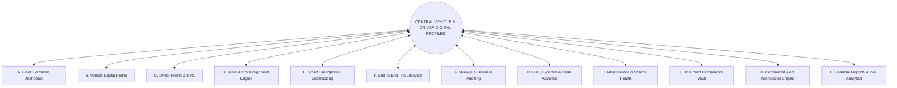
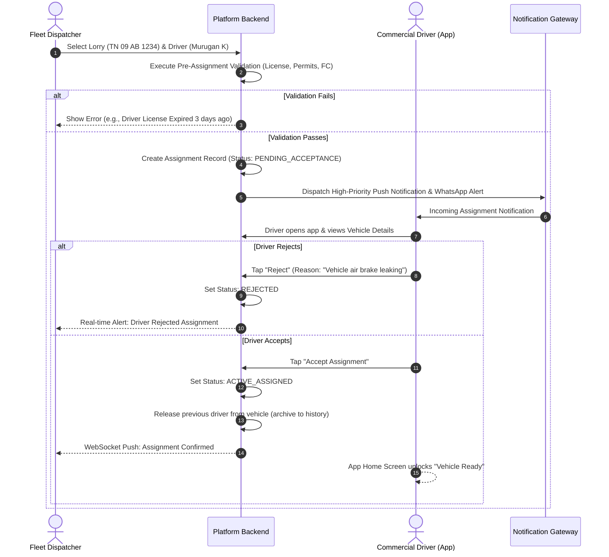
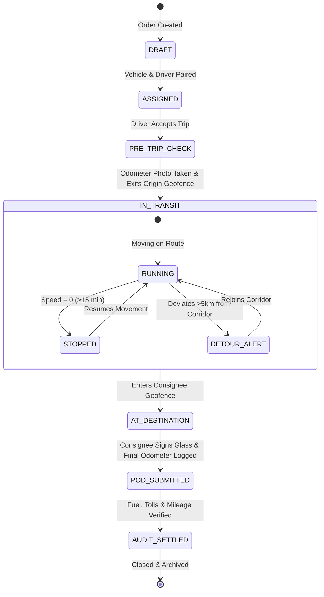

# 04. Complete Feature Hierarchy & Detailed Module Specifications

**Document Version:** 1.0.0  
**Status:** Approved Functional Specification  
**Architecture Scope:** 12 Core Operational Pillars with End-to-End Interconnection  

---

## 1. Overview of Platform Functional Architecture

The platform is structured into **12 interconnected operational modules**. Unlike fragmented point solutions, each module does not exist in isolation; data generated in one module (such as a GPS ping during trip execution) automatically updates distance counters, recalculates driver fuel efficiency scores, decrements service interval triggers, and populates customer delivery tracking.

---

## 2. Module-by-Module Detailed Breakdown

---

### Module A: Fleet Executive Dashboard
*The real-time operational nerve center for fleet owners, dispatchers, and managers.*

#### 1. Detailed Feature Breakdown
- **Real-Time Fleet Status Telemetry:** Total vehicles, active vehicles (moving, idling, stopped), inactive/offline vehicles, vehicles under scheduled maintenance, impounded or grounded vehicles.
- **Workforce Availability Counters:** Total registered drivers, drivers on active duty, drivers off-duty, available/unassigned drivers, drivers on approved leave.
- **Operational Distance Metrics:** Today’s cumulative fleet distance (km), current week distance, month-to-date distance, compared with preceding periods.
- **Financial Velocity Ticker:** Today's estimated fuel burn (₹), unbilled completed trips, pending freight receivables, urgent payments due (tolls, advances, loan EMIs).
- **Statutory Expiry Radar:** Banner alerts for documents expiring within 30, 15, and 3 days (FC, Insurance, Permits, Driver Licenses).
- **Interactive Multi-Vehicle Map View:** Vector map rendering all active assets with directional heading arrows, velocity color indicators (green = moving $>20$ km/h, amber = slow/traffic, orange = idling, gray = offline).
- **Quick-Action Dispatch Launcher:** Direct button triggers for "Dispatch Trip", "Assign Driver", "Record Fuel Slip", and "Add Expense".

#### 2. Technical & Domain Parameters
- **Primary Persona:** Fleet Owner, Operations Manager, Dispatcher.
- **Data Required:** Aggregated real-time metrics cached in Redis, vehicle geolocation coordinates, document validity timestamps, financial ledger balances.
- **Backend Requirements:** High-performance Redis aggregation pipeline; WebSocket server streaming real-time status deltas every 5 seconds without triggering full database queries.
- **Frontend Requirements:** Responsive grid with CSS subgrid/flexbox, lazy-loaded MapLibre canvas, sub-50ms tab switching, visual audio alert toggles for critical incidents.
- **Dependencies:** Modules B, C, D, E, J.
- **Priority:** Phase 1 (Core Release).

---

### Module B: Lorry / Vehicle Management (360° Digital Asset Profile)
*A complete digital biodata and operating ledger for every commercial vehicle in the fleet.*

#### 1. Detailed Feature Breakdown
- **Technical & Identity Specifications:**
  - Registration Plate Number (formatted to standard Indian motor vehicle formats, e.g., `TN 09 AB 1234`).
  - Vehicle Class & Type: Mini Truck (Tata Ace), LCV (Eicher 14T), Multi-axle HCV (Ashok Leyland 2820, BharatBenz 3128), Tractor-Trailer (40T/55T), Tipper, Tanker, Containerized Box.
  - Make, Model, Manufacturing Year, Body Type, Gross Vehicle Weight (GVW), Unladen Weight (Tare), Rated Payload Capacity (Tonnes).
  - Chassis Number (VIN) and Engine Serial Number (with regex validation).
  - Fuel System: Tank capacity (Litres), dual-tank support, fuel type (Diesel, CNG, LNG, Electric), AdBlue (DEF) tank capacity.
  - Tyre Layout: Axle configuration ($4\times 2$, $6\times 2$, $6\times 4$, $10\times 2$), individual tyre serial numbers, tread depth tracking.
- **Financial & Commercial Profile:**
  - Asset Acquisition Date, Purchase Invoice Value, Financer / Bank Hypothecation details, Monthly Loan EMI, EMI due date.
  - Operational Cost-per-Kilometre target benchmark (₹/km).
- **Current Operational State:**
  - Dynamic status: `AVAILABLE`, `ASSIGNED_PENDING_DISPATCH`, `ON_TRIP`, `UNDER_MAINTENANCE`, `IMPOUNDED`.
  - Current assigned driver link with photo and one-tap calling.
  - Current physical location with reverse-geocoded address and time since last ping.
- **Historical Asset Traversal (Reverse Links):**
  - Lifetime distance logged; chronological trip ledger; complete driver assignment log; maintenance service history with invoice receipts; cumulative diesel consumption and lifetime fuel expenses; insurance claim history.

#### 2. Technical & Domain Parameters
- **Primary Persona:** Fleet Owner, Fleet Manager, Workshop Supervisor.
- **Data Required:** Vehicle entity records, relational links to Trips, Drivers, Fuel, Maintenance, and Document tables.
- **Backend Requirements:** Spatial point storage (`geometry(Point, 4326)`), parameterized search APIs supporting filtering by make, capacity, status, and branch.
- **Frontend Requirements:** High-density vehicle card grid and tabular view with quick search, drawer modal for 360° vehicle deep-dive.
- **Dependencies:** None (Core foundational asset).
- **Priority:** Phase 1 (Core Release).

---

### Module C: Driver Management (Complete Professional Profile & KYC)
*Digital biodata, statutory compliance verification, and performance scorecards for commercial drivers.*

#### 1. Detailed Feature Breakdown
- **Personal Biodata & KYC:**
  - Full legal name, profile photograph, primary and alternate mobile phone numbers, permanent address, local residential address.
  - Emergency contact details (Next of kin name, relationship, verified phone number).
  - Government Identity Proofs: Aadhaar Card (masked storage), PAN Card (for TDS transport tax compliance under Section 194C).
- **Professional & Licensing Verification:**
  - Driving Licence Number, Licensing Authority (RTO), License Class Endorsements (LMV, TRANS, HGMV, Hazardous Chemicals).
  - Driving Licence Expiry Date with automated Sarathi API validation.
  - Medical fitness certificate validity, eye check-up renewal dates.
- **Employment & Compensation Terms:**
  - Employment Type: Full-time salaried, contract trip-basis, percentage-share model.
  - Base salary, daily trip allowance (*Daily Bata*), per-kilometre incentive rate.
  - Bank Account details (Account number, IFSC code, UPI VPA) for automated wage and advance disbursements.
- **Driver Performance & Behavioral Scorecard:**
  - Total lifetime distance driven, completed trips, on-time delivery rate (%).
  - Average fuel economy achieved across assigned vehicles (km/L).
  - Driving safety infractions: Harsh braking count, rapid acceleration events, sustained overspeeding duration (>65 km/h).
  - Night driving ratio (% of driving between 11 PM and 5 AM).
  - Incident and dispute record: Logged road accidents, traffic challans, consignee dispute reports.
- **Active Operational State:**
  - Duty Status: `OFF_DUTY`, `ON_DUTY_AVAILABLE`, `ON_DUTY_EN_ROUTE`.
  - Current assigned vehicle, smartphone battery level, GPS accuracy state.

#### 2. Technical & Domain Parameters
- **Primary Persona:** Fleet Owner, HR/Payroll Manager, Dispatcher.
- **Data Required:** Driver profile records, KYC documents, daily telematics telemetry aggregated by driver ID.
- **Backend Requirements:** Secure encrypted storage for identity documents (AES-256); automated integration with Parivahan Sarathi APIs for license validation; background job computing weekly driver safety scores.
- **Frontend Requirements:** Driver directory with search and license expiry sorting, driver scorecard visualization with star ratings and safety radar charts.
- **Dependencies:** None (Core foundational asset).
- **Priority:** Phase 1 (Core Release).

---

### Module D: Driver and Lorry Dual-Handshake Assignment Engine
*The intelligent workflow bridge binding commercial assets with human operators.*

#### 1. Detailed Feature Breakdown
- **Dual-Handshake Assignment Workflow:**
  1. Dispatcher selects available vehicle and driver.
  2. System runs automated **Pre-Assignment Validation Engine**:
     - *Check 1:* Does the driver have a valid, non-expired Heavy Commercial Driving Licence?
     - *Check 2:* Does the vehicle have active, valid Insurance, Fitness, and Permits?
     - *Check 3:* Is the driver already assigned to an ongoing, uncompleted trip?
     - *Check 4:* Is the vehicle flagged as `UNDER_MAINTENANCE`?
  3. Dispatcher initiates assignment offer.
  4. **Multi-Channel Handshake Routing:**
     - **For Smartphone-Equipped Drivers:** Interactive Push Notification & WhatsApp alert: *"You have been assigned Tata Prima TN 09 AB 1234. Tap to Accept or Reject."* Driver reviews vehicle in app and taps **"Accept Assignment"** or **"Reject"**.
     - **For Keypad / Feature-Phone Drivers:** Automated outbound IVR phone call in driver's language: *"Bharath Swift has assigned vehicle TN 09 AB 1234 to you. Press 1 to Accept, Press 2 to Decline."* Alternatively, two-way SMS: *"Reply 1 to Accept, 2 to Decline."*
  5. On acceptance, the system binds Driver $\leftrightarrow$ Vehicle, updates global status, archives previous associations, and logs the timestamped assignment event.
- **Multi-Driver Dispatch (Co-Drivers):** Support for assigning primary driver and secondary co-driver for continuous long-haul journeys (>800 km).
- **Temporary & Relief Driver Swaps:** Mid-trip driver reassignment with mandatory handoff odometer verification.
- **Historical Audit Trail:** Complete chronological record of every driver who has operated a given lorry, and every lorry operated by a given driver, with exact start and end dates.

#### 2. Assignment Workflow Diagram

---

### Module E: Multi-Mode Vehicle Tracking Engine (Smartphones, Hardware GPS, AIS-140, SIM LBS, FASTag & Manual Checkpoints)
*Unified telematics ingestion engine normalizing 7 heterogeneous location sources into a single operational map.*

#### 1. Detailed Feature Breakdown
- **Mode A: Zero-Hardware Driver Smartphone Telemetry:**
  - High-precision smartphone GPS (`FusedLocationProviderClient` on Android, `CLLocationManager` on iOS).
  - Dynamic adaptive sampling: 10-second intervals when moving ($>5$ km/h), dropping to 5-minute heartbeats when stationary.
  - Resilient offline-first local queue (`SQLite`/`WatermelonDB`) caching 100,000 pings during highway blindspots with gzip reconnect batch sync.
  - Anti-spoof engine (`Location.isFromMockProvider()` rejection, kinematic speed jump filters).
  - Strict privacy guarantees: location tracked ONLY when active on duty with persistent foreground service notification.
- **Mode B: Dedicated Hardwired GPS / GSM Hardware:**
  - Aftermarket vehicle battery tracker integration (Concox GT06, Teltonika, Coban) over TCP Port 5023.
  - 24/7 continuous ignition sensing ($ACC$), external power cut tamper alarms, vehicle battery low-voltage monitoring.
- **Mode C: AIS-140 Government Certified Telematics:**
  - Ingestion for Rule 125H CMVR mandated vehicles (National Permit Form 48, hazardous chemical tankers).
  - Dual-constellation NavIC (IRNSS) + GPS receiver, dual-profile eUICC M2M eSIM, hardwired cabin emergency panic buttons (SOS).
- **Mode D: Telecom Network-Based SIM Tracking (LBS Cell Tower Polling):**
  - Zero-smartphone tracking for drivers with basic 2G keypad feature phones (Nokia 105, Samsung Guru).
  - Periodic automated polling (every 60-120 minutes) via telecom enterprise LBS APIs based on Cell ID / BTS towers.
- **Mode E: FASTag NETC National Toll Plaza Interception:**
  - Zero-hardware, zero-smartphone automatic transit tracking using passive RFID windshield tags across 1,000+ national toll plazas.
  - Sub-second webhook ingestion providing verified physical toll plaza timestamps and highway corridor coordinates.
- **Mode F: Automated Voice IVR & SMS Keypad Milestone Reporting:**
  - Scheduled automated outbound voice calls querying driver on dialpad: *"Press 1 for On Route, Press 2 for Meal Stop, Press 3 for Delay."*
  - Toll-free virtual missed-call check-ins at transit milestones.
- **Mode G: Collaborative Manual Dock & Hub Checkpoint Verification:**
  - Warehouse security / receiving dock clerk scans vehicle plate and logs physical odometer with timestamp at origin and destination.
- **Unified Canonical Normalization & Confidence Engine:**
  - Normalizes all 7 streams into `UnifiedTrackingPing` with confidence scoring: High Satellite ($\pm 5$m), Medium Hardware ($\pm 2.5$m), Approximate Cell Tower ($\pm 1-3$km), Milestone Verified (Toll Plaza).
  - Per-vehicle configurable tracking mode with automatic fallback and historical mode transition audit logs.

---

### Module F: End-to-End Trip Lifecycle Management
*Managing the complete commercial freight run from order booking to final delivery.*

#### 1. Detailed Feature Breakdown
- **Phase 1: Trip Dispatch & Pre-Trip Verification:**
  - Selection of Origin, Destination, intermediate waypoints, Customer Consignor, and Consignee.
  - Freight billing terms: Per-Tonne (e.g., ₹2,200/Tonne), Fixed Trip Rate (e.g., ₹48,000), or Per-Kilometre.
  - Cargo details: Goods category (Steel coils, Cement, FMCG, Agri), loaded weight (Tonnes), e-Way Bill numbers.
  - Mandatory **Pre-Trip Inspection (PTI):** Driver captures initial odometer photograph, physical odometer value, tyre condition check, and fuel tank gauge level.
- **Phase 2: Trip Transit & Active Monitoring:**
  - Geofence trigger: Automatic trip status transition from `DISPATCHED` to `IN_TRANSIT` when the lorry exits the origin warehouse geofence ($>200$ m radius).
  - Live route deviation monitoring against the optimal corridor (NH 48, NH 44).
  - Automatic stop classification: Detection of toll halts, fuel bunk stops, dhaba/meal stops, and unauthorized stationary idling ($>30$ minutes).
  - Emergency Panic Button (SOS): Driver can trigger immediate distress broadcast with audio recording and GPS pinpointing to fleet manager and local police emergency contact.
- **Phase 3: Delivery Confirmation & Proof-of-Delivery (e-POD):**
  - Destination geofence entry auto-detection.
  - Driver records final odometer reading with mandatory photo upload.
  - Digital Proof of Delivery (e-POD): Consignee receiver enters name, signature on driver’s glass touch screen, and notes cargo condition (e.g., "Received 200 bags undamaged").
  - Driver captures photographs of physical signed delivery challan paper.
  - Automatic trip settlement generation triggering customer invoicing and driver trip bata settlement.

---

### Module G: Mileage and Distance Analytics
*Auditing the fundamental currency of commercial transport: physical distance.*

#### 1. Detailed Feature Breakdown
- **Dual Distance Reconciliation Engine:**
  - **Metric 1: Verified Physical Odometer Distance:** $\Delta \text{Odo} = \text{Odometer}_{\text{End}} - \text{Odometer}_{\text{Start}}$ (verified against high-resolution photographic proof).
  - **Metric 2: Telematics GPS Path Distance:** $\sum \text{VincentyDistance}(P_{i}, P_{i+1})$ calculated along the filtered breadcrumb trail.
  - **Variance Analysis & Tamper Alert:** Automated computation of variance:
    $$\text{Variance \%} = \frac{|\Delta \text{Odo} - \Delta \text{GPS}|}{\Delta \text{GPS}} \times 100$$
    If variance exceeds $\pm 6\%$, system flags a potential odometer tampering, speedometer cable disconnection, or unauthorized offline driving incident.
- **Multi-Period Utilization Analytics:** Daily, weekly, monthly, and lifetime running distance per vehicle and driver; vehicle utilization percentage (Running Hours vs Idle Hours vs Maintenance Downtime).
- **Export & Reporting:** Scheduled automated generation of mileage compliance sheets in PDF and Microsoft Excel formats.

---

### Module H: Fuel, Toll (FASTag), Expense & Cash Advance Accounting
*Preventing diesel leakage and reconciling highway expenditures.*

#### 1. Detailed Feature Breakdown
- **Diesel Expense Management:**
  - Driver fuel entry form: Fuel quantity (Litres), total cost (₹), rate per litre, fuel bunk name/location, odometer at refuel.
  - Receipt photo capture with automated OCR extracting liters, total amount, and date.
  - Automated Mileage Calculation: Full-tank to full-tank methodology calculating real-world km/L:
    $$\text{Fuel Economy} = \frac{\Delta \text{Distance (km)}}{\text{Litres Consumed}}$$
  - Fuel Consumption Anomaly Alert: Flags vehicles performing $>15\%$ below their class average (e.g., a 28T truck dropping from $3.8$ km/L to $2.6$ km/L).
- **FASTag Electronic Toll Auditing:**
  - Ingestion of NETC FASTag deduction statements.
  - Geolocation cross-verification: Matching FASTag toll deduction plaza coordinates against the vehicle's GPS trail at that exact timestamp to detect toll account misuse.
- **Trip Cash Advance & En-Route Expense Ledger:**
  - Trip advance disbursement tracking (Bank transfer, UPI, or cash to driver).
  - En-route driver expense categories: Toll cash, loading/unloading coolie charges, police/RTO weighbridge fees, parking, urea/AdBlue refills, puncture repairs.
  - Real-time balance reconciliation: Advances disbursed vs verified expenses approved by dispatcher.

---

### Module I: Maintenance and Vehicle Health
*Shifting fleet maintenance from catastrophic roadside failure to planned preventive servicing.*

#### 1. Detailed Feature Breakdown
- **Preventive Service Schedules:**
  - Configurable maintenance intervals based on odometer distance, engine operating hours, or calendar elapsed time:
    - Engine Oil & Filter Replacement: Every 20,000 km.
    - Hub Greasing & Brake Shoe Check: Every 40,000 km.
    - Differential & Transmission Fluid Flush: Every 80,000 km.
    - Tyre Rotation & Alignment: Every 15,000 km.
- **Automated Service Triggers:** When vehicle lifetime odometer approaches within 1,000 km of a scheduled threshold, the dashboard automatically generates a "Service Required" warning.
- **Digital Job Cards & Repair Invoices:**
  - Creation of workshop job cards itemizing replacement parts, labor charges, mechanic notes, and vendor tax invoices.
  - Spare parts tracking: Battery serial numbers and warranty tracking; tyre serial numbers and retreading history (Retread 1, Retread 2, Scrap).
- **Breakdown & Incident Logging:** Log of highway breakdowns, towing costs, roadside mechanic dispatch time, and total downtime hours.

---

### Module J: Documents and Compliance Vault
*Zero-penalty statutory compliance management customized for Indian transport regulations.*

#### 1. Detailed Feature Breakdown
- **Statutory Document Management:**
  - **Vehicle Documents:** Registration Certificate (RC Book), Commercial Insurance Policy (Third-Party & Comprehensive), Vehicle Fitness Certificate (FC), Form 48 National Permit / All India Tourist Permit (AITP), State Goods Permit, Pollution Under Control Certificate (PUC), Road Tax Receipt.
  - **Driver Documents:** Heavy Commercial Vehicle Driving Licence, Aadhaar Card, Police Verification Certificate, Hazardous Material Training Endorsement.
- **Automated Expiry Radar & Alert Engine:**
  - Three-tier automated reminder schedule: **30 days prior**, **15 days prior**, and **3 days prior** to document expiry.
  - Delivery channels: In-app warning banners, SMS alerts, and automated WhatsApp messages directly to the owner and driver.
- **Document Locker & Cloud Verification:**
  - Secure high-resolution PDF/image storage with role-based download permissions.
  - QR Code generator allowing drivers to present digital document bundles during highway RTO / Police traffic inspections.

---

### Module K: Centralized Event, Geofence & Alert Notification Engine
*Real-time actionable alerts with intelligent threshold filtering to eliminate notification fatigue.*

#### 1. Detailed Feature Breakdown
- **Alert Taxonomy & Severity Levels:**
  - **Critical (P0):** Driver SOS panic button triggered, vehicle battery disconnected/dying during active trip, mock GPS location detected, major route detour ($>20$ km), document expired while on trip.
  - **Warning (P1):** Driver delayed past ETA by $>2$ hours, unauthorized stationary halt $>45$ minutes, excessive overspeeding ($>75$ km/h), vehicle insurance expiring in 7 days, fuel efficiency drop $>20\%$.
  - **Informational (P2):** Assignment accepted by driver, trip dispatched, consignment delivered and POD signed, scheduled maintenance due in 500 km.
- **Geofence Engine:** Circular and polygonal geofence definitions for client factories, ports, logistics warehouses, and border checkpoints, with entry/exit timestamp logging.
- **Multi-Channel Dispatch:** In-app push notifications, web dashboard audio chimes, SMS gateways, and WhatsApp Business API webhooks.

---

### Module L: Financial Reports & Business Intelligence
*Transforming operational telemetry into bottom-line profit and loss insights.*

#### 1. Detailed Feature Breakdown
- **Vehicle Profitability Ledger (True P&L per Lorry):**
  - Revenue earned (Completed trips) minus Direct Operating Expenses (Fuel + Tolls + Driver Bata + Maintenance + Insurance/Tax Amortization + Financing EMI).
  - Identifies which specific trucks are generating positive cash flow and which are loss-making drains on the business.
- **Driver Performance & Efficiency Matrix:** Ranking drivers by fuel efficiency, on-time delivery adherence, and safety scores.
- **Consignor / Customer Profitability Report:** Profit margins per customer account, revealing which freight clients have chronic loading detention delays or unviable payment terms.
- **Tax & Statutory Audit Reports:** GST-ready reports on freight billing (Forward Charge vs Reverse Charge Mechanism - RCM under Indian GST), TDS Section 194C declarations.
- **One-Click Multi-Format Export:** PDF executive summaries, raw CSV/Excel dumps for tally/accounting import.

