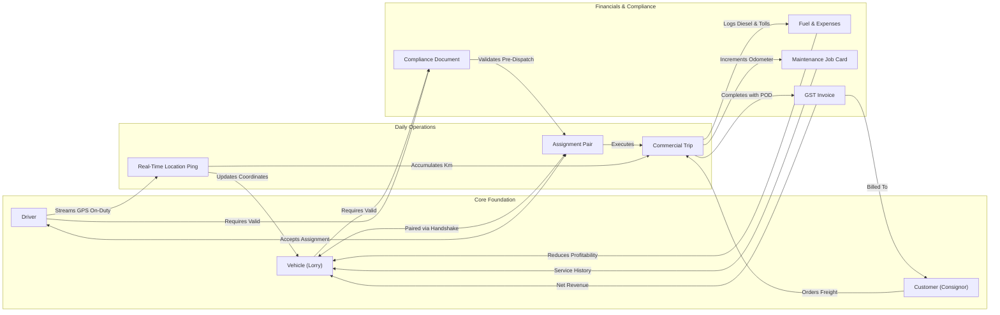

# 05. Visual Hierarchical Mind Map: Interconnected Platform Architecture

**Document Version:** 1.0.0  
**Status:** Visual Mind Map Specification  
**Format:** Multi-Level Mermaid Mindmap & Relational Node Graph  

---

## 1. High-Density Hierarchical Product Mind Map

The mind map below visualizes the entire platform topology across 12 functional hubs, breaking down every capability into operational sub-branches, data artifacts, and automated workflow triggers.

```mermaid
mindmap
  root((Smart Fleet & Transport Platform))
    Fleet Executive Dashboard
      Operational Telemetry
        Active Moving Lorries
        Idle Lorries With Engine On
        Offline Devices / Phones
        Under Maintenance Grounded
      Workforce Tracking
        Drivers on Active Duty
        Drivers Off Duty
        Available Unassigned Pool
      Distance & Financial Velocity
        Today Fleet Distance
        Month To Date Distance
        Fuel Burn Expenditure
        Pending Customer Invoices
      Statutory Expiry Radar
        Documents Expiring in 30 Days
        Documents Expiring in 15 Days
        Documents Expiring in 3 Days
      Live Tactical Map
        Directional Heading Markers
        Velocity Color Coded Arrows
        Real Time Trail Playback
    Lorry Vehicle 360 Digital Profile
      Identity & Specifications
        Plate Registration Formatter
        Make Model Year & Class
        Gross Vehicle Weight & Payload
        Chassis VIN & Engine Serial
        Fuel Tank Capacity & DEF Tank
        Axle Layout & Tyre Tracking
      Statutory Document Vault
        Registration Certificate RC
        Fitness Certificate FC
        National State Form 48 Permit
        Commercial Insurance Policy
        Pollution PUC Certificate
        Road Tax Challan Receipts
      Operational Lifecycle History
        Cumulative Lifetime Distance
        Chronological Trip Ledger
        Assigned Driver Historical Log
        Fuel Consumption & Mileage Record
        Maintenance & Repair Invoices
        Insurance Accident Claim Log
      Commercial & Financing Ledger
        Vehicle Purchase Value
        Bank Hypothecation & Financer
        Monthly Loan EMI Schedule
        Operating Cost Per Km Target
    Driver Profile & Workforce KYC
      Personal Biodata & KYC
        Full Legal Name & Photograph
        Mobile Phone Verification
        Permanent & Local Address
        Emergency Next of Kin Contact
        Aadhaar Masked Storage
        PAN Card for TDS Compliance
      Professional Licensing
        Driving Licence Number
        Parivahan Sarathi Verification
        Badge Endorsements HGMV HAZMAT
        Medical Eye Fitness Validity
      Compensation & Advances
        Base Salary Structure
        Daily Trip Allowance Bata
        Per Km Performance Incentive
        Bank Account IFSC & UPI VPA
        Cash Advance Balance Ledger
      Safety & Behavior Scorecard
        Harsh Braking Incidents
        Rapid Acceleration Events
        Sustained Overspeeding
        Night Driving Ratio
        Consignee Delivery Ratings
    Driver Lorry Assignment Engine
      Pre Assignment Validator
        Driver License Expiry Check
        Vehicle FC Insurance Validity
        Active Trip Conflict Lockout
        Maintenance Grounding Check
      Dual Handshake Workflow
        Dispatcher Assignment Offer
        Push Notification & WhatsApp App
        Automated Outbound Voice Call IVR
        Two Way SMS Gateway Shortcode
        Driver Dialpad DTMF 1 Accept 2 Reject
        Driver Review & Accept Screen
        Driver Rejection Reason Code
        Instant Global Status Update
      Specialized Dispatch Patterns
        Multi Driver Long Haul Pairing
        En Route Relief Driver Handoff
        Scheduled Future Assignments
      Assignment History Ledger
        Chronological Vehicle Driver Pairings
        Historical Duration Logs
    Multi Mode Tracking Engine
      Mode A Smartphone Telemetry
        Fused Location Provider GPS
        Dynamic Velocity Adaptive Interval
        Local SQLite Offline Queue
        Anti Mock Location Spoof Check
        Strict On Duty Privacy Guard
      Mode B Dedicated Hardware GPS
        Concox Teltonika 12V 24V Loom
        Continuous Ignition Wire ACC
        External Power Cut Anti Tamper
        TCP Ingestion Gateway Port 5023
      Mode C AIS140 Certified Telematics
        NavIC IRNSS Dual Constellation
        Dual Profile eUICC eSIM
        Cabin Emergency Panic Buttons SOS
        ARAI Certificate & Vahan Sync
      Mode D Telecom SIM LBS Tracking
        Keypad 2G Feature Phone Support
        Cell ID BTS Tower Triangulation
        Automated 60 Min Telco Polling
      Mode E FASTag RFID Toll Interception
        NETC Highway Plaza Webhooks
        1000 Plus Toll Crossing Verification
        Zero Hardware Zero Smartphone
      Mode F IVR & SMS Keypad Milestone
        Scheduled Automated Outbound Voice
        Toll Free Missed Call Check In
        DTMF Keypad Milestone Capture
      Mode G Collaborative Manual Checkpoints
        Warehouse Dock Plate & Odo Entry
        Consignee Gate Security Scan
      Canonical Telemetry Normalizer
        UnifiedTrackingPing Schema
        Confidence Scoring 0 to 100
        Dynamic Mode Switcher With Audit Log
    End To End Trip Lifecycle
      Commercial Order Creation
        Origin Destination Geofences
        Freight Rate Tonne Trip Fixed
        Cargo Category & Weight
        E Way Bill Association
      Pre Trip Inspection
        Physical Odometer Photo Capture
        Initial Fuel Level Verification
        Tyre Condition Check
      Active Transit Oversight
        Origin Geofence Departure Auto Trigger
        Corridor Deviation Monitoring
        Unauthorized Halt Detection
        Driver Emergency SOS Alert
      Delivery & e POD
        Destination Geofence Arrival
        Final Odometer Photo Capture
        Consignee Digital Touch Signature
        Damaged Shortage Cargo Notes
        Physical Challan Photo Upload
    Mileage & Distance Analytics
      Dual Distance Reconciliation
        Verified Physical Odometer Delta
        GPS High Resolution Path Length
        Variance Percentage Calculation
        Tamper Cable Disconnect Alert
      Utilization & Fleet Health
        Running vs Idling Hours
        Fleet Capacity Utilization
        Driver Distance Leaderboards
      Automated Reporting
        Daily Distance Audit Sheets
        Scheduled PDF & Excel Export
    Fuel Expense & FASTag Accounting
      Diesel Expenditure
        Fuel Volume Litres & Price
        Fuel Station Geolocation
        Fuel Bill Photo OCR Ingestion
        Full Tank km Per Litre Calculation
        Fuel Siphoning Theft Drop Alert
      FASTag Toll Reconciliation
        NETC FASTag Transaction Ingestion
        GPS Coordinate vs Toll Plaza Match
        Toll Fraud Anomaly Detection
      En Route Expense Ledger
        Driver Cash Advance Ledger
        Coolie Loading Unloading Bills
        Police RTO Weighbridge Fees
        AdBlue Urea & Puncture Costs
    Maintenance & Vehicle Health
      Preventive Service Schedules
        Odometer Interval Triggers
        Engine Hours Triggers
        Calendar Interval Triggers
      Workshop & Spares Ledger
        Digital Job Card Work Orders
        Replacement Spare Parts Log
        Battery Warranty & Serial Log
        Tyre Tread Depth & Retreading
      Breakdown & Incident Tracking
        Highway Breakdown Log
        Towing & Mechanic Dispatch
        Total Asset Downtime Hours
    Compliance & Document Vault
      Statutory Expiry Radar
        30 Day Advance Alert
        15 Day Urgent Alert
        3 Day Critical Alert
      Multi Channel Delivery
        Web In App Banner
        Automated SMS Notifications
        WhatsApp Business Notifications
      Digital Highway Locker
        QR Code Inspection Presentation
        Role Based Document Download
    Centralized Alert Engine
      Severity Hierarchy
        P0 Critical Panic Tamper Expiry
        P1 Warning Delay Overspeed Idle
        P2 Informational Dispatch POD
      Multi Channel Webhooks
        Web Audio Visual Notifications
        Mobile Push Notifications
        WhatsApp Webhook Dispatch
    Financial Reports & P and L
      Vehicle True Profitability
        Freight Revenue Credited
        Direct Operating Costs Deducted
        Net Profit Margin Per Lorry
      Tax & Statutory Accounting
        GST Forward vs Reverse Charge
        TDS Section 194C Reports
      Customer Freight Ledger
        Consignor Account Margins
        Loading Detention Loss Analysis
```

---

## 2. Multi-Directional Relational Mind Map (Entity Interconnectivity)

This graph illustrates how the physical entities and operational events intersect across the system architecture.

---

## 3. Workflow Trigger Mind Map (Automated Event Propagation)

The diagram below maps how a single physical event in the real world propagates automated system actions across multiple modules.

```mermaid
flowchart TD
    Event["Driver taps 'End Trip' & Consignee Signs Digital POD"]
    
    Event --> Action1["Module F: Trip status updates to DELIVERED"]
    Event --> Action2["Module E: Location tracking pauses (Driver enters Off-Duty)"]
    Event --> Action3["Module G: Compares Final Odometer Photo vs GPS Distance"]
    Event --> Action4["Module H: Sums Fuel Slips + FASTag Deductions + Driver Bata"]
    Event --> Action5["Module B: Adds Trip Distance to Vehicle Lifetime Odometer"]
    Event --> Action6["Module C: Increments Driver Completed Trips & Updates Safety Score"]
    Event --> Action7["Module L: Generates Trip P&L Statement"]
    Event --> Action8["Module L: Drafts GST-Compliant Customer Invoice"]
    Event --> Action9["Module I: Checks if Lifetime Odometer crossed Service Interval"]
    Event --> Action10["Module K: Dispatches Delivery Confirmation WhatsApp to Consignor"]
```

