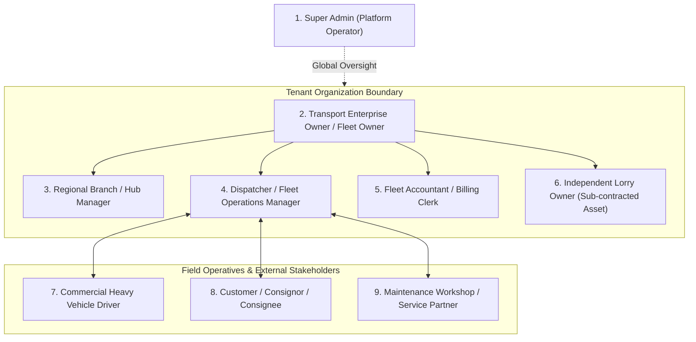
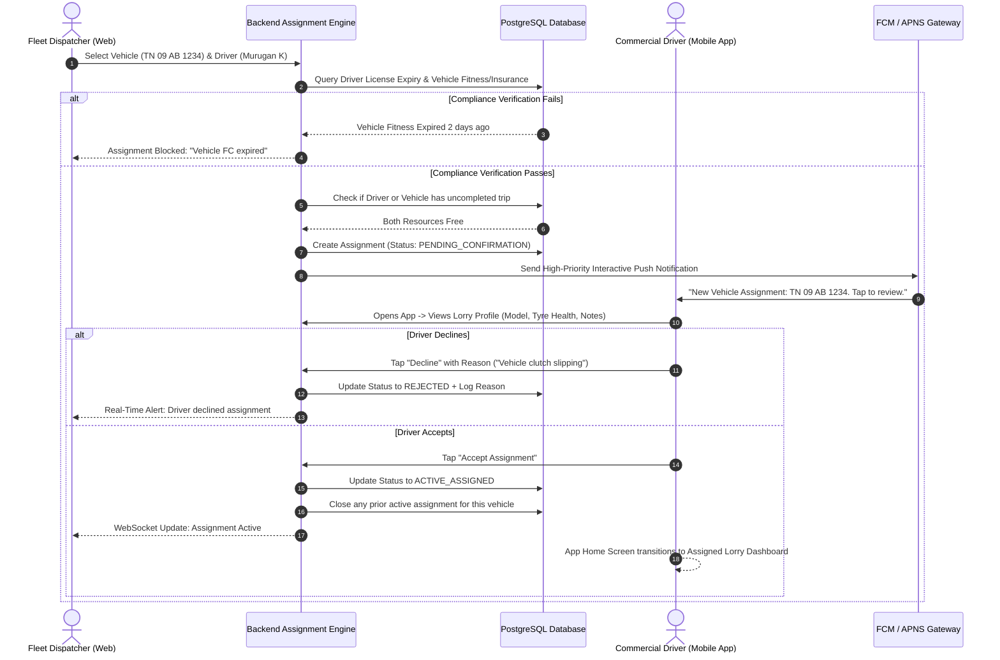
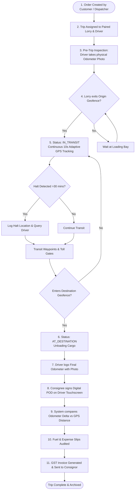
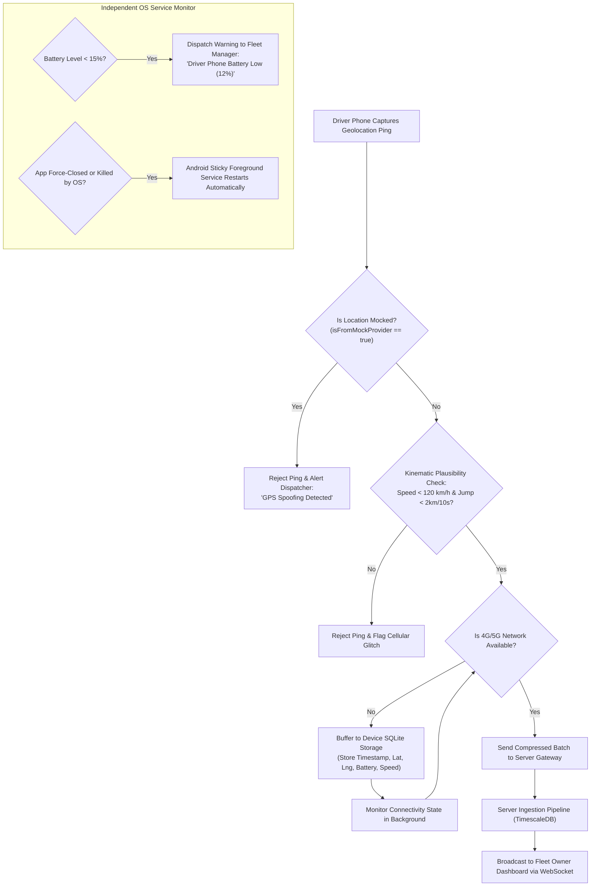
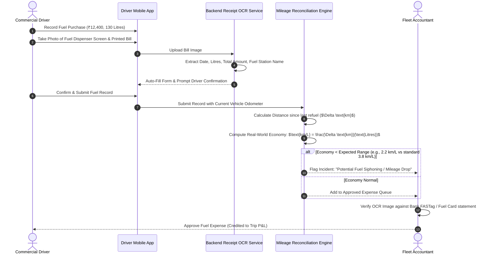

# 06. User Roles, Permissions Matrix & Operational Workflows

**Document Version:** 1.0.0  
**Status:** Approved Security & Workflow Blueprint  
**Scope:** Multi-Tenant Role-Based Access Control (RBAC), Privacy Boundaries & Critical Operational Sequences  

---

## 1. Enterprise Role-Based Access Control (RBAC) Architecture

To support organizations ranging from a single-truck owner-operator to a 500-vehicle transport enterprise with regional branch offices, the platform enforces a granular, multi-tenant RBAC system. 

---

## 2. Granular Permissions Matrix

The table below details permissions across the CRUD lifecycle (Create, Read, Update, Delete, Approve):

| Role | Vehicle Management | Driver & Assignment | Live Tracking & Map | Trips & Orders | Expenses & Fuel | Invoicing & Financials | Maintenance & Spares | System & Settings |
| :--- | :--- | :--- | :--- | :--- | :--- | :--- | :--- | :--- |
| **1. Super Admin** | Full (Global) | Full (Global) | Full (Global) | Full (Global) | Full (Global) | Full (Global) | Full (Global) | System Configuration & Multi-Tenant Management |
| **2. Enterprise / Fleet Owner** | CRUD + Archive | CRUD + Onboard | View All + History | CRUD + Approve | CRUD + Approve | Full P&L + GST Reports | CRUD + Approve Work Orders | Org Settings, Team Invite, Subscription |
| **3. Branch / Hub Manager** | Read Branch Assets | Read + Request Assign | View Branch Assets | CRUD Branch Trips | Read + Verify Slips | Read Branch Invoices | Create Service Requests | View Branch Members |
| **4. Fleet Manager / Dispatcher** | Read + Update Status | CRUD Assignments | View All Real-Time | Create + Dispatch + Monitor | Read + Verify Slips | No Financial Access | Create Job Cards | Manage Geofences & Operational Alerts |
| **5. Fleet Accountant** | Read Asset Info | Read Driver Salary/Bata | No Real-Time Map | Read Completed Trips | Audit + Approve Slips | CRUD Invoices + GST + P&L | Audit Repair Invoices | Export Tax Reports |
| **6. Independent Lorry Owner** | Read/Update Own Truck | View Assigned Driver | View Own Truck Only | Read Own Trips | View Own Truck Expenses | View Own Truck P&L | View Own Truck Health | Manage Own Documents |
| **7. Commercial Driver** | Read Assigned Lorry | View Profile + Bata | Self-Location Only | View Assigned + POD Sign | Upload Fuel & Expense Slips | View Earnings / Advances | Log Breakdown / Defect | Update App Language & Profile |
| **8. Customer (Consignor)** | No Access | No Access | Track Active Order Link | Create Booking Order | No Access | View / Pay Consignment Invoices | No Access | Manage Delivery Addresses |
| **9. Workshop Vendor** | Read Vehicle Specs | No Access | No Access | No Access | Submit Parts Invoice | Submit Repair Bills | CRUD Work Order Items | Workshop Profile |

---

## 3. Strict Data Privacy Boundaries

1. **Driver Off-Duty Privacy Wall:**
   - When a driver taps **"End Duty"** or completes a trip, all GPS coordinates collection terminates immediately at the operating system level.
   - Fleet managers and owners have **zero visibility** into the driver’s off-duty whereabouts. The dashboard displays the status as `OFFLINE` and shows only the last known on-duty location timestamp.
2. **Financial Confidentiality:**
   - Drivers cannot view freight rates, consignor invoice amounts, or company profit margins. They can only view their daily trip allowance (*bata*), approved cash advances, and monthly driving incentives.
   - Dispatchers cannot view high-level company tax filings, loan EMI structures, or executive net profit margins.
3. **Multi-Tenant Data Isolation:**
   - Every database query strictly filters by `organization_id` enforced via PostgreSQL Row-Level Security (RLS). A user from Organization A cannot discover, query, or track any asset from Organization B under any circumstance.
4. **Sub-Contracted Owner Separation:**
   - In third-party vehicle attachments (market trucks attached to a transport company), the vehicle owner can see **only their specific vehicle's** live location, mileage, fuel logs, and trip payouts. They cannot view any other vehicles in the enterprise fleet.

---

## 4. End-to-End Operational Workflows

---

### Workflow 1: Driver-Lorry Dual-Handshake Assignment Workflow

This workflow eliminates assignment disputes by requiring formal mutual confirmation between dispatcher and driver.

---

### Workflow 2: Commercial Trip Lifecycle (From Booking to Invoice)

---

### Workflow 3: Resilient Tracking Exception Handling

This workflow governs how the platform recovers gracefully when mobile connectivity drops, batteries run low, or drivers attempt to spoof locations.

---

### Workflow 4: Fuel Expense Verification & Discrepancy Auditing

