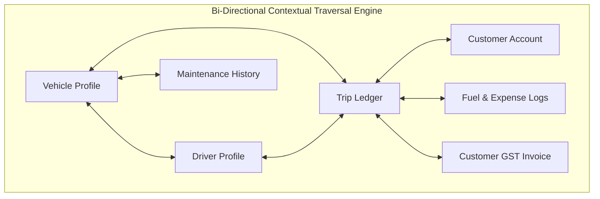
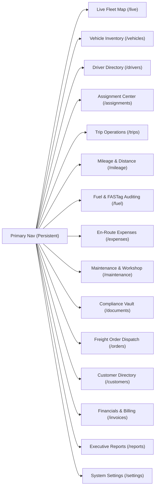
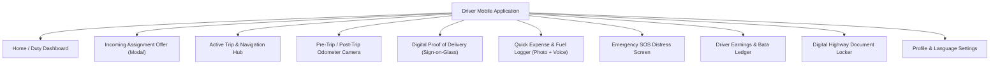
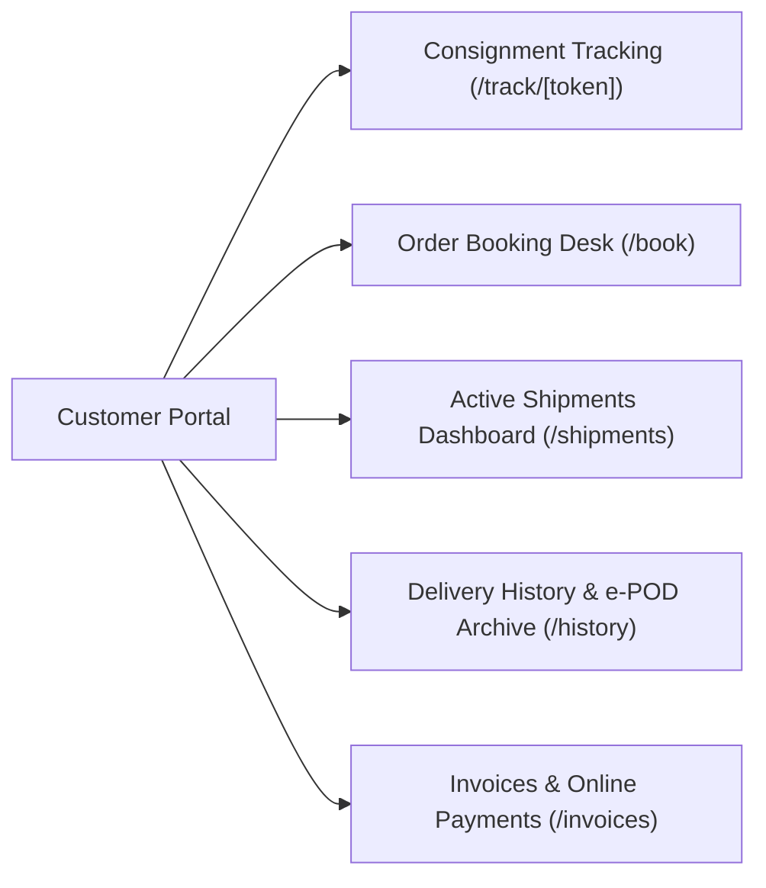

# 07. UI/UX & Screen Architecture: Multi-Persona Design System

**Document Version:** 1.0.0  
**Status:** Approved Design System Specification  
**Design Tokens:** Preserved from Existing Assessment (`#12202B`, `#1769E0`, `#F3F5F7`, `IBM Plex Sans/Mono`)  
**Target Clients:** Web Fleet Portal, Native Driver Mobile App, Customer Self-Service Portal  

---

## 1. Information Architecture & Navigation Philosophy

A fleet management platform fails when users are forced to click through deep, disjointed navigation trees to answer simple questions like: *"Where is lorry TN 09 AB 1234, who is driving it, and is it making money?"*

To solve this, our UI/UX follows three non-negotiable principles:
1. **Contextual Bi-Directional Traversal:** Every entity view contains direct, clickable hyperlinks to all related entities. From a Vehicle card, one click opens the Driver profile; from that Driver profile, one click reveals their full Trip history; from any Trip, one click opens the customer's Goods Order and Invoice.
2. **High-Density Tactical Layouts:** Fleet controllers monitor dozens of moving assets simultaneously. Screen layouts maximize data density using compact cards, status dots, and tabular views with keyboard shortcuts, eliminating unnecessary whitespace without compromising legibility.
3. **Vernacular & Accessible Field UI:** The Driver Mobile App is designed for high-glare outdoor highway conditions, using oversized touch targets ($\ge 56$ px), high-contrast palettes, and full support for 6 Indian vernacular languages (Hindi, Tamil, Telugu, Kannada, Marathi, English) with voice input support for expense logging.



---

## 2. Screen Architecture: Web Fleet Operations Portal

The Web Fleet Portal uses a persistent dark sidebar navigation (`#12202B`) that can collapse to icon-only mode on smaller displays ($<1280$ px), coupled with a dynamic, lazy-loaded content viewport.



### 2.1 Detailed Screen Breakdown (Web Portal)

| Screen ID & Route | Core Purpose & Primary Components | Key User Actions & Interactions |
| :--- | :--- | :--- |
| **SCR-W01: Live Fleet Map** (`/live`) | - Top KPI bar: Moving, Idle, Stopped, Offline counts, Today's Fleet Km.<br>- Left sidebar: Searchable vehicle list with status badges and speed.<br>- Full-viewport vector map (MapLibre GL) with clustering and directional vehicle markers.<br>- Bottom/Slide-over Vehicle Telemetry Drawer. | - Filter by vehicle status (Moving, Idle, Offline).<br>- Click vehicle card to focus map and render 24h breadcrumb trail.<br>- Toggle street/satellite map view.<br>- Direct quick-action: "Call Driver", "View Full Profile". |
| **SCR-W02: Vehicle Directory** (`/vehicles`) | - Search, filter by vehicle type (HCV, LCV, Trailer) and branch.<br>- High-density table / card view.<br>- Add Vehicle slide-out modal with 4-step wizard (Identity, Specs, Financing, Documents). | - Click registration plate to open 360° Vehicle Profile.<br>- Export vehicle inventory to Excel/PDF.<br>- Bulk upload vehicle master via CSV. |
| **SCR-W03: 360° Vehicle Profile** (`/vehicles/[id]`) | - Tabbed master detail view:<br>  1. *Overview:* Specifications, current driver, live position.<br>  2. *Trips:* Chronological list of completed and ongoing runs.<br>  3. *Fuel & Mileage:* Real-world km/L curve, monthly diesel expense.<br>  4. *Maintenance:* Past service job cards, upcoming tyre/oil triggers.<br>  5. *Documents:* RC, Insurance, FC, Permits with download links.<br>  6. *P&L:* Net profitability, revenue vs operating expenses. | - One-click reassign driver.<br>- Upload renewed document.<br>- Create maintenance work order.<br>- Print vehicle biodata summary. |
| **SCR-W04: Driver Directory** (`/drivers`) | - Search by name, phone, driving license number.<br>- Driver cards with profile photo, duty status pill, assigned vehicle.<br>- Expiry radar highlighting licenses expiring within 30 days.<br>- Add Driver modal with Aadhaar and Sarathi verification fields. | - Filter by duty status (`ON_DUTY`, `OFF_DUTY`, `UNASSIGNED`).<br>- One-click dial to driver phone.<br>- Click driver to open 360° Driver Profile. |
| **SCR-W05: 360° Driver Profile** (`/drivers/[id]`) | - Tabbed profile:<br>  1. *Biodata:* Personal, emergency contact, banking details.<br>  2. *Assignments:* Current vehicle, historical pairings.<br>  3. *Trip History:* Completed trips, customer delivery ratings.<br>  4. *Driving Scorecard:* Safety score, overspeeding, harsh braking.<br>  5. *Salary & Bata:* Advance ledger, unpaid trip allowances. | - Edit salary/allowance terms.<br>- Pay cash advance via UPI gateway.<br>- Deactivate/blacklist driver.<br>- Download driver compliance report. |
| **SCR-W06: Assignment Engine** (`/assignments`) | - Interactive 3-panel wizard: Available Vehicles $\rightarrow$ Available Drivers $\rightarrow$ Impact & Conflict Resolution.<br>- Live Conflict Checker (flags expired licenses or vehicles on trips).<br>- Historical Assignment Audit Table with dates and duration. | - Issue Assignment Offer to driver's mobile app.<br>- Override assignment in emergency.<br>- Filter historical assignments by date range. |
| **SCR-W07: Trip Operations** (`/trips`) | - Kanban / List view of trips categorized by status (`DRAFT`, `ASSIGNED`, `IN_TRANSIT`, `AT_DESTINATION`, `POD_SUBMITTED`, `SETTLED`).<br>- Trip Dispatch Form with route checkpoints, cargo weight, e-Way bill. | - Create new trip booking.<br>- View live transit corridor on map.<br>- Audit final delivery POD signature and photos.<br>- Settle trip expenses. |
| **SCR-W08: Fuel & Expense Audit** (`/fuel`) | - Ledger of all diesel refuels with bunk name, litres, rate, and total.<br>- Side-by-side fuel receipt photo inspector with OCR comparison.<br>- Fleet fuel efficiency benchmarks (km/L) with anomaly highlighting. | - Approve/reject driver fuel claims.<br>- Flag potential fuel theft.<br>- Ingest monthly corporate fuel card statements. |
| **SCR-W09: Maintenance Desk** (`/maintenance`) | - Preventive Maintenance Calendar (odometer and time-based triggers).<br>- Active Workshop Work Orders and spare parts log.<br>- Breakdown emergency incident register. | - Create digital service job card.<br>- Log battery or tyre replacement with serial number.<br>- Approve garage repair invoices. |
| **SCR-W10: Compliance Vault** (`/documents`) | - Matrix of all vehicles and drivers against statutory document types.<br>- Color-coded expiry flags (Green: $>30$ days, Yellow: $15-30$ days, Red: $<15$ days or expired).<br>- Document upload and verification desk. | - Trigger automated WhatsApp renewal reminders to owner/driver.<br>- Bulk download vehicle compliance packets.<br>- Direct link to state RTO / Parivahan renewal portals. |
| **SCR-W11: Financial Reports** (`/reports`) | - P&L report per vehicle, per driver, and per customer account.<br>- Daily distance summary sheets (GPS vs Physical Odometer).<br>- GST outward transport supply reports (Forward vs Reverse Charge). | - Custom date range selector.<br>- Filter by branch and fleet division.<br>- Export to Excel, PDF, and Tally XML format. |

---

## 3. Screen Architecture: Driver Mobile Application (Native Android / iOS)

The Driver Mobile App is structured around a streamlined, distraction-free interface optimized for one-thumb operation.



### 3.1 Detailed Screen Breakdown (Driver Mobile App)

```
+------------------------------------+
|  [Logo] Fleet Tracker      [Tamil] |
|  Good Morning, Murugan K           |
+------------------------------------+
|  YOUR ASSIGNED VEHICLE             |
|  TN 09 AB 1234                     |
|  Tata Prima 4028.S · Truck 28T     |
|  [● ON DUTY - TRACKING ACTIVE]     |
+------------------------------------+
|  TODAY'S METRICS                   |
|  +----------------+---------------+|
|  | Duty Started   | Distance Today||
|  | 06:12 AM       | 214.6 km      ||
|  +----------------+---------------+|
|  | GPS Accuracy   | Phone Battery ||
|  | 8 m (High)     | 82% (Charging)||
|  +----------------+---------------+|
+------------------------------------+
|  ACTIVE CONSIGNMENT                |
|  Trip #TRP-8492 · En Route         |
|  Chennai Port -> Bangalore ICD     |
|  Cargo: Auto Components (22T)      |
|  [ View Route & Delivery Contact ] |
+------------------------------------+
|  QUICK ACTIONS                     |
|  [+ Log Fuel]   [+ Trip Expense]   |
|  [   SOS    ]   [  End Duty    ]   |
+------------------------------------+
```

| Screen ID | Core Purpose & Primary Components | Field-Optimized Interactions |
| :--- | :--- | :--- |
| **SCR-M01: Duty Dashboard** | - Assigned vehicle card with plate number, make, model.<br>- Prominent duty status banner with pulsing radar indicator.<br>- Live operational metrics: Duty start time, distance today, GPS accuracy, phone battery.<br>- Current active trip card with origin/destination and consignee call button.<br>- Quick action buttons: Log Fuel, Log Expense, SOS Panic. | - One-tap **"Start Duty"** / **"End Duty"** toggle.<br>- Persistent Android foreground service notification.<br>- Offline indicator banner when cellular signal drops. |
| **SCR-M02: Assignment Modal** | - High-priority full-screen modal triggered by dispatch offer.<br>- Displays vehicle plate, photo, model, payload capacity, and owner notes.<br>- Two prominent action buttons: **"Accept Assignment"** (Green, 56px) and **"Decline"** (Red, 56px). | - Mandatory decline reason selector (Vehicle defect, Sickness, Route issue).<br>- Acceptance binds phone immediately and unlocks vehicle dashboard. |
| **SCR-M03: Active Trip Hub** | - Route map with corridor path and waypoints.<br>- Customer / Consignee contact card with direct phone dialer.<br>- Toll plaza alert banners.<br>- Action buttons: "Log Highway Halt", "Report Delay", "Arrived at Destination". | - Direct launch into Google Maps / Mapbox turn-by-turn navigation.<br>- One-tap call to consignee warehouse manager. |
| **SCR-M04: Odometer Capture** | - Camera viewfinder with overlay guide aligning the physical odometer digits.<br>- Numeric input field for driver confirmation.<br>- Timestamp, GPS coordinates, and watermarking auto-embedded. | - Prevents gallery uploads (forces live camera capture to eliminate fraud).<br>- Automated edge AI OCR reading numbers from dashboard photo. |
| **SCR-M05: Digital e-POD** | - Delivery receipt form.<br>- Consignee name and phone number entry.<br>- Full-width touch signature canvas ("Sign on glass").<br>- Cargo condition checklist (Undamaged, Damaged, Shortage).<br>- Camera capture for physical stamped delivery challan. | - Consignee signs with finger directly on screen.<br>- Generates instant digital delivery receipt sent via SMS to consignor. |
| **SCR-M06: Fuel & Expense Logger** | - Expense category tabs: Diesel, Toll Cash, Loading Coolie, AdBlue/DEF, Puncture, Police/RTO.<br>- Amount (₹) numeric keypad.<br>- Fuel quantity (Litres) and fuel station name.<br>- Receipt photo capture button with instant upload. | - Voice input support (*"Diesel ten thousand rupees one hundred liters"* converts to structured fields).<br>- Works 100% offline; queues receipts until network resumes. |
| **SCR-M07: Emergency SOS** | - High-contrast red screen with massive SOS panic button.<br>- 5-second countdown to prevent accidental triggers.<br>- Triggers automated siren alert to fleet manager dashboard, SMS broadcast with GPS coordinates to emergency contacts, and 112 police dispatch. | - Operates even when phone screen is locked via triple-click of power button (hardware key binding). |
| **SCR-M08: Driver Earnings** | - Summary of monthly base salary, daily trip allowances (*bata*), performance bonuses.<br>- Itemized cash advance ledger showing received vs spent amounts.<br>- Bank account / UPI payout status. | - Clear vernacular accounting building trust between driver and fleet owner. |
| **SCR-M09: Highway Doc Locker** | - Quick-access digital wallet containing vehicle RC, Insurance, FC, National Permit, PUC, and Driver’s Licence.<br>- Offline-cached high-resolution images.<br>- Single master QR code for highway traffic police scanning. | - Accessible in under 2 seconds during police/RTO checkpoint stops without internet. |

---

## 4. Screen Architecture: Customer / Consignor Self-Service Portal

Shippers and cargo owners access a dedicated, branded customer portal (responsive web and mobile web) without needing to install an app.



| Screen ID | Core Purpose & Primary Components | Customer Interactions |
| :--- | :--- | :--- |
| **SCR-C01: Public Tracking** (`/track/[token]`) | - Secure, tokenized live map view of specific assigned lorry.<br>- Real-time ETA calculated dynamically based on distance and traffic.<br>- Current status timeline (Dispatched $\rightarrow$ En Route $\rightarrow$ Approaching $\rightarrow$ Delivered).<br>- Vehicle plate and driver contact details. | - No login required (accessed via secure link sent via SMS/WhatsApp).<br>- Share live tracking link with end-receiver.<br>- Call driver or dispatch desk directly from tracking card. |
| **SCR-C02: Order Booking** (`/book`) | - Freight booking form: Origin pickup address, destination delivery address, pickup date/time window.<br>- Cargo details: Weight (Tonnes), material type, required vehicle class (16T, 28T, Container).<br>- Instant freight rate quotation calculator. | - Submit transport order to transport company.<br>- Upload e-Way Bill PDF.<br>- Save frequent warehouse addresses. |
| **SCR-C03: Consignee e-POD** (`/pod/[id]`) | - Digital delivery archive.<br>- High-resolution view of signed touch signature and physical stamped challan.<br>- Delivery timestamp and GPS arrival proof. | - Download signed delivery receipt PDF for commercial audit.<br>- Dispute cargo damage or shortages within 24 hours. |
| **SCR-C04: Billing & Invoices** (`/invoices`) | - Table of all freight invoices with GST breakdown (CGST/SGST/IGST).<br>- Payment status: Paid, Pending, Overdue.<br>- Integrated online payment checkout (UPI, Net Banking, NEFT/RTGS virtual account). | - Download GST-compliant tax invoice.<br>- Pay freight bill directly via Razorpay/Cashfree gateway. |

