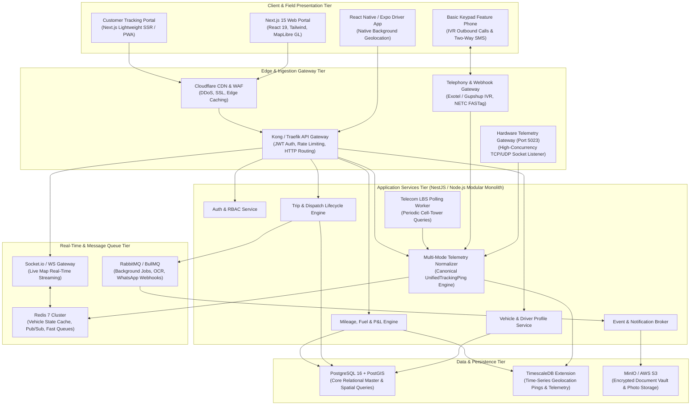
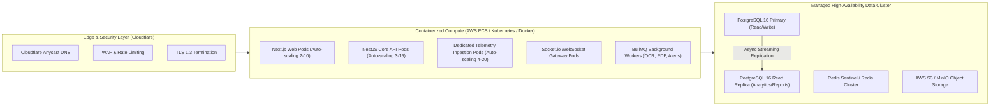

# 08. Technical Architecture & Engineering Technology Evaluation

**Document Version:** 1.0.0  
**Status:** Approved Technical Architecture Blueprint  
**System Class:** High-Throughput Geospatial SaaS & Event-Driven IoT/Mobile Platform  
**Target Performance:** Sub-100ms API latency, Sub-1.5s live map streaming, 99.95% uptime  

---

## 1. Executive Architectural Recommendation

Building a mission-critical fleet management platform that handles high-frequency smartphone telemetry (tens of thousands of concurrent location pings every 10 seconds), complex spatial queries, document storage, and accounting ledgers requires a **modular, event-driven architecture**.



---

## 2. In-Depth Technology Stack Evaluation

### 2.1 Web Frontend Framework Comparison

| Criteria | Next.js (React 19) | Vite + React SPA | Vue 3 (Nuxt) | Angular 18 | Recommended Choice |
| :--- | :--- | :--- | :--- | :--- | :--- |
| **Rendering Model** | Hybrid (SSR, SSG, Client Components) | Pure Client SPA | Hybrid SSR / SPA | Hybrid SSR / SPA | **Next.js 15 (React 19)** |
| **SEO & Public Tracking** | Superb (Instant open for `/track/[id]`) | Poor (Requires JS render) | Excellent | Good | **Next.js wins** for public consignor tracking links. |
| **Code Splitting & Modularity** | Built-in route chunking (App Router) | Manual manual lazy-imports | Good auto-chunking | Built-in modular chunks | **Next.js wins** with zero-configuration granular route splitting. |
| **Ecosystem & UI Libraries** | Unmatched (Tailwind, Radix UI, shadcn) | High | Moderate | Enterprise/Steep | Next.js has the deepest ecosystem for dense data tables. |

**Frontend Decision:** **Next.js 15 with App Router, Tailwind CSS, and MapLibre GL JS.**
- *Rationale:* Next.js App Router enforces directory-based code-splitting. When a user opens `/vehicles`, the JavaScript bundles for `/fuel`, `/maintenance`, or `/reports` are **not loaded**, keeping initial bundle sizes under 120 KB.

---

### 2.2 Mobile Technology Stack Comparison

The choice of mobile technology is the single most critical engineering decision for this product because continuous background geolocation on standard Android phones is notoriously difficult due to aggressive OS battery managers.

| Technology | Background Tracking Reliability | OS Service Access | Cross-Platform Sharing | Developer Velocity | Ecosystem Score |
| :--- | :--- | :--- | :--- | :--- | :--- |
| **React Native (Expo + Custom Native Bridge)** | **High** (via `react-native-background-geolocation` / Transistor Software or custom Kotlin Foreground Service) | Native Modules via JSI / TurboModules | 85% shared code with web (TypeScript, validation, state) | High | 9.5 / 10 |
| **Flutter (Dart)** | **High** (via `flutter_background_geolocation` or native platform channels) | Excellent | 0% code shared with web (separate Dart language) | Moderate | 8.5 / 10 |
| **Native Android (Kotlin) + iOS (Swift)** | **Highest** (Direct control of OS APIs) | 100% Direct | 0% code shared (dual development teams required) | Low / High Cost | 9.0 / 10 |
| **Progressive Web App (PWA)** | **Zero (Completely Unusable)** | No background geolocation access when screen is locked or browser minimized | 100% | Ultra High | 2.0 / 10 |

**Mobile Decision:** **React Native with Expo Prebuild + Dedicated Native Android Foreground Service (Kotlin).**
> [!CAUTION]
> **Why PWA is strictly rejected for Driver Tracking:** Modern mobile operating systems (especially Android 13+ and iOS 16+) terminate web browser background threads within 15 to 30 seconds of the user switching apps or locking the screen. A PWA **cannot** sustain continuous highway tracking. A native background service with a persistent OS notification is mandatory.

---

### 2.3 Backend Engineering Framework Comparison

| Criteria | NestJS (TypeScript) | Go (Golang) | Java (Spring Boot) | Node.js (Express / Fastify) | Recommended Choice |
| :--- | :--- | :--- | :--- | :--- | :--- |
| **Architecture & Structure** | Modular Enterprise Architecture (Decorators, DI) | Microservices / Procedural | Heavy Enterprise Modular | Freeform / Unstructured | **NestJS (with Fastify engine)** |
| **Type Safety & Code Sharing** | 100% end-to-end TypeScript with Web & Mobile | Typed, but no code sharing | Typed, heavy boilerplate | Weak unless configured | **NestJS wins** (shared DTOs with Next.js & React Native). |
| **Concurrency & Throughput** | Fastify engine handles 35,000+ req/sec | 70,000+ req/sec (Goroutines) | 30,000+ req/sec | 20,000 req/sec | High enough for tens of thousands of trucks. |
| **Geospatial & ORM Ecosystem** | TypeORM / Prisma with PostGIS support | GORM (moderate) | Hibernate Spatial (heavy) | Good | Mature spatial type mapping. |

**Backend Decision:** **NestJS with Fastify HTTP adapter, TypeORM / Prisma, and Socket.io.**
- *Rationale:* NestJS enforces strict modular domain isolation (AuthModule, VehicleModule, TripModule, TrackingModule). It uses the same TypeScript models as our Next.js web portal and React Native driver app, eliminating interface drift.

---

### 2.4 Database & Geolocation Storage Comparison

| Storage Layer | Evaluated Option | Selected Role in Platform | Architectural Justification |
| :--- | :--- | :--- | :--- |
| **Relational Master Database** | **PostgreSQL 16 + PostGIS 3.4** | **Primary Source of Truth** | ACID compliance is mandatory for financial accounting (invoices, expenses, fuel bills, driver advances). PostGIS provides world-standard spatial indexing (`ST_DWithin`, `ST_Contains`, `ST_Intersects`) for high-speed geofence matching. |
| **Time-Series Telemetry Store** | **TimescaleDB Extension** (inside PostgreSQL) | **GPS Ping & Breadcrumb Archive** | Rather than maintaining an expensive, separate NoSQL cluster (like Cassandra or MongoDB), TimescaleDB partitions standard PostgreSQL tables into automatic spatial-temporal "hypertables". This gives us 10x faster spatial time-series queries, automatic 90% data compression, and unified SQL joins between trips and GPS pings. |
| **In-Memory Cache & State Store** | **Redis 7 Cluster** | **Live Telemetry & Ephemeral State** | Holds the latest known coordinate, speed, battery, and status of every active vehicle in an in-memory hash (`vehicle:TN09AB1234:state`). Powers the live map without hitting the primary disk database. Redis Pub/Sub drives the WebSocket real-time fanout. |
| **Unstructured Media Storage** | **MinIO (S3 Compatible) / AWS S3** | **Encrypted Document Vault** | Stores driver licenses, vehicle RC PDFs, fuel bill receipts, and delivery POD signatures with AES-256 server-side encryption. |

---

## 3. Modular Performance Architecture & Code-Splitting

A core requirement is that the platform must remain lightweight and responsive, never loading unrelated modules simultaneously.

```mermaid
graph TD
    RootBundle["App Shell Bundle (<120 KB gzip)"]
    
    RootBundle --> LazyLive["/live Chunk (MapLibre + WebSocket)"]
    RootBundle --> LazyVehicles["/vehicles Chunk (Tables + Modals)"]
    RootBundle --> LazyDrivers["/drivers Chunk (KYC + Scorecards)"]
    RootBundle --> LazyTrips["/trips Chunk (Kanban + Dispatch)"]
    RootBundle --> LazyFuel["/fuel Chunk (OCR + Charts)"]
    RootBundle --> LazyMaint["/maintenance Chunk (Job Cards)"]
    RootBundle --> LazyReports["/reports Chunk (Export + Aggregation)"]
    
    style RootBundle fill:#12202B,stroke:#1769E0,color:#fff
    style LazyLive fill:#EAF2FF,stroke:#1769E0,color:#0A4A9E
    style LazyVehicles fill:#EAF2FF,stroke:#1769E0,color:#0A4A9E
    style LazyDrivers fill:#EAF2FF,stroke:#1769E0,color:#0A4A9E
    style LazyTrips fill:#EAF2FF,stroke:#1769E0,color:#0A4A9E
    style LazyFuel fill:#EAF2FF,stroke:#1769E0,color:#0A4A9E
    style LazyMaint fill:#EAF2FF,stroke:#1769E0,color:#0A4A9E
    style LazyReports fill:#EAF2FF,stroke:#1769E0,color:#0A4A9E
```



### Key Performance Engineering Rules:
1. **Dynamic Route Chunking:** Every primary operational module in Next.js is configured with dynamic imports:
   ```typescript
   // Next.js dynamic code splitting
   const LiveMapCanvas = dynamic(() => import('@/components/map/LiveMapCanvas'), {
     ssr: false,
     loading: () => <MapLoadingSkeleton />
   });
   ```
2. **Server-Side Cursor Pagination:** No API ever returns unbounded arrays. All vehicle, driver, and trip lists enforce cursor-based pagination (`limit=50&cursor=eyJpZCI6MTAxfQ==`), guaranteeing sub-30ms database response times even for fleets with 10,000+ historical trips.
3. **Spatial Tile Caching:** Map geofences and historical route trails are vectorized into protocol buffers (Mapbox Vector Tiles - MVT) and cached at the Cloudflare edge for 24 hours.
4. **WebSocket Selective Subscription:** When an admin is viewing only 5 specific vehicles in a branch, the WebSocket connection subscribes strictly to `room:branch_42` rather than streaming the entire national fleet, saving 90% of client bandwidth and CPU rendering cycles.

---

## 4. Multi-Tenant Infrastructure Topology



