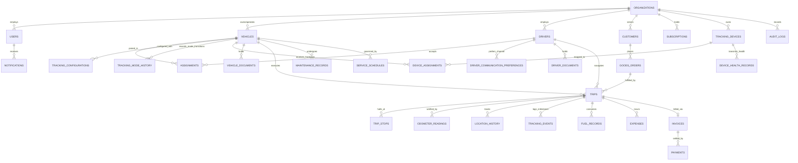

# 09. Database Schema Design & Entity-Relationship Architecture

**Document Version:** 1.0.0  
**Status:** Approved Database Architecture Specification  
**RDBMS Engine:** PostgreSQL 16 + PostGIS Spatial Extension + TimescaleDB Extension  
**Multi-Tenant Model:** Row-Level Security (RLS) with Tenant Identifier (`organization_id`)  

---

## 1. High-Level Entity Relationship Diagram (ERD)

The diagram below maps the relationships across all core operational, tracking, financial, and compliance domains:



---

## 2. Detailed Table Specifications & Data Dictionaries

### 2.1 Core Identity & Multi-Tenancy

```sql
-- Organizations (Tenants)
CREATE TABLE organizations (
    id UUID PRIMARY KEY DEFAULT gen_random_uuid(),
    legal_name VARCHAR(255) NOT NULL,
    trade_name VARCHAR(255),
    gstin VARCHAR(15) UNIQUE,
    pan_number VARCHAR(10),
    contact_email VARCHAR(255) NOT NULL,
    contact_phone VARCHAR(20) NOT NULL,
    registered_address JSONB NOT NULL,
    subscription_tier VARCHAR(50) DEFAULT 'STARTER_FREE',
    subscription_status VARCHAR(50) DEFAULT 'ACTIVE',
    created_at TIMESTAMPTZ DEFAULT CURRENT_TIMESTAMP,
    updated_at TIMESTAMPTZ DEFAULT CURRENT_TIMESTAMP
);

-- Users & Authentication
CREATE TABLE users (
    id UUID PRIMARY KEY DEFAULT gen_random_uuid(),
    organization_id UUID NOT NULL REFERENCES organizations(id) ON DELETE CASCADE,
    full_name VARCHAR(255) NOT NULL,
    email VARCHAR(255) UNIQUE,
    phone_number VARCHAR(20) UNIQUE NOT NULL,
    password_hash VARCHAR(255),
    role VARCHAR(50) NOT NULL, -- SUPER_ADMIN, FLEET_OWNER, BRANCH_MANAGER, DISPATCHER, ACCOUNTANT, DRIVER, CUSTOMER
    is_active BOOLEAN DEFAULT TRUE,
    last_login_at TIMESTAMPTZ,
    created_at TIMESTAMPTZ DEFAULT CURRENT_TIMESTAMP
);
CREATE INDEX idx_users_org_role ON users(organization_id, role);
```

---

### 2.2 Vehicle Master & Digital Profile

```sql
CREATE TABLE vehicles (
    id UUID PRIMARY KEY DEFAULT gen_random_uuid(),
    organization_id UUID NOT NULL REFERENCES organizations(id) ON DELETE CASCADE,
    registration_plate VARCHAR(20) NOT NULL,
    chassis_number VARCHAR(50) NOT NULL,
    engine_number VARCHAR(50) NOT NULL,
    make VARCHAR(100) NOT NULL,
    model VARCHAR(100) NOT NULL,
    manufacturing_year INT NOT NULL,
    vehicle_type VARCHAR(50) NOT NULL, -- HCV_28T, TRAILER_40T, LCV_14T, TIPPER, etc.
    gross_vehicle_weight_kg NUMERIC(10,2) NOT NULL,
    unladen_weight_kg NUMERIC(10,2) NOT NULL,
    payload_capacity_kg NUMERIC(10,2) NOT NULL,
    fuel_type VARCHAR(20) DEFAULT 'DIESEL',
    fuel_tank_capacity_litres NUMERIC(6,2) NOT NULL,
    current_odometer_km NUMERIC(12,2) DEFAULT 0.0,
    operational_status VARCHAR(50) DEFAULT 'AVAILABLE', -- AVAILABLE, ON_TRIP, UNDER_MAINTENANCE, IMPOUNDED
    current_driver_id UUID REFERENCES users(id),
    current_location GEOMETRY(Point, 4326),
    current_location_address TEXT,
    last_location_ping_at TIMESTAMPTZ,
    created_at TIMESTAMPTZ DEFAULT CURRENT_TIMESTAMP,
    updated_at TIMESTAMPTZ DEFAULT CURRENT_TIMESTAMP,
    CONSTRAINT uq_org_plate UNIQUE (organization_id, registration_plate)
);
CREATE INDEX idx_vehicles_org_status ON vehicles(organization_id, operational_status);
CREATE INDEX idx_vehicles_spatial ON vehicles USING GIST(current_location);
```

---

### 2.3 Driver Profile & Workforce Management

```sql
CREATE TABLE drivers (
    id UUID PRIMARY KEY DEFAULT gen_random_uuid(),
    user_id UUID UNIQUE NOT NULL REFERENCES users(id) ON DELETE CASCADE,
    organization_id UUID NOT NULL REFERENCES organizations(id) ON DELETE CASCADE,
    driving_licence_number VARCHAR(50) NOT NULL,
    licence_classes VARCHAR(100)[] NOT NULL, -- ['LMV', 'TRANS', 'HGMV']
    licence_expiry_date DATE NOT NULL,
    aadhaar_masked VARCHAR(12) NOT NULL,
    emergency_contact_name VARCHAR(150) NOT NULL,
    emergency_contact_phone VARCHAR(20) NOT NULL,
    duty_status VARCHAR(50) DEFAULT 'OFF_DUTY', -- OFF_DUTY, ON_DUTY_AVAILABLE, ON_DUTY_EN_ROUTE
    base_salary_monthly NUMERIC(10,2) DEFAULT 0.0,
    daily_bata_allowance NUMERIC(8,2) DEFAULT 0.0,
    cash_advance_balance NUMERIC(10,2) DEFAULT 0.0,
    safety_score_rating NUMERIC(3,2) DEFAULT 5.0,
    total_completed_trips INT DEFAULT 0,
    created_at TIMESTAMPTZ DEFAULT CURRENT_TIMESTAMP
);
CREATE INDEX idx_drivers_org_duty ON drivers(organization_id, duty_status);
CREATE INDEX idx_drivers_licence_expiry ON drivers(licence_expiry_date);
```

---

### 2.4 Dual-Handshake Assignment Engine

```sql
CREATE TABLE assignments (
    id UUID PRIMARY KEY DEFAULT gen_random_uuid(),
    organization_id UUID NOT NULL REFERENCES organizations(id) ON DELETE CASCADE,
    vehicle_id UUID NOT NULL REFERENCES vehicles(id),
    driver_id UUID NOT NULL REFERENCES drivers(id),
    assigned_by_user_id UUID NOT NULL REFERENCES users(id),
    assignment_status VARCHAR(50) DEFAULT 'PENDING_CONFIRMATION', -- PENDING_CONFIRMATION, ACTIVE, REJECTED, TERMINATED
    rejection_reason TEXT,
    started_at TIMESTAMPTZ,
    ended_at TIMESTAMPTZ,
    notes TEXT,
    created_at TIMESTAMPTZ DEFAULT CURRENT_TIMESTAMP
);
CREATE INDEX idx_assignments_active ON assignments(vehicle_id, driver_id) WHERE assignment_status = 'ACTIVE';
```

---

### 2.5 Commercial Trips, Stops & Verification

```sql
CREATE TABLE trips (
    id UUID PRIMARY KEY DEFAULT gen_random_uuid(),
    trip_code VARCHAR(50) UNIQUE NOT NULL, -- e.g. TRP-202611-0084
    organization_id UUID NOT NULL REFERENCES organizations(id) ON DELETE CASCADE,
    vehicle_id UUID NOT NULL REFERENCES vehicles(id),
    driver_id UUID NOT NULL REFERENCES drivers(id),
    customer_id UUID REFERENCES customers(id),
    origin_name VARCHAR(255) NOT NULL,
    origin_location GEOMETRY(Point, 4326) NOT NULL,
    destination_name VARCHAR(255) NOT NULL,
    destination_location GEOMETRY(Point, 4326) NOT NULL,
    trip_status VARCHAR(50) DEFAULT 'DRAFT', -- DRAFT, ASSIGNED, IN_TRANSIT, AT_DESTINATION, POD_SUBMITTED, AUDIT_SETTLED
    cargo_description TEXT,
    cargo_weight_tonnes NUMERIC(8,2),
    freight_rate_type VARCHAR(30) DEFAULT 'PER_TONNE', -- PER_TONNE, FIXED_TRIP, PER_KM
    freight_rate_value NUMERIC(10,2) NOT NULL,
    total_agreed_freight NUMERIC(12,2) NOT NULL,
    eway_bill_number VARCHAR(50),
    started_at TIMESTAMPTZ,
    completed_at TIMESTAMPTZ,
    start_odometer_km NUMERIC(12,2),
    end_odometer_km NUMERIC(12,2),
    gps_calculated_distance_km NUMERIC(10,2) DEFAULT 0.0,
    pod_signee_name VARCHAR(150),
    pod_signature_image_url TEXT,
    pod_stamped_challan_url TEXT,
    pod_signed_at TIMESTAMPTZ,
    created_at TIMESTAMPTZ DEFAULT CURRENT_TIMESTAMP
);
CREATE INDEX idx_trips_org_status ON trips(organization_id, trip_status);
CREATE INDEX idx_trips_vehicle ON trips(vehicle_id, started_at);
CREATE INDEX idx_trips_driver ON trips(driver_id, started_at);

-- Odometer Photo Evidence
CREATE TABLE odometer_readings (
    id UUID PRIMARY KEY DEFAULT gen_random_uuid(),
    trip_id UUID NOT NULL REFERENCES trips(id) ON DELETE CASCADE,
    vehicle_id UUID NOT NULL REFERENCES vehicles(id),
    reading_type VARCHAR(20) NOT NULL, -- 'TRIP_START', 'TRIP_END', 'REFUEL', 'INSPECTION'
    odometer_value NUMERIC(12,2) NOT NULL,
    photo_evidence_url TEXT NOT NULL,
    captured_at TIMESTAMPTZ NOT NULL,
    captured_latitude NUMERIC(10,7),
    captured_longitude NUMERIC(10,7),
    is_verified BOOLEAN DEFAULT FALSE,
    verified_by_user_id UUID REFERENCES users(id)
);
```

---

### 2.6 High-Throughput Geospatial Telemetry (TimescaleDB Hypertable)

```sql
-- Location History partitioned by time
CREATE TABLE location_history (
    recorded_at TIMESTAMPTZ NOT NULL,
    vehicle_id UUID NOT NULL,
    trip_id UUID,
    driver_id UUID,
    source_type VARCHAR(40) DEFAULT 'SMARTPHONE_GPS', -- SMARTPHONE_GPS, HARDWARE_GPS_STANDARD, HARDWARE_GPS_AIS140, SIM_CELLULAR_LBS, FASTAG_RFID_PLAZA, IVR_KEYPAD_CHECKIN, MANUAL_CHECKPOINT
    confidence_score INT DEFAULT 100, -- 0 to 100
    coordinates GEOMETRY(Point, 4326) NOT NULL,
    altitude_m NUMERIC(6,1),
    speed_kmh NUMERIC(5,1) NOT NULL,
    bearing_deg NUMERIC(5,1),
    accuracy_m NUMERIC(5,1) NOT NULL,
    battery_level_pct INT,
    is_charging BOOLEAN,
    is_mock_provider BOOLEAN DEFAULT FALSE,
    milestone_name VARCHAR(255),
    raw_metadata JSONB
);

-- Convert to TimescaleDB Hypertable partitioned by 7-day chunks
SELECT create_hypertable('location_history', 'recorded_at', chunk_time_interval => INTERVAL '7 days');

-- Spatial & Composite Indexes for lightning-fast queries
CREATE INDEX idx_loc_vehicle_time ON location_history(vehicle_id, recorded_at DESC);
CREATE INDEX idx_loc_trip_time ON location_history(trip_id, recorded_at ASC);
CREATE INDEX idx_loc_spatial ON location_history USING GIST(coordinates);
```

---

### 2.7 Fuel, Expenses & Accounting

```sql
CREATE TABLE fuel_records (
    id UUID PRIMARY KEY DEFAULT gen_random_uuid(),
    organization_id UUID NOT NULL REFERENCES organizations(id) ON DELETE CASCADE,
    trip_id UUID REFERENCES trips(id),
    vehicle_id UUID NOT NULL REFERENCES vehicles(id),
    driver_id UUID NOT NULL REFERENCES drivers(id),
    litres_filled NUMERIC(8,2) NOT NULL,
    rate_per_litre NUMERIC(6,2) NOT NULL,
    total_cost NUMERIC(10,2) NOT NULL,
    odometer_at_fill NUMERIC(12,2) NOT NULL,
    fuel_station_name VARCHAR(255),
    receipt_photo_url TEXT,
    filled_at TIMESTAMPTZ NOT NULL,
    is_approved BOOLEAN DEFAULT FALSE,
    created_at TIMESTAMPTZ DEFAULT CURRENT_TIMESTAMP
);

CREATE TABLE expenses (
    id UUID PRIMARY KEY DEFAULT gen_random_uuid(),
    organization_id UUID NOT NULL REFERENCES organizations(id) ON DELETE CASCADE,
    trip_id UUID REFERENCES trips(id),
    vehicle_id UUID REFERENCES vehicles(id),
    driver_id UUID REFERENCES drivers(id),
    category VARCHAR(50) NOT NULL, -- TOLL_CASH, FASTAG, COOLIE, ADBLUE, POLICE_RTO, PUNCTURE, REPAIR
    amount NUMERIC(10,2) NOT NULL,
    receipt_photo_url TEXT,
    expense_date DATE NOT NULL,
    notes TEXT,
    status VARCHAR(30) DEFAULT 'PENDING_AUDIT', -- PENDING_AUDIT, APPROVED, REJECTED
    approved_by_user_id UUID REFERENCES users(id)
);
```

---

### 2.8 Compliance Vault & Maintenance Schedules

```sql
CREATE TABLE vehicle_documents (
    id UUID PRIMARY KEY DEFAULT gen_random_uuid(),
    organization_id UUID NOT NULL REFERENCES organizations(id) ON DELETE CASCADE,
    vehicle_id UUID NOT NULL REFERENCES vehicles(id) ON DELETE CASCADE,
    document_type VARCHAR(50) NOT NULL, -- RC_BOOK, FITNESS_CERTIFICATE, NATIONAL_PERMIT, INSURANCE_POLICY, PUC, ROAD_TAX
    document_number VARCHAR(100),
    issued_date DATE NOT NULL,
    expiry_date DATE NOT NULL,
    file_storage_url TEXT NOT NULL,
    verification_status VARCHAR(30) DEFAULT 'VALID', -- VALID, EXPIRING_SOON, EXPIRED, UNDER_RENEWAL
    created_at TIMESTAMPTZ DEFAULT CURRENT_TIMESTAMP
);
CREATE INDEX idx_vdocs_expiry ON vehicle_documents(expiry_date, verification_status);

CREATE TABLE maintenance_records (
    id UUID PRIMARY KEY DEFAULT gen_random_uuid(),
    organization_id UUID NOT NULL REFERENCES organizations(id) ON DELETE CASCADE,
    vehicle_id UUID NOT NULL REFERENCES vehicles(id) ON DELETE CASCADE,
    service_type VARCHAR(100) NOT NULL, -- ENGINE_OIL_CHANGE, BRAKE_OVERHAUL, TYRE_REPLACE
    service_odometer_km NUMERIC(12,2) NOT NULL,
    total_cost NUMERIC(10,2) NOT NULL,
    workshop_name VARCHAR(255) NOT NULL,
    invoice_document_url TEXT,
    serviced_at DATE NOT NULL,
    created_at TIMESTAMPTZ DEFAULT CURRENT_TIMESTAMP
);
```

---

### 2.9 Multi-Mode Tracking, Hardware Telematics & Driver Channels

```sql
-- Tracking Configurations per Vehicle
CREATE TABLE tracking_configurations (
    id UUID PRIMARY KEY DEFAULT gen_random_uuid(),
    organization_id UUID NOT NULL REFERENCES organizations(id) ON DELETE CASCADE,
    vehicle_id UUID UNIQUE NOT NULL REFERENCES vehicles(id) ON DELETE CASCADE,
    active_tracking_mode VARCHAR(40) NOT NULL DEFAULT 'SMARTPHONE_GPS', -- SMARTPHONE_GPS, HARDWARE_GPS_STANDARD, HARDWARE_GPS_AIS140, SIM_CELLULAR_LBS, FASTAG_RFID_PLAZA, IVR_KEYPAD_CHECKIN, MANUAL_CHECKPOINT
    fallback_tracking_mode VARCHAR(40) DEFAULT 'FASTAG_RFID_PLAZA',
    telemetry_frequency_seconds INT DEFAULT 10,
    lbs_polling_interval_minutes INT DEFAULT 60,
    ivr_checkin_interval_hours INT DEFAULT 6,
    fastag_wallet_id VARCHAR(100),
    fastag_tag_id VARCHAR(50),
    allow_driver_app_override BOOLEAN DEFAULT TRUE,
    created_at TIMESTAMPTZ DEFAULT CURRENT_TIMESTAMP,
    updated_at TIMESTAMPTZ DEFAULT CURRENT_TIMESTAMP
);

-- Hardware Tracking Devices (Standard GPS & AIS-140)
CREATE TABLE tracking_devices (
    id UUID PRIMARY KEY DEFAULT gen_random_uuid(),
    organization_id UUID NOT NULL REFERENCES organizations(id) ON DELETE CASCADE,
    imei_number VARCHAR(20) UNIQUE NOT NULL,
    device_model VARCHAR(100) NOT NULL, -- Concox GT06N, Teltonika FMB920, Pricol AIS-140, etc.
    device_type VARCHAR(40) NOT NULL, -- 'STANDARD_GPS', 'AIS140_GOVT_CERTIFIED', 'OBD2_DONGLE'
    firmware_version VARCHAR(50),
    primary_sim_iccid VARCHAR(30) NOT NULL,
    primary_sim_phone VARCHAR(20) NOT NULL,
    primary_sim_operator VARCHAR(50) NOT NULL, -- Airtel, BSNL, Jio, Vi
    secondary_sim_iccid VARCHAR(30), -- For AIS-140 dual eSIM
    secondary_sim_operator VARCHAR(50),
    protocol_type VARCHAR(30) DEFAULT 'GT06', -- GT06, TELTONIKA, AIS140_MORTH
    is_active BOOLEAN DEFAULT TRUE,
    installed_vehicle_id UUID REFERENCES vehicles(id),
    created_at TIMESTAMPTZ DEFAULT CURRENT_TIMESTAMP
);
CREATE INDEX idx_devices_imei ON tracking_devices(imei_number);

-- Device-to-Vehicle Mapping History
CREATE TABLE device_assignments (
    id UUID PRIMARY KEY DEFAULT gen_random_uuid(),
    organization_id UUID NOT NULL REFERENCES organizations(id) ON DELETE CASCADE,
    device_id UUID NOT NULL REFERENCES tracking_devices(id),
    vehicle_id UUID NOT NULL REFERENCES vehicles(id),
    assigned_by_user_id UUID NOT NULL REFERENCES users(id),
    installed_by_technician_name VARCHAR(150),
    installation_odometer_km NUMERIC(12,2),
    assigned_at TIMESTAMPTZ DEFAULT CURRENT_TIMESTAMP,
    removed_at TIMESTAMPTZ,
    status VARCHAR(30) DEFAULT 'ACTIVE' -- ACTIVE, REPLACED, REMOVED
);

-- Tracking Mode Transition History
CREATE TABLE tracking_mode_history (
    id UUID PRIMARY KEY DEFAULT gen_random_uuid(),
    organization_id UUID NOT NULL REFERENCES organizations(id) ON DELETE CASCADE,
    vehicle_id UUID NOT NULL REFERENCES vehicles(id) ON DELETE CASCADE,
    previous_mode VARCHAR(40) NOT NULL,
    new_mode VARCHAR(40) NOT NULL,
    transitioned_by_user_id UUID NOT NULL REFERENCES users(id),
    transition_reason TEXT NOT NULL,
    changed_at TIMESTAMPTZ DEFAULT CURRENT_TIMESTAMP
);

-- Hardware Device Diagnostics & Health Records
CREATE TABLE device_health_records (
    recorded_at TIMESTAMPTZ NOT NULL,
    device_id UUID NOT NULL REFERENCES tracking_devices(id) ON DELETE CASCADE,
    vehicle_id UUID,
    external_battery_voltage NUMERIC(4,2), -- e.g. 24.2V
    internal_backup_battery_voltage NUMERIC(3,2), -- e.g. 3.85V
    is_external_power_connected BOOLEAN DEFAULT TRUE,
    ignition_status BOOLEAN DEFAULT FALSE,
    gsm_signal_strength_csq INT, -- 0 to 31
    satellite_fix_count INT, -- e.g. 11 satellites
    is_tamper_detected BOOLEAN DEFAULT FALSE,
    tamper_event_type VARCHAR(50) -- POWER_CUT, ANTENNA_REMOVED, CASE_OPENED
);
SELECT create_hypertable('device_health_records', 'recorded_at', chunk_time_interval => INTERVAL '14 days');

-- Driver Communication & Hardware Preferences
CREATE TABLE driver_communication_preferences (
    id UUID PRIMARY KEY DEFAULT gen_random_uuid(),
    driver_id UUID UNIQUE NOT NULL REFERENCES drivers(id) ON DELETE CASCADE,
    preferred_channel VARCHAR(40) DEFAULT 'SMARTPHONE_APP', -- SMARTPHONE_APP, KEYPAD_FEATURE_PHONE_SMS, KEYPAD_FEATURE_PHONE_IVR, SHARED_CABIN_TABLET
    preferred_language VARCHAR(30) DEFAULT 'ta-IN', -- ta-IN (Tamil), hi-IN (Hindi), te-IN (Telugu), kn-IN, mr-IN, en-IN
    can_read_sms BOOLEAN DEFAULT TRUE,
    enable_automated_outbound_calls BOOLEAN DEFAULT TRUE,
    speed_dial_sos_configured BOOLEAN DEFAULT FALSE,
    pin_hash_for_shared_kiosk VARCHAR(255),
    updated_at TIMESTAMPTZ DEFAULT CURRENT_TIMESTAMP
);

-- Milestone & Event Tracking (FASTag, IVR, Checkpoints)
CREATE TABLE tracking_events (
    id UUID PRIMARY KEY DEFAULT gen_random_uuid(),
    organization_id UUID NOT NULL REFERENCES organizations(id) ON DELETE CASCADE,
    trip_id UUID REFERENCES trips(id),
    vehicle_id UUID NOT NULL REFERENCES vehicles(id),
    event_type VARCHAR(50) NOT NULL, -- FASTAG_TOLL_CROSSING, IVR_CHECKIN_RECEIVED, MANUAL_DOCK_SCAN, LBS_TOWER_POLLED
    event_source VARCHAR(50) NOT NULL, -- NETC_API, EXOTEL_IVR, OPERATOR_LBS, WAREHOUSE_PORTAL
    event_timestamp TIMESTAMPTZ NOT NULL,
    location_name VARCHAR(255) NOT NULL,
    coordinates GEOMETRY(Point, 4326),
    raw_payload JSONB,
    created_at TIMESTAMPTZ DEFAULT CURRENT_TIMESTAMP
);
CREATE INDEX idx_tracking_events_trip ON tracking_events(trip_id, event_timestamp DESC);
```

---

## 3. Historical Data Preservation & Immutability Rules

1. **Assignment Continuity Guarantee:** When an active assignment between Driver `D1` and Vehicle `V1` is closed, the record in `assignments` is **never deleted**. The `ended_at` timestamp is written, and `assignment_status` transitions to `'TERMINATED'`. A new assignment row is inserted for the new driver. Consequently:
   - Querying `assignments WHERE vehicle_id = :id ORDER BY started_at DESC` returns the complete chronological lineage of all past drivers.
   - Querying `assignments WHERE driver_id = :id ORDER BY started_at DESC` returns every lorry the driver has ever piloted.
2. **Immutable Location Audit:** The `location_history` hypertable has strict append-only constraints (`REVOKE UPDATE, DELETE ON location_history FROM app_user;`). Telemetry records cannot be altered or doctored once received by the ingestion cluster.
3. **Multi-Tenant Row-Level Security (RLS) Policy:**
   ```sql
   ALTER TABLE vehicles ENABLE ROW LEVEL SECURITY;
   CREATE POLICY tenant_isolation_policy ON vehicles
       FOR ALL
       USING (organization_id = NULLIF(current_setting('app.current_organization_id', true), '')::UUID);
   ```

