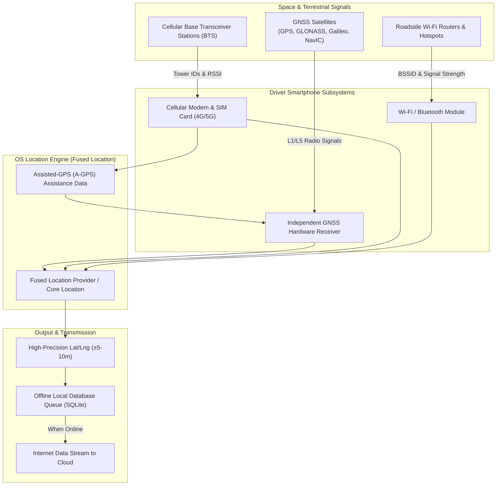
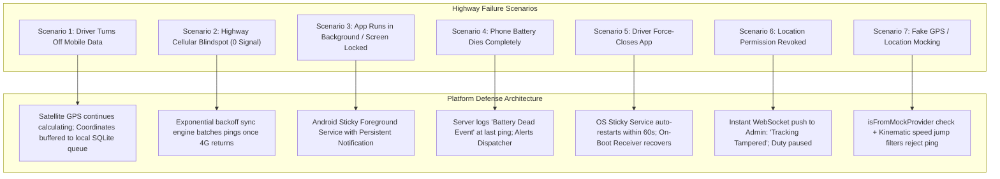
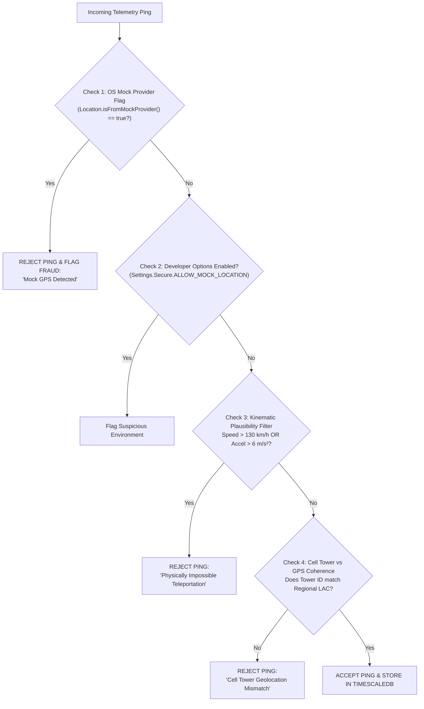

# 10. Technical Study: Smartphone-Based Fleet Tracking vs Dedicated GPS Hardware

**Document Version:** 1.0.0  
**Status:** Approved Technical Feasibility & Architecture Study  
**Core Objective:** Establish Zero-Capex, Highly Reliable Smartphone Geolocation with Resilient Offline Fallbacks and Anti-Fraud Guardrails  

---

## 1. Architectural Distinction: The 5 Geolocation & Connectivity Layers

To design a reliable vehicle tracking system without dedicated GPS hardware, we must demystify what "mobile tracking" actually entails. In the real world, **mobile network connectivity and satellite location tracking are completely independent physical systems**.



### The 5 Independent Layers

1. **Hardware Satellite GNSS (Pure Smartphone GPS):**
   - The phone's internal silicon receiver decodes radio signals directly from satellites in medium Earth orbit (US GPS, Russian GLONASS, EU Galileo, Indian NavIC).
   - **Crucial Fact:** Satellite GPS works **100% independently of mobile network data**. A smartphone in airplane mode with no SIM card can still calculate its exact latitude, longitude, speed, and heading anywhere on Earth with an open view of the sky.
2. **Network-Assisted GPS (A-GPS):**
   - Pure satellite acquisition ("cold start") can take 2 to 5 minutes to download satellite orbital parameters (almanac and ephemeris). A-GPS uses the mobile network to download these ephemeris files in 1.5 seconds over cellular internet, accelerating Time-To-First-Fix (TTFF) to under 3 seconds.
3. **Cellular Tower-Based Positioning (Cell ID Triangulation):**
   - When satellite signals are blocked (deep urban tunnels, indoor basements), the phone calculates its location based on the Cell IDs and signal strengths (RSSI) of surrounding cell towers.
   - **Limitation:** Extremely low accuracy ($\pm 200\text{ m}$ to $\pm 3\text{ km}$ on rural Indian highways where towers are kilometers apart). Unsuitable for highway speed or accurate mileage tracking.
4. **Internet Connectivity (4G/5G/GPRS Data):**
   - Internet connectivity **does not calculate location**; it is merely the transport pipeline that transmits coordinates from the smartphone to the cloud server.
5. **Dedicated Hardware Telematics (AIS-140 GPS Device):**
   - A dedicated microcontroller hardwired directly to the vehicle battery, featuring high-gain external patch antennas, industrial GNSS chips, internal flash memory, and an M2M eSIM.

---

## 2. Comprehensive Comparative Matrix

| Evaluation Dimension | 1. Smartphone Satellite GPS | 2. Cellular Tower Triangulation | 3. Hardwired Dedicated GPS (AIS-140) |
| :--- | :--- | :--- | :--- |
| **Typical Positional Accuracy** | **3 to 10 meters** (High precision) | **200 to 3,000 meters** (Very low) | **2.5 to 5 meters** (Highest precision) |
| **Speed & Bearing Calculation** | Direct Doppler shift ($\pm 0.5$ km/h) | Approximated / Inaccurate | Direct Doppler shift ($\pm 0.2$ km/h) |
| **Upfront Hardware Capex** | **₹0 (Zero)** | **₹0 (Zero)** | **₹4,500 to ₹8,000 per truck** |
| **Installation Friction** | **Instant (Driver installs app)** | Instant | 2 to 4 hours (Mechanic cuts wires) |
| **Battery Dependency** | Driver's phone battery (12–18% drain/shift) | Negligible | Vehicle 12V/24V lead-acid battery |
| **Susceptibility to Driver Action** | Medium (Driver can switch off phone) | High | Low (Hardwired, but wires can be cut) |
| **Highway Blindspot Behavior** | Continues tracking; buffers to SQLite | Fails completely | Continues tracking; buffers to flash |
| **Cold Start TTFF** | 3 to 15 seconds (with A-GPS) | Instantaneous | 5 to 30 seconds |

---

## 3. Deep Dive: Edge Cases & Real-World Highway Failure Modes

Operating on Indian highways presents aggressive environmental and human failure modes. Below is the precise failure mode and recovery architecture:



### Scenario 1: What happens when the driver turns off mobile data?
- **Behavior:** The smartphone's internal GNSS receiver continues receiving satellite radio signals without interruption. The app captures coordinates, velocity, and timestamps at 10-second intervals and stores them directly into the encrypted local SQLite database.
- **Result:** No data is lost. The live dashboard marks the vehicle as "Buffering Offline", and the instant the driver reconnects to data (or connects to roadside Wi-Fi), the entire accumulated trail streams to the server.

### Scenario 2: What happens when the phone loses cellular coverage?
- **Behavior:** Identical to Scenario 1. On national highway blindspots (e.g., forest corridors or ghat roads), satellite locks remain pristine. The local buffer caches up to 100,000 points (representing $>14$ days of continuous driving) without dropping a single coordinate.

### Scenario 3: What happens when the app runs in the background or screen is locked?
- **Android Architecture:** Standard apps are throttled by Android Doze Mode. To guarantee continuous tracking, the app initiates an **Android Foreground Service** with a non-dismissible persistent notification (`FOREGROUND_SERVICE_TYPE_LOCATION`) and acquires a partial `WakeLock`. This instructs the Android Linux kernel to exempt the process from CPU sleep and memory garbage collection.
- **iOS Architecture:** iOS handles background execution through `UIBackgroundModes = ["location"]`. When the driver starts duty, the app calls `locationManager.allowsBackgroundLocationUpdates = true` and `locationManager.showsBackgroundLocationIndicator = true`. This renders the familiar blue location pill in the iOS status bar, allowing continuous tracking even when the iPhone is locked.

### Scenario 4: What happens when the phone battery dies?
- **Behavior:** The app continuously monitors phone battery levels. When the battery drops to **15%**, the app dispatches a high-priority warning ping to the server: `BATTERY_CRITICAL_15%`. At **5%**, it dispatches `BATTERY_SHUTDOWN_IMMINENT` with the exact coordinate.
- **Fleet Dashboard Alert:** The owner sees: *"Murugan K's phone battery died at 04:12 PM on NH 48 near Vellore. Lorry was travelling at 52 km/h."* The driver cannot claim "the app crashed" when the battery clearly reached 0%.

### Scenario 5: What happens when the driver force-closes the application?
- **Android Behavior:** In modern Android, swiping an app away from the Recents menu stops standard activities, but a properly configured `Service` returning `START_STICKY` in `onStartCommand()` is automatically rescheduled and restarted by the Android OS within 30 to 90 seconds. Furthermore, a `BOOT_COMPLETED` broadcast receiver automatically resumes the service if the phone restarts.
- **Operational Policy:** If tracking stops abruptly without an "End Duty" action, the fleet dashboard immediately marks the vehicle with an orange flag: `UNEXPECTED_TRACKING_TERMINATION`.

### Scenario 6: What happens when the driver revokes location permissions?
- **Behavior:** An OS permission change instantly fires a callback (`onRequestPermissionsResult`). The app immediately sends a high-priority event to the backend: `PERMISSION_REVOKED_BY_USER` and displays a modal requiring permission restoration to continue the trip. The fleet owner receives an instant SMS and dashboard alert.

---

## 4. Anti-Fraud & Location Spoofing Prevention

Drivers may attempt to fake their location using third-party "Fake GPS" apps downloaded from the Play Store to simulate being on duty while resting at home. The platform enforces a multi-layered anti-fraud defense:



1. **Native OS Mock Check:** Utilizing `location.isFromMockProvider()` (API 18+) and `location.isMock()` (API 31+). Any coordinate originating from a mock location provider is instantly discarded and flagged as a disciplinary violation.
2. **Kinematic Plausibility Filter:** Commercial multi-axle lorries have defined physical kinematic limits. If two consecutive pings 10 seconds apart reflect a displacement of 2 kilometers (requiring an impossible velocity of $720\text{ km/h}$), the ping is rejected as a GPS jump.
3. **Dual Odometer Reconciliation:** At the end of every trip, the GPS-calculated path distance is cross-audited against the physical dashboard odometer photo. Even if a driver somehow fakes GPS coordinates, they cannot alter the mechanical odometer on the lorry's dashboard.

---

## 5. Dynamic Adaptive Sampling & Battery Conservation Algorithm

Continuous high-frequency GPS querying consumes significant battery. To achieve **all-day battery life (12+ hours)** on a standard 5000 mAh Android smartphone, the mobile engine implements a dynamic state-dependent sampling algorithm:

```mermaid
stateDiagram-v2
    [*] --> STATIONARY: App Starts / Speed = 0
    
    state STATIONARY {
        description: GPS queries every 5 minutes. Accelerometer monitors vibration.
    }
    
    STATIONARY --> MOVING: Accelerometer detects sustained movement (>30s)
    
    state MOVING {
        description: High-precision GPS queries every 10 seconds.
    }
    
    MOVING --> HIGHWAY_CRUISE: Speed > 45 km/h sustained (>2 min)
    
    state HIGHWAY_CRUISE {
        description: GPS queries every 15 seconds (reduces payload by 33%).
    }
    
    HIGHWAY_CRUISE --> MOVING: Speed drops < 45 km/h
    MOVING --> STATIONARY: Speed = 0 for > 5 consecutive minutes
```

- **Stationary State (Halt / Loading / Traffic Jam):** When the vehicle is stopped for $>5$ minutes, the high-power GNSS chip is put to sleep. A low-power hardware step/motion detector listens for movement. Telemetry heartbeats drop to once every 5 minutes.
- **Active City Transit ($5-45$ km/h):** High-precision sampling every 10 seconds to capture sharp turns, traffic halts, and city deliveries.
- **Highway Cruise ($>45$ km/h):** Straight-line trajectory sampling every 15 seconds, saving 33% battery and network bandwidth while maintaining pristine route fidelity.

---

## 6. Future Hardware Hybrid Evolution (AIS-140 Support)

While smartphone tracking is our zero-capex foundation, the platform architecture includes an **Abstract Telemetry Ingestion Layer**. 

For enterprise clients who eventually require dedicated hardware (e.g., refrigerated reefer temperature monitoring, electronic fuel tank cap sensors, or AIS-140 government compliance), the platform accepts standard TCP/UDP binary packets from hardware telematics devices (Concox, Teltonika, Coban) over port 5023, normalizing the data into the exact same database tables as the smartphone app.

