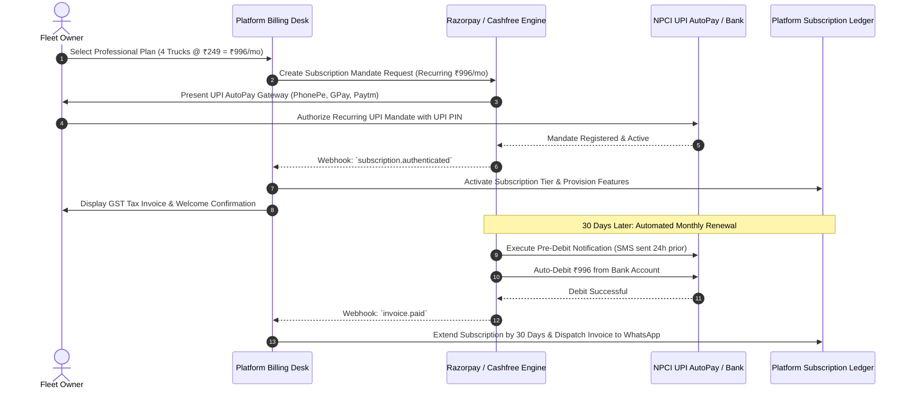
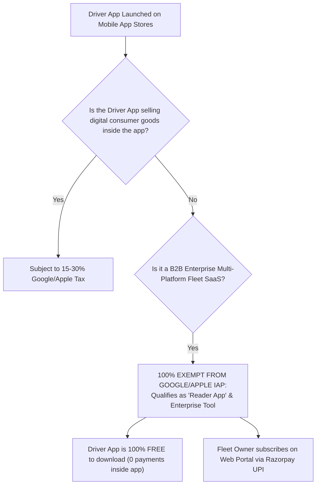

# 11. Monetization, Pricing Model & Payment Gateway Architecture

**Document Version:** 1.0.0  
**Status:** Approved Commercial Monetization Blueprint  
**Target Market:** India (INR ₹) & Regional Logistics Corridors  
**Primary Payment Engine:** Razorpay / Cashfree with UPI AutoPay & e-NACH Mandates  

---

## 1. Commercial Pricing Philosophy & Tiered Packaging

Commercial fleet operators in India are highly price-sensitive and resistant to rigid multi-year hardware contracts. Our commercial strategy employs a **Freemium & Tiered SaaS Model** anchored strictly on **per-active-vehicle monthly billing**, completely eliminating upfront hardware installation costs.

```mermaid
graph LR
    subgraph Tier1["FREE STARTER<br/>(₹0 / Forever)"]
        F1["1 Vehicle Lifetime"]
        F2["1 Driver Account"]
        F3["Live Smartphone Tracking"]
        F4["7-Day History"]
        F5["Document Expiry Reminders"]
    end

    subgraph Tier2["GROWTH (OWNER)<br/>(₹149 / vehicle / mo)"]
        G1["Up to 5 Vehicles"]
        G2["30-Day Trail History"]
        G3["Fuel & Expense Logging"]
        G4["Mileage Auditing"]
        G5["WhatsApp Alert Dispatch"]
    end

    subgraph Tier3["PROFESSIONAL FLEET<br/>(₹249 / vehicle / mo)"]
        P1["6 to 25 Vehicles"]
        P2["Unlimited History"]
        P3["Full Trip Lifecycle & POD"]
        P4["Preventive Maintenance"]
        P5["P&L per Lorry Analytics"]
        P6["GST Invoicing"]
    end

    subgraph Tier4["ENTERPRISE LOGISTICS<br/>(₹199 / vehicle / mo volume)"]
        E1["25+ Vehicles"]
        E2["Multi-Branch RBAC"]
        E3["FASTag Direct API Sync"]
        E4["E-Way Bill Auto Extension"]
        E5["ERP & Tally Integration"]
        E6["Dedicated Account Manager"]
    end

    Tier1 --> Tier2 --> Tier3 --> Tier4
```

### Detailed Pricing Comparison Matrix

| Commercial Feature | Starter (Free) | Growth (Small Owner) | Professional (Fleet) | Enterprise (Transport Co) |
| :--- | :--- | :--- | :--- | :--- |
| **Target Audience** | Single-truck owner-driver | 2 to 5 trucks (Owner-Operator) | 6 to 25 trucks (Transporter) | 26 to 500+ trucks (3PL / Fleet) |
| **Pricing (Monthly)** | **₹0 (Free Forever)** | **₹149 / vehicle / month** | **₹249 / vehicle / month** | **₹199 / vehicle / month** (Volume discount) |
| **Pricing (Annual - 20% Off)**| ₹0 | ₹1,430 / vehicle / year | ₹2,390 / vehicle / year | Custom Enterprise Agreement |
| **Upfront Hardware Capex** | **₹0** | **₹0** | **₹0** | **₹0** (Optional AIS-140 bridge) |
| **Supported Tracking Modes** | Mode A (Smartphone) & Mode E (FASTag) | Mode A, Mode D (LBS), Mode E (FASTag), Mode F (IVR) | All Modes (Smartphone, Hardwired BYOD, LBS, FASTag, IVR) | All Modes + AIS-140 MoRTH Compliance Sync |
| **Keypad Feature Phone (IVR/SMS)** | Basic SMS | Included (2 calls/day) | Included (4 calls/day) | Unlimited IVR & Telco LBS |
| **Hardware GPS Integration** | None | Add-on (₹50/mo) | Included (BYOD supported) | Included (Standard & AIS-140) |
| **Vehicle Limit** | Exactly 1 vehicle | Up to 5 vehicles | Up to 25 vehicles | Unlimited |
| **Tracking Retention** | 7 Days | 30 Days | 1 Year | Indefinite (Multi-year archival) |
| **Driver Assignment Handshake** | Basic Pairing | Full Dual-Handshake | Full Dual-Handshake | Multi-Driver Long-Haul Dispatch |
| **Fuel & Expense Auditing** | None | Manual Entry | Full OCR + Mileage Curve | FASTag Reconciliation + Anomaly Alerts |
| **Maintenance Module** | Basic reminders | Basic triggers | Digital Job Cards & Spares | Predictive Wear Analytics |
| **Commercial Invoicing** | None | None | GST-compliant e-Invoices | Reverse Charge (RCM) + Tally Bridge |
| **Branch Management** | Single Branch | Single Branch | Up to 3 Branches | Unlimited Hierarchical Branches |
| **Support SLA** | Community / FAQ | Email & In-App Chat | Priority WhatsApp Support | Dedicated Account Manager & 2h SLA |

---

## 2. Indian Payment Gateway & Automated Billing Architecture

Indian commercial transport businesses operate overwhelmingly on **UPI, IMPS, and Net Banking**. Credit card penetration among truck owners is under 4%. Therefore, the billing engine must be built around **UPI AutoPay (e-Mandate)** and **e-NACH**.

### Key Payment Capabilities:
1. **Automated GST Tax Invoicing:** Every subscription deduction automatically generates an IRN-compliant (Invoice Reference Number) GST tax invoice with the fleet company's GSTIN, calculating CGST (9%) + SGST (9%) or IGST (18%) based on state jurisdiction.
2. **Failed Payment & Dunning Management:**
   - If a monthly auto-debit fails (due to insufficient bank funds), the system does not abruptly lock the fleet out of tracking.
   - **Grace Period (7 Days):** Fleet operations continue without interruption for 7 days.
   - **Automated Retries:** System re-attempts debit on Day 2, Day 4, and Day 6 via Razorpay Smart Collect.
   - **Automated Alerts:** Dispatch of payment reminder links via WhatsApp and SMS directly to the owner.
   - If payment remains unpaid on Day 8, the account gracefully downgrades to the Free Starter Tier (retaining 1 vehicle tracking while pausing multi-vehicle dispatch).

---

## 3. App Store Compliance: Google Play & Apple App Store Billing Rules

A common pitfall for B2B SaaS applications is having their mobile apps rejected by Google Play or Apple for failing to use Google Play In-App Billing or Apple In-App Purchase (IAP), which levies a punitive **15% to 30% platform commission**.

### Detailed App Store Compliance Strategy

1. **Google Play Store Policy (Play Console Billing Exemption):**
   - Under Google Play Payments Policy Section 3, **enterprise business management software** and physical logistics operational tools where the mobile app serves as a client to an enterprise web system are **strictly exempt from Google Play Billing**.
   - Furthermore, the **Driver App is distributed completely free of charge**. Drivers do not pay any subscription or fee to download or use the app; the software is purchased at the organizational level by their employer (the transport company).
2. **Apple App Store Review Guidelines (Guideline 3.1.3(a) & 3.1.3(c) - Multiplatform Services):**
   - Apple explicitly permits apps that operate across multiple platforms (Web, Android, iOS) where accounts are created and subscriptions are managed on the web.
   - Our iOS App will feature no in-app digital purchasing buttons for subscriptions. Fleet owners manage their commercial billing exclusively through the Web Portal via secure domestic payment gateways (Razorpay/Cashfree).

