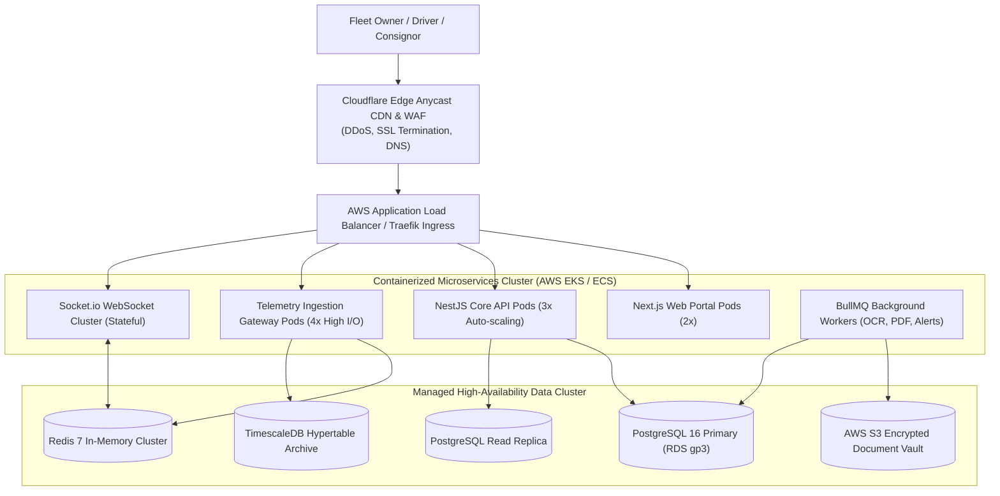
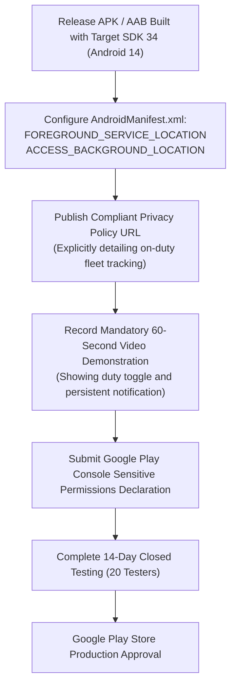
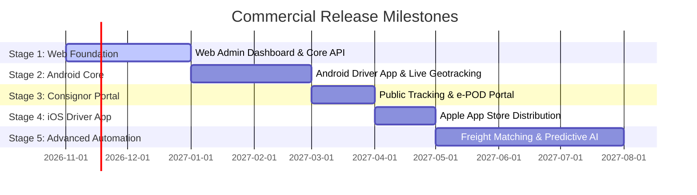

# 12. Deployment, Infrastructure & App Store Publishing Strategy

**Document Version:** 1.0.0  
**Status:** Approved DevOps & Store Distribution Blueprint  
**Primary Cloud Region:** AWS Mumbai (`ap-south-1`) / GCP Mumbai (`asia-south1`) for sub-25ms latency across India  
**Mobile Targets:** Google Play Store (Android) & Apple App Store (iOS)  

---

## 1. Cloud Infrastructure & Hosting Topology

To guarantee low latency for real-time tracking across India's logistics corridors, all core API, database, and telemetry ingestion pods are hosted within the **Mumbai cloud region**.



---

## 2. Web Application Deployment & Domain Infrastructure

1. **Domain Strategy:**
   - Primary Corporate Portal: `https://fleettracker.in` or `https://trackourvehicle.com`
   - Fleet Management SaaS Portal: `https://app.fleettracker.in`
   - Real-Time WebSocket Endpoint: `wss://ws.fleettracker.in`
   - Public Consignor Tracking Links: `https://track.fleettracker.in/t/{token}`
2. **DNS & Edge Network:**
   - Managed via Cloudflare Enterprise / Pro DNS.
   - Enforced DNSSEC, TLS 1.3, HSTS (Strict-Transport-Security with 1-year max-age).
   - Automatic WebP/AVIF image compression at the edge for uploaded fuel and document receipts.
3. **Database Backup & Disaster Recovery (DR):**
   - Automated continuous Write-Ahead Log (WAL) archiving to S3, enabling Point-In-Time-Recovery (PITR) down to the exact second.
   - Nightly cross-region encrypted snapshot replication to AWS Hyderabad (`ap-south-2`), ensuring business continuity against regional cloud outages.

---

## 3. Google Play Store Android Publishing & Background Location Approval

Publishing an app that tracks location in the background is subject to Google Play’s most rigorous privacy policies. Failing to properly prepare the required disclosures will result in instant app rejection.



### 3.1 Android Permission Declarations (`AndroidManifest.xml`)
```xml
<!-- Essential Geolocation & Service Permissions -->
<uses-permission android:name="android.permission.ACCESS_FINE_LOCATION" />
<uses-permission android:name="android.permission.ACCESS_COARSE_LOCATION" />
<uses-permission android:name="android.permission.ACCESS_BACKGROUND_LOCATION" />
<uses-permission android:name="android.permission.FOREGROUND_SERVICE" />
<uses-permission android:name="android.permission.FOREGROUND_SERVICE_LOCATION" />
<uses-permission android:name="android.permission.POST_NOTIFICATIONS" />
<uses-permission android:name="android.permission.WAKE_LOCK" />
<uses-permission android:name="android.permission.RECEIVE_BOOT_COMPLETED" />
```

### 3.2 The Google Play Background Location Approval Blueprint:
1. **The Prominent In-App Disclosure:** Before the driver is prompted for OS permissions, the app displays a full-screen, non-dismissible modal explaining:
   > *"Fleet Tracker collects location data to enable real-time trip tracking, fleet dispatch oversight, and consignee delivery estimation only while you are ON DUTY. Your location is NEVER collected when you are off duty."*
2. **The Video Demonstration Requirement:** Google requires a video demonstrating the user flow. We prepare a recorded video showing:
   - Driver tapping "Start Duty".
   - The persistent Android notification appearing in the notification shade: *"Fleet Tracker is sharing your trip location."*
   - Locking the phone screen and walking/driving, then showing the location successfully received on the Web Admin Dashboard.
3. **Mandatory 14-Day Closed Testing:** Android now requires new developer accounts to conduct a 14-day closed beta test with a minimum of 20 opt-in testers before production release. We use a pilot fleet of 25 commercial truck drivers in Tamil Nadu and Karnataka to satisfy this requirement.

---

## 4. Apple App Store Publishing & iOS Core Location Strategy

While 95% of Indian truck drivers use Android smartphones, fleet owners, managers, and enterprise drivers frequently use iPhones.

### 4.1 iOS Background Location Architecture (`Info.plist`)
```xml
<key>UIBackgroundModes</key>
<array>
    <string>location</string>
    <string>fetch</string>
    <string>remote-notification</string>
</array>
<key>NSLocationWhenInUseUsageDescription</key>
<string>Fleet Tracker requires your location to navigate routes and verify consignment deliveries.</string>
<key>NSLocationAlwaysAndWhenInUseUsageDescription</key>
<string>Fleet Tracker requires background location while you are on duty to share your live transit position with your fleet manager.</string>
```

### 4.2 Navigating Apple App Store Review:
1. **Human Interface Guidelines (HIG) Compliance:** The app must activate the standard iOS blue status bar location pill (`showsBackgroundLocationIndicator = true`), transparently showing that tracking is occurring.
2. **App Tracking Transparency (ATT):** Because the app does not sell driver data to advertising brokers, we do not require the invasive ATT tracking prompt, classifying data collection strictly under "App Functionality / Service Delivery".
3. **TestFlight Beta:** Prior to public release, the iOS driver and owner apps are distributed via Apple TestFlight to internal fleet stakeholders.

---

## 5. Phased Commercial Rollout Strategy

To optimize engineering resources and manage operational risk, the platform rolls out across **5 sequential stages**:



| Rollout Stage | Deliverables & Milestone Scope | Target Users | Estimated Cloud & Store Budget | Estimated Engineering Effort |
| :--- | :--- | :--- | :--- | :--- |
| **Stage 1: Web Admin Foundation** | - Multi-tenant backend, RBAC, Vehicle & Driver 360 profiles, Dual-handshake assignment UI, Document vault. | Fleet Owners & Dispatchers | \$150 / month (AWS RDS, ECS, S3) | 8 Sprints (16 Weeks) |
| **Stage 2: Android Driver App** | - React Native Android app, FusedLocation background service, offline SQLite buffer, Odometer camera capture. | Commercial Drivers | \$25 (One-time Google Play Console) + \$250/mo | 6 Sprints (12 Weeks) |
| **Stage 3: Customer Portal** | - Public tokenized tracking links (`/track/[token]`), digital sign-on-glass POD, SMS/WhatsApp dispatch gateway. | Shippers & Consignees | \$350 / month (Twilio / Gupshup WhatsApp API) | 4 Sprints (8 Weeks) |
| **Stage 4: iOS Driver App** | - iOS App Store build, TestFlight beta distribution, Apple CoreLocation optimization. | iPhone-equipped Drivers & Managers | \$99 / year (Apple Developer Program) | 4 Sprints (8 Weeks) |
| **Stage 5: Advanced Automation** | - Freight order matching, automated toll reconciliation, predictive maintenance, and Tally ERP bridges. | Enterprise Transport Enterprises | \$800+ / month (Scaled microservices) | 10 Sprints (20 Weeks) |

