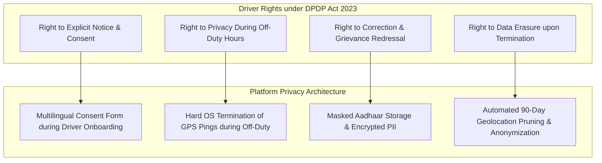
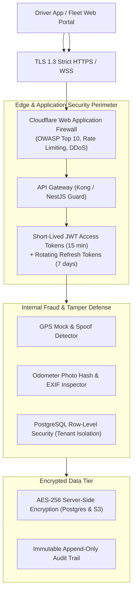
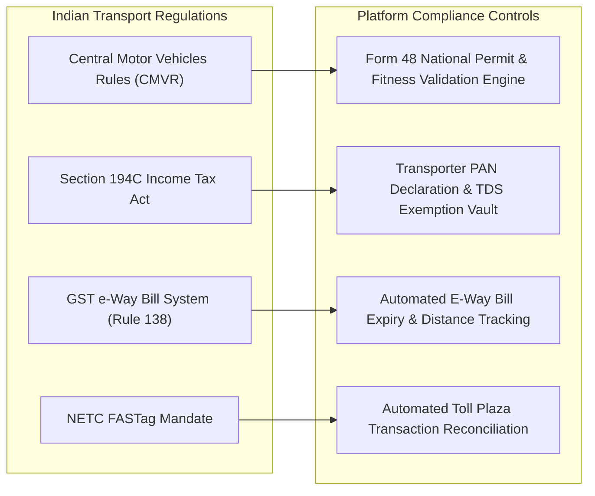

# 13. Security, Privacy & Statutory Regulatory Compliance

**Document Version:** 1.0.0  
**Status:** Approved Security & Legal Architecture Blueprint  
**Statutory Frameworks:** India DPDP Act 2023, IT Act 2000, Central Motor Vehicles Rules (CMVR), Section 194C Income Tax Act  

---

## 1. Compliance with the Digital Personal Data Protection Act (DPDP Act 2023)

In India, commercial fleet tracking intersects directly with personal privacy laws. Under the **Digital Personal Data Protection Act (DPDP Act 2023)**, commercial vehicle drivers are classified as **Data Principals**, while the transport enterprise and platform operator are **Data Fiduciaries**.

### 1.1 Four Non-Negotiable Privacy Mandates:
1. **Explicit Driver Consent Architecture:**
   - Drivers must be presented with an onboarding disclosure in their preferred vernacular language (Tamil, Hindi, Telugu, etc.) explicitly detailing what data is collected (GPS coordinates, speed, battery level), the exact business purpose (trip dispatch, route safety, customer delivery ETA), and retention duration.
2. **Strict Off-Duty Privacy Enclosure:**
   - Clandestine 24/7 employee tracking is illegal and creates hostile workplace friction. The application architecture ensures that the moment a driver taps **"End Duty"** or a trip is marked as completed, all background location listeners are terminated at the native OS layer. Fleet managers attempting to query an off-duty driver receive a `403 FORBIDDEN: DRIVER_OFF_DUTY` response.
3. **Aadhaar Masking & PII Security:**
   - In accordance with UIDAI regulations, full 12-digit Aadhaar numbers are **never stored** in plain text. The application stores only the last 4 digits (e.g., `XXXX-XXXX-1234`), while the identity document image stored in S3 has the first 8 digits automatically redacted/blacked out using edge image processing.
4. **Data Retention & Automated Pruning Policy:**
   - Raw 10-second GPS telemetry points are retained in hot TimescaleDB storage for **90 days**. After 90 days, telemetry is automatically downsampled into 1-minute aggregated points for 1 year, and raw breadcrumbs older than 1 year are permanently purged, retaining only trip-level summary statistics (total distance, duration, fuel consumed, POD signatures).

---

## 2. Platform Security Architecture & Threat Defense

### 2.1 Technical Security Controls

1. **Authentication & Token Lifecycles:**
   - **Drivers:** Passwordless, friction-free login via **Mobile Phone Number + 6-digit SMS OTP** verified via Firebase Auth / Twilio Verify. Session refresh tokens are cryptographically bound to the device's hardware Android ID / iOS Vendor Identifier.
   - **Fleet Owners & Staff:** Email / Phone + Password with mandatory **Two-Factor Authentication (2FA)** via Authenticator TOTP or SMS OTP for administrative actions (payout approvals, driver deletions). Access tokens expire in 15 minutes.
2. **API Protection & Rate Limiting:**
   - Rate limiting enforced at the API gateway:
     - Telemetry Ingestion Endpoint: Max 1 request per 8 seconds per active driver token.
     - Authentication Endpoints: Max 5 attempts per 15 minutes per IP address (brute-force defense).
     - Financial Export Endpoints: Max 10 requests per hour.
3. **Database Security & Encryption:**
   - **Data at Rest:** All PostgreSQL tables, TimescaleDB chunks, and S3 document buckets are encrypted using **AES-256** with AWS KMS customer-managed keys.
   - **Data in Transit:** Enforced **TLS 1.3** across all HTTP endpoints and WebSocket pipelines. Weak ciphers (SSLv3, TLS 1.0, TLS 1.1) are permanently rejected.
   - **SQL Injection Defense:** 100% parameterized queries via Prisma / TypeORM; zero dynamic string concatenation in SQL execution.
4. **Presigned Ephemeral S3 URLs:**
   - Document files (RC books, insurance certificates, signed delivery challans) are stored in private, non-public S3 buckets. Clients access documents exclusively via time-limited **presigned URLs that expire within 15 minutes**.

---

## 3. Commercial Transport Legal Compliance (Indian Regulatory Framework)

### 3.1 Key Regulatory Integrations:
1. **Income Tax Act Section 194C (Transporter TDS Exemption):**
   - In India, payments made to goods transport contractors are subject to Tax Deducted at Source (TDS). However, under Section 194C(6), if the transporter owns 10 or fewer commercial vehicles at any time during the financial year and furnishes a PAN declaration, **zero TDS is deductible**.
   - The platform includes a built-in **Section 194C Form Generator** that automatically collects and verifies the truck owner's PAN and fleet size certificate, generating compliant audit documents for corporate consignors.
2. **GST e-Way Bill Rule 138 Compliance:**
   - Under Indian GST laws, an e-Way Bill is valid for 1 day for every 200 km of travel for non-over-dimensional cargo. If a lorry is delayed on the highway due to breakdown or traffic, the e-Way Bill must be extended **within 8 hours before expiry or 8 hours after expiry**.
   - The platform continuously computes the remaining transit distance against the official e-Way Bill validity timestamp, automatically alerting the dispatcher 4 hours before expiry with a one-click extension request.
3. **Tamper-Evident Audit Logging:**
   - All critical actions (manual odometer corrections, driver reassignments, expense approvals, invoice deletions) write an immutable record to the `audit_logs` table containing: `user_id`, `client_ip`, `action_type`, `old_values_json`, `new_values_json`, and cryptographic hash chaining (SHA-256) preventing retroactive modification.

