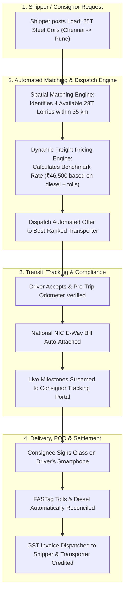
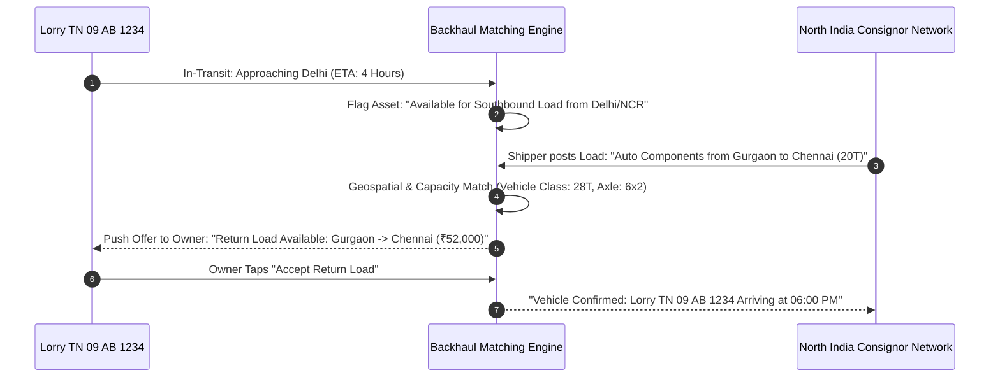
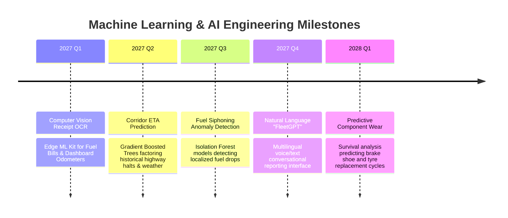

# 14. Future Automation, Freight Marketplace & AI Intelligence Roadmap

**Document Version:** 1.0.0  
**Status:** Approved Long-Term Innovation Roadmap  
**Scope:** Automated Freight Operations, Backhaul Marketplace & Pragmatic AI Applications  

---

## 1. Architectural Pragmatism: Where AI Shines vs. Where Deterministic Automation Wins

A common mistake in modern product architecture is forcing Machine Learning (AI) onto problems that are far better, faster, and more cheaply solved by **deterministic rule engines and APIs**. 

```mermaid
quadrantChart
    title Automation Technology Selection: Heuristics vs Machine Learning
    x-axis Low Pattern Complexity (Deterministic) --> High Pattern Complexity (Probabilistic)
    y-axis High Computational Cost (GPU/Model) --> Low Computational Cost (Standard CPU)
    quadrant-1 "Lightweight Heuristics & Math"
    quadrant-2 "Pragmatic Machine Learning"
    quadrant-3 "Deep Learning / Vision Models"
    quadrant-4 "Anti-Pattern (Overengineered AI)"
    "E-Way Bill Expiry Trigger": [0.15, 0.90]
    "FASTag Toll Route Cross-Match": [0.25, 0.85]
    "Odometer OCR Digit Extraction": [0.65, 0.40]
    "Fuel Theft Anomaly Detection": [0.75, 0.70]
    "Empty Return Backhaul Matching": [0.60, 0.80]
    "Predictive Tyre Wear Forecasting": [0.70, 0.65]
    "Natural Language Fleet Assistant": [0.90, 0.25]
    "Freight Rate Formula Engine": [0.20, 0.92]
```

### Technology Allocation Matrix

| Platform Capability | Recommended Technology | Why Heuristics / Deterministic Rules are Superior | Why Machine Learning (AI) is Superior |
| :--- | :--- | :--- | :--- |
| **Freight Rate Calculation** | **Deterministic Formula Engine** | Commercial freight rates follow defined mathematical matrices (Base Rate + Fuel Surcharge Index + Weight Brackets). Rules are 100% predictable, auditable, and sub-millisecond. | AI models create unpredictable pricing hallucinations that alienate shippers and truck owners. |
| **Statutory Document Reminders** | **Deterministic Cron Scheduler** | A document expiry date is an absolute scalar value ($T_{\text{expiry}} - T_{\text{current}} \le 30\text{ days}$). | Using AI for calendar reminders is gross overengineering. |
| **Fuel Theft & Siphoning Detection** | **Unsupervised Machine Learning (Isolation Forests / Z-Score)** | Simple threshold alerts trigger constant false alarms due to hilly terrain or heavy cargo. | ML clusters historical consumption patterns across specific highway corridors, factoring in cargo weight and elevation gradients to flag true fuel siphoning anomalies. |
| **Odometer & Fuel Slip OCR** | **Edge Vision AI (Apple Vision / ML Kit / Tesseract)** | Physical paper bills crumpled by highway drivers cannot be parsed with simple regex templates. | Convolutional OCR models extract amounts, litres, and dates from degraded receipts with $>94\%$ accuracy. |
| **Empty Return Backhaul Matching** | **Bipartite Graph Matching + Spatial Heuristics** | Direct spatial proximity and dimensional capacity constraints solve 90% of load matches instantly. | ML scores historical transporter reliability and pricing elasticity to rank the matches. |
| **Natural Language Fleet Assistant** | **Large Language Model (LLM) with Function Calling** | Free-form voice/text queries in Hindi or Tamil cannot be parsed by standard SQL query builders. | An LLM translates *"How much diesel did Murugan's lorry burn this week?"* into a structured database query. |

---

## 2. The Freight Business Operating Platform (Transport Business Automation)

Moving beyond vehicle tracking, the platform evolves into the primary operating system coordinating shippers, fleet owners, and drivers.



---

## 3. The Empty Backhaul (Return Load) Matching Marketplace

In India, **over 35% of commercial truck trips run empty on return legs**. A lorry carrying mangoes from Krishnagiri to Delhi often returns empty because the small owner has no local network in Delhi to secure return cargo.



### Marketplace Impact:
- **For the Lorry Owner:** Eliminates deadhead miles, converting what would have been a ₹35,000 diesel loss into a profitable return leg.
- **For the Shipper:** Access to verified, pre-screened commercial lorries with real-time tracking at competitive return-trip freight rates.
- **For the Platform:** Monetization via a **1.5% to 3% transaction facilitation fee** on matched freight freight value.

---

## 4. Advanced AI Implementations (Phased Innovation)



### 4.1 Predictive Maintenance (Survival Analysis & Wear Modeling)
- Rather than relying solely on static odometer milestones (e.g., "Change oil every 20,000 km"), the system trains a **Cox Proportional Hazards model** combining:
  1. Cumulative odometer distance.
  2. Operating environment (Highway cruising vs Severe city stop-and-go driving).
  3. Average payload weight carried over the preceding 90 days.
  4. Ambient operating temperatures.
- **Outcome:** Generates customized service alerts, warning the owner that lorry `AP 39 JK 7788` requires premature brake lining replacement due to heavy ghat-road transit.

### 4.2 Natural Language Fleet Intelligence ("FleetGPT")
- Fleet owners frequently struggle with complex reporting dashboards while on the move.
- The platform integrates a conversational AI assistant accessible via WhatsApp and mobile voice interface:
  - *Owner Voice Query (Tamil):* "சென்ற வாரம் முருகன் வண்டி எவ்வளவு டீசல் போட்டது?" (*How much diesel did Murugan's truck consume last week?*)
  - *System Action:* Speech-to-text converts voice to tokens; LLM maps intent to SQL function `get_driver_fuel_summary(driver_id='d1', date_range='last_week')`; compiles response.
  - *Voice Response:* "Murugan's lorry TN 09 AB 1234 filled 340 litres of diesel costing ₹31,960 across 2 refuels, averaging 3.7 km/L."

