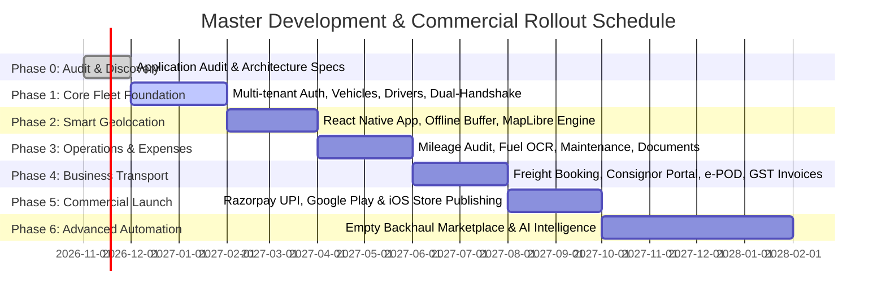

# 15. Complete Phased Development Roadmap & Engineering Blueprint

**Document Version:** 1.0.0  
**Status:** Approved Master Engineering Plan  
**Execution Model:** 2-Week Agile Sprints across 6 Execution Phases  
**Total Development Horizon:** 40 Sprints (80 Weeks to Full Maturity)  

---

## 1. Master Phase Roadmap Overview

---

## 2. Phase-by-Phase Detailed Specifications

---

### Phase 0: Existing Application Audit & Research (Completed)
- **Scope:** Deconstruction of existing mockups (`Main.dc.html`, `Driver.dc.html`), domain benchmarking, competitor dissection, and preparation of the 16 architectural blueprints.
- **Deliverables:** Complete 16-part documentation package in `/docs`.
- **Status:** **100% COMPLETE & VERIFIED.**

---

### Phase 1: Core Fleet Management & 360° Digital Profiles
*Establishing the enterprise multi-tenant backbone, identity system, and multi-channel resource pairing.*

| Dimension | Engineering Specification |
| :--- | :--- |
| **Features** | - Multi-tenant organization workspace with branch hierarchy. - JWT/Refresh token authentication with SMS OTP driver verification. - Role-Based Access Control (RBAC) enforcing 8 role profiles. - 360° Vehicle Profile management with technical specifications and document associations. - 360° Driver Profile management with KYC, Sarathi verification, and Communication Channel Preferences (Smartphone App vs Keypad Feature Phone). - Multi-Channel Dual-Handshake Assignment Engine (Push & WhatsApp for smartphone drivers; Automated Outbound IVR Call & Two-Way SMS for keypad drivers). - Tracking configuration setup per vehicle (active mode selection: Smartphone, Hardware GPS, LBS, FASTag, Manual). |
| **Dependencies** | Phase 0 architecture blueprints. |
| **Technical Requirements** | - NestJS backend with Fastify and TypeORM. - PostgreSQL 16 relational database with Row-Level Security. - Next.js 15 Web Portal with Tailwind CSS and Radix UI primitives. - Telephony Gateway integration (Exotel / Gupshup) for automated IVR outbound dispatch calls. |
| **Database Changes** | Migration `001_core_identity_and_assets.sql`: Tables `organizations`, `users`, `vehicles`, `drivers`, `assignments`, `tracking_configurations`, `driver_communication_preferences`. |
| **API Endpoints** | - `POST /api/v1/auth/otp/send`, `POST /api/v1/auth/otp/verify` - `GET, POST, PATCH /api/v1/vehicles`, `GET /api/v1/vehicles/:id` - `GET, POST, PATCH /api/v1/drivers`, `GET /api/v1/drivers/:id` - `POST /api/v1/assignments/dispatch`, `PATCH /api/v1/assignments/:id/handshake` - `POST /api/v1/telephony/ivr-callback` (Exotel/Gupshup webhook) |
| **UI Screens** | `SCR-W01` (Dashboard Skeleton), `SCR-W02` (Vehicle List), `SCR-W03` (Vehicle Profile), `SCR-W04` (Driver Directory), `SCR-W05` (Driver Profile), `SCR-W06` (Assignment Wizard with Communication Channel selector). |
| **Testing** | 85%+ Jest unit test coverage on assignment conflict resolution and IVR webhook handlers; Cypress E2E tests for vehicle onboarding. |
| **Risks & Mitigation** | *Risk:* Keypad phone drivers missing assignment calls. *Mitigation:* Multi-retry IVR scheduling (3 attempts spaced 5 min apart) with instant fallback to two-way SMS. |
| **Effort** | **6 Sprints (12 Weeks)** |
| **Acceptance Criteria** | 1. Owner can onboard 50 vehicles via CSV and select default tracking mode. 2. Smartphone driver receives push notification; Keypad driver receives automated IVR call within 3 seconds of assignment dispatch. 3. Driver pressing '1' on basic phone keypad activates vehicle assignment in production database. |

---

### Phase 2: Multi-Mode Tracking Engine & Ingestion Architecture
*Building the native driver app, hardware telematics socket gateway, and live multi-source map streaming.*

| Dimension | Engineering Specification |
| :--- | :--- |
| **Features** | - Cross-platform React Native Driver Mobile App with native Kotlin foreground service. - High-precision GPS tracking with adaptive sampling (10s moving / 5m stationary). - Offline-first embedded SQLite queue buffering pings during highway blindspots with gzip sync. - Hardware Telematics TCP Socket Gateway (Port 5023) parsing GT06 and Teltonika binary streams. - AIS-140 protocol parser for government-mandated commercial vehicles. - Telecom Cellular LBS Polling Worker querying 2G keypad phone tower locations. - FASTag NETC toll crossing webhook ingestion for zero-hardware highway corridor tracking. - Canonical Telemetry Normalizer emitting `UnifiedTrackingPing` with confidence scores. - Production MapLibre GL JS live map on web portal with source-specific marker styling. |
| **Dependencies** | Phase 1 (Auth, Assignment, and TrackingConfiguration entities). |
| **Technical Requirements** | - TimescaleDB hypertable for time-series location pings (`location_history`). - High-concurrency TCP socket listener in Go/NestJS on Port 5023. - Redis 7 cluster for live vehicle coordinate caching. - Socket.io WebSocket cluster for sub-1.5s map telemetry broadcasting. |
| **Database Changes** | Migration `002_telemetry_timescale.sql`: Hypertables `location_history`, `device_health_records`; tables `tracking_devices`, `device_assignments`, `tracking_mode_history`, `tracking_events`. |
| **API Endpoints** | - `POST /api/v1/telemetry/ingest` (Smartphone Gzip batch) - `TCP :5023` (Hardware GT06/Teltonika stream) - `POST /api/v1/integrations/fastag/webhook` - `POST /api/v1/integrations/telco-lbs/callback` - `WSS /socket.io` (Real-time unified telemetry channel) |
| **UI Screens** | `SCR-M01` (Driver Duty Dashboard), `SCR-M02` (Assignment Offer Modal), `SCR-W01` (Unified MapLibre Live Vector Map with mode-specific icons and confidence badges), Hardware Device Management Desk. |
| **Testing** | Emulated field tests with simulated network drops, mock GPS injections, and hardware GT06 packet replay. |
| **Risks & Mitigation** | *Risk:* High memory load from TCP socket connections. *Mitigation:* Decouple TCP socket termination into lightweight Go worker broadcasting to Redis Pub/Sub. |
| **Effort** | **8 Sprints (16 Weeks)** |
| **Acceptance Criteria** | 1. System concurrently streams positions from smartphone GPS, hardwired GT06 tracker, and FASTag toll crossing onto a single unified map. 2. Live map clearly distinguishes high-precision GPS (±5m) from approximate cell tower LBS (±2km). 3. External power cut on hardwired device triggers instant P0 alarm on fleet dashboard. |

---

### Phase 3: Operational Control, Fuel & Compliance Automation
*Transforming raw tracking into operational auditing, diesel monitoring, and document compliance.*

| Dimension | Engineering Specification |
| :--- | :--- |
| **Features** | - Dual distance reconciliation engine (Odometer Photo vs GPS Haversine distance). - Pre-trip and post-trip physical odometer camera capture with live watermarking. - Fuel expense logging with mobile camera OCR (extracting liters, amount, date). - Automated vehicle mileage curve calculation (km/L) with fuel siphoning drop alerts. - Statutory document compliance vault (RC, FC, Insurance, National Permit, PUC). - Automated expiry alerts (30, 15, and 3 days) via SMS, WhatsApp, and Web banners. - Preventive maintenance scheduler (odometer and time-based triggers) with digital job cards. |
| **Dependencies** | Phase 2 (Live and historical telemetry). |
| **Technical Requirements** | - AWS S3 / MinIO encrypted object storage with presigned URLs. - BullMQ background workers for asynchronous OCR processing and scheduled cron jobs. |
| **Database Changes** | Migration `003_operations_and_vault.sql`: Tables `odometer_readings`, `fuel_records`, `expenses`, `vehicle_documents`, `maintenance_records`. |
| **API Endpoints** | - `POST /api/v1/trips/:id/odometer` - `POST /api/v1/fuel/record`, `GET /api/v1/fuel/analytics/:vehicleId` - `POST /api/v1/documents/upload`, `GET /api/v1/documents/compliance-radar` - `POST /api/v1/maintenance/job-cards` |
| **UI Screens** | `SCR-M04` (Odometer Capture Viewfinder), `SCR-M06` (Fuel & Expense Logger), `SCR-W07` (Mileage Audit Table), `SCR-W08` (Fuel Inspector), `SCR-W09` (Maintenance Desk), `SCR-W10` (Compliance Vault). |
| **Testing** | OCR accuracy testing across 500 sample Indian petrol bunk receipts; cron trigger verification. |
| **Risks & Mitigation** | *Risk:* Blurry odometer photos submitted by drivers. *Mitigation:* In-app sharpness validation rejecting unfocused images before upload. |
| **Effort** | **6 Sprints (12 Weeks)** |
| **Acceptance Criteria** | 1. Odometer vs GPS discrepancy $>6\%$ triggers automated audit flag. 2. Fuel receipt OCR achieves $>90\%$ field extraction accuracy. 3. Expiry radar triggers automated WhatsApp reminder 30 days before insurance lapse. |

---

### Phase 4: Transport Business Automation & Consignor Portals
*Expanding beyond internal tracking into commercial freight operations, customer tracking, and billing.*

| Dimension | Engineering Specification |
| :--- | :--- |
| **Features** | - Transport order booking desk with origin/destination geofences and cargo specifications. - Dynamic freight rate calculator (per-tonne, fixed trip, per-km). - Public, tokenized live consignor tracking portal (`/track/[token]`) with dynamic ETA. - Digital Proof of Delivery (e-POD) with consignee touch signature and shortage logging. - Automated GST-compliant invoicing (Forward Charge vs Reverse Charge Mechanism - RCM). - Real-time Trip Profit & Loss (P&L) statement per individual lorry run. |
| **Dependencies** | Phase 3 (Fuel, expenses, and verified distance). |
| **Technical Requirements** | - Serverless edge rendering for public tracking links. - PDF generation microservice (Puppeteer/HTML-to-PDF) for invoices and e-POD receipts. |
| **Database Changes** | Migration `004_commercial_transport.sql`: Tables `customers`, `goods_orders`, `invoices`, `payments`. |
| **API Endpoints** | - `POST /api/v1/orders/create`, `GET /api/v1/orders/public-track/:token` - `POST /api/v1/trips/:id/pod-sign` - `POST /api/v1/invoices/generate`, `GET /api/v1/reports/pnl/:tripId` |
| **UI Screens** | `SCR-C01` (Public Tracking Link), `SCR-C02` (Order Booking), `SCR-M05` (Driver e-POD Sign-on-Glass), `SCR-W11` (Commercial Invoices & P&L Statement). |
| **Testing** | End-to-end simulation from order booking to customer payment reconciliation. |
| **Risks & Mitigation** | *Risk:* Consignees disputing POD signatures. *Mitigation:* Capture consignee phone number, GPS coordinates, and timestamp alongside signature image. |
| **Effort** | **6 Sprints (12 Weeks)** |
| **Acceptance Criteria** | 1. Customer receives public tracking link via WhatsApp immediately upon dispatch. 2. Consignee signs glass on driver phone; signed POD PDF arrives in customer inbox in $<10$ seconds. 3. Trip P&L statement correctly reflects gross freight minus diesel, tolls, and driver bata. |

---

### Phase 5: Commercial SaaS Monetization & App Store Launch
*Monetizing the platform via domestic payment gateways and publishing native store binaries.*

| Dimension | Engineering Specification |
| :--- | :--- |
| **Features** | - Freemium & Tiered SaaS subscription engine (Free Starter, Growth, Pro, Enterprise). - Razorpay / Cashfree integration supporting UPI AutoPay recurring e-mandates. - Automated monthly subscription invoicing with GST breakdown and dunning retries. - Android production binary build, Google Play Console sensitive permissions video submission. - iOS production binary build, Apple App Store Connect multiplatform service review. - Production DevOps: AWS Mumbai EKS cluster, Cloudflare WAF, Prometheus/Grafana monitoring. |
| **Dependencies** | Phases 1 through 4. |
| **Technical Requirements** | - Webhook ingestion cluster for payment gateway events. - React Native release signing keys, Google Play App Signing, Apple Developer Certificates. |
| **Database Changes** | Migration `005_subscriptions_and_billing.sql`: Table `subscriptions`, `payment_transactions`. |
| **API Endpoints** | - `POST /api/v1/billing/subscriptions/create-mandate` - `POST /api/v1/billing/webhooks/razorpay` - `GET /api/v1/billing/invoices` |
| **UI Screens** | Billing & Plan Selection Desk, Payment Checkout Modal, App Store Listing Assets. |
| **Testing** | 100% test coverage on webhook idempotency; PCI-DSS compliance verification. |
| **Risks & Mitigation** | *Risk:* Google Play rejecting background location. *Mitigation:* Follow exact disclosure blueprint and video demonstration prepared in Doc 12. |
| **Effort** | **6 Sprints (12 Weeks)** |
| **Acceptance Criteria** | 1. Fleet owner successfully authorizes ₹996/mo UPI AutoPay mandate on PhonePe. 2. Android Driver App approved and live on Google Play Store. 3. iOS App approved and live on Apple App Store. |

---

### Phase 6: Advanced Business Automation & Logistics Network
*Expanding into freight matching, empty return trip elimination, and AI predictive maintenance.*

| Dimension | Engineering Specification |
| :--- | :--- |
| **Features** | - Empty Backhaul Return Load Matching Marketplace. - NIC e-Way Bill direct API integration with automated validity extension warnings. - NETC FASTag direct API sync for real-time toll transaction auditing. - Machine learning fuel anomaly and theft detection models. - Multilingual Natural Language Fleet Assistant ("FleetGPT") for voice/text querying. |
| **Dependencies** | Phase 5 (Commercial operational scale). |
| **Technical Requirements** | - Python FastAPI machine learning microservice for isolation forest anomaly scoring. - LLM Function Calling pipeline for conversational database querying. |
| **Database Changes** | Migration `006_marketplace_and_ai.sql`: Tables `marketplace_loads`, `fastag_transactions`. |
| **API Endpoints** | - `POST /api/v1/marketplace/search-backhauls` - `POST /api/v1/integrations/ewaybill/extend` - `POST /api/v1/ai/assistant/query` |
| **UI Screens** | Return Load Exchange Desk, Marketplace Bidding Panel, Voice Assistant Mobile Widget. |
| **Testing** | Load testing with 100,000 simulated loads; model cross-validation. |
| **Risks & Mitigation** | *Risk:* Transporter disintermediation (dealing off-platform). *Mitigation:* Require digital POD and payment settlement through platform to guarantee freight payout. |
| **Effort** | **8 Sprints (16 Weeks)** |
| **Acceptance Criteria** | 1. System detects truck completing outbound run and suggests verified return load within 50 km. 2. Transporter asks voice question in Tamil and receives accurate vehicle diesel calculation. |

