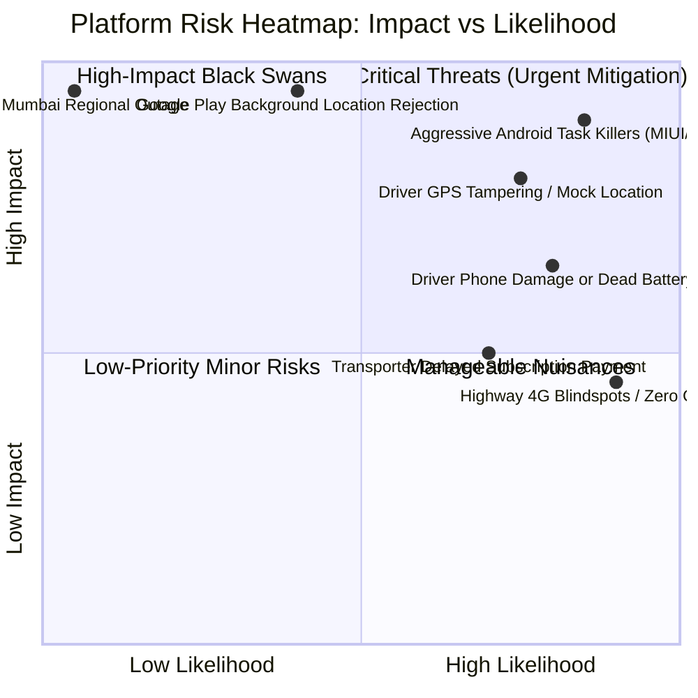

# 16. Technical Decisions, Risk Assessment & Critical Dependencies

**Document Version:** 1.0.0  
**Status:** Approved Engineering Decisions & Risk Management Blueprint  
**Contents:** Architecture Decision Records (ADRs), Risk Mitigation Matrix, External Dependencies  

---

## 1. Architecture Decision Records (ADRs)

---

### ADR-01: Modular Monolith vs. Distributed Microservices for Initial Scale

- **Context:** The platform encompasses multiple domains: Identity, Vehicles, Telemetry Ingestion, Trips, Expenses, Documents, and Billing. The team must decide between a microservices topology or a modular monolith.
- **Decision:** **Adopt a Modular Monolith in NestJS** with clearly decoupled bounded contexts, sharing a unified PostgreSQL/TimescaleDB cluster, with an isolated high-throughput worker for telemetry ingestion.
- **Justification:** Distributed microservices introduce significant network latency, distributed transaction complexity (Saga patterns), operational deployment overhead, and infrastructure costs. A modular monolith allows shared TypeScript interfaces, atomic transactions across trips and accounting, and rapid development velocity, while still allowing individual modules (like telemetry ingestion) to be split into standalone services if throughput demands dictate.
- **Status:** **APPROVED.**

---

### ADR-02: React Native (Expo Prebuild) vs. Flutter vs. Native Kotlin/Swift

- **Context:** Mobile application development requires support for Android and iOS with deep background geolocation capabilities and offline SQLite caching.
- **Decision:** **Adopt React Native with Expo Prebuild and a custom Native Android Foreground Service (Kotlin).**
- **Justification:** React Native enables $>80\%$ code sharing with the Next.js web application (TypeScript business logic, validation schemas, API clients, translation dictionaries). Custom native modules written in Kotlin provide direct, uncompromising control over Android `ForegroundService` and `FusedLocationProviderClient`. Flutter would require maintaining an entirely separate Dart codebase without web code sharing, while dual native apps would double engineering costs.
- **Status:** **APPROVED.**

---

### ADR-03: PostgreSQL (PostGIS + TimescaleDB) vs. NoSQL (MongoDB) for Telemetry

- **Context:** The system must store high-frequency time-series GPS pings alongside relational business entities (vehicles, drivers, invoices, payments).
- **Decision:** **Adopt PostgreSQL 16 with PostGIS 3.4 and TimescaleDB extension.**
- **Justification:** MongoDB lacks native multi-table ACID transactions, making financial accounting (P&L, fuel auditing, invoices) fragile. PostGIS is the gold standard for spatial calculations (`ST_DWithin`, `ST_Distance`). TimescaleDB converts standard PostgreSQL tables into automatic spatial-temporal "hypertables", providing 90% data compression, 10x faster query execution, and seamless SQL joins between trips and GPS breadcrumb trails without requiring a separate database cluster.
- **Status:** **APPROVED.**

---

### ADR-04: Smartphone-First Geolocation vs. Mandatory Hardware GPS

- **Context:** The market is dominated by legacy telematics requiring ₹4,500–₹8,000 upfront GPS hardware. The platform must decide whether to require hardware or lead with smartphone tracking.
- **Decision:** **Lead with Zero-Capex Smartphone Tracking, with an Abstract Ingestion Bridge for optional AIS-140 hardware.**
- **Justification:** Eliminating upfront hardware capital expenditures reduces onboarding time from 5 days to 2 minutes, removes field technician dependencies, and unlocks the 85% of Indian fleet owners who own fewer than 5 trucks. By adding an abstract telemetry ingestion adapter, enterprise fleets with existing hardware can still connect via standard protocols (TCP/UDP binary streams).
- **Status:** **APPROVED.**

---

### ADR-05: UPI AutoPay (e-Mandate) as the Primary Payment Channel

- **Context:** Traditional SaaS platforms rely on recurring credit card charges (Stripe). In Indian commercial transport, credit card adoption is under 4%.
- **Decision:** **Adopt Razorpay / Cashfree UPI AutoPay (e-Mandate) and e-NACH as the primary recurring billing engine.**
- **Justification:** UPI is ubiquitous across Indian small business owners and transport operators. UPI AutoPay allows automated recurring monthly debits with full customer authorization via their everyday banking apps (PhonePe, Google Pay, Paytm), eliminating manual invoice chasing and achieving $>92\%$ renewal success.
- **Status:** **APPROVED.**

---

## 2. Comprehensive Risk Assessment & Mitigation Matrix

### Detailed Risk Breakdown

| Risk Description | Category | Severity | Likelihood | Concrete Mitigation Architecture |
| :--- | :--- | :--- | :--- | :--- |
| **Aggressive OEM Battery Optimization** (Xiaomi MIUI, Oppo ColorOS, Vivo FunTouch aggressively killing background tracking apps) | Technical | **Critical** | **High** | 1. Implement persistent Android Foreground Service with non-dismissible notification. 2. Detect OEM manufacturer and guide driver through manufacturer-specific "Autostart" and "No Restrictions" battery settings modal during onboarding. 3. Implement `START_STICKY` service recovery and `RECEIVE_BOOT_COMPLETED` broadcast receiver. |
| **Driver Location Spoofing & Fraud** (Drivers using Fake GPS apps to fake being on duty) | Operational | **High** | **High** | 1. Query `Location.isFromMockProvider()` at the native OS layer and discard flagged pings. 2. Kinematic plausibility filter rejecting speed jumps $>130$ km/h. 3. Mandatory physical dashboard odometer photo capture at start and end of trip. |
| **Google Play Console Sensitive Permissions Rejection** | Regulatory | **Critical** | **Medium** | 1. Follow exact prominent disclosure modal rules. 2. Submit high-definition 60-second operational demonstration video showing transparent on-duty duty tracking. 3. Conduct mandatory 14-day closed beta testing with 20 real commercial drivers prior to production submission. |
| **Extended Highway Connectivity Blindspots** (Vehicles passing through ghats or remote mining zones with 0 cellular coverage) | Environmental | **Medium** | **High** | 1. Satellite GPS chips calculate coordinates without cellular signal. 2. Embedded SQLite buffer caches up to 100,000 points on the phone. 3. Automatic gzip compressed batch sync once network is restored. |
| **Driver Phone Battery Depletion During Active Trip** | Operational | **Medium** | **High** | 1. Implement dynamic adaptive sampling (10s moving / 5m stationary), capping total battery consumption at $<18\%$ per shift. 2. Transmit automated battery warning pings at 15% and 5% battery to alert fleet manager. 3. Provide low-cost 12V/24V high-speed cabin cigarette lighter chargers to pilot fleets. |
| **Customer Payment Default / Subscription Dunning** | Commercial | **Medium** | **Medium** | 1. Automated UPI AutoPay e-mandates with 24-hour pre-debit notifications. 2. 7-day grace period with multi-retry scheduling (Day 2, 4, 6) before downgrading to the Free Starter tier. |
| **Primary Cloud Infrastructure Failure (AWS Mumbai)** | Technical | **Critical** | **Low** | 1. Automated continuous PostgreSQL WAL streaming to cross-region S3 in AWS Hyderabad. 2. Infrastructure-as-Code (Terraform) scripts enabling complete cluster recreation in $<45$ minutes. |

---

## 3. Critical External Dependencies & Fallback Strategy

| External Dependency | Primary Vendor / Service | Critical Function | Failure Impact | Fallback / Redundancy Architecture |
| :--- | :--- | :--- | :--- | :--- |
| **SMS & OTP Gateway** | Gupshup / Twilio / MSG91 | Driver OTP login & critical SMS alerts | Drivers cannot log in; owners miss alerts | Multi-vendor failover: If Primary fails to deliver in 15s, route automatically through Secondary SMS gateway. WhatsApp OTP alternative. |
| **WhatsApp Business API** | Gupshup / Meta Cloud API | Document expiry reminders & customer tracking links | Alerts delayed | Fallback to standard SMS and in-app web push notifications. |
| **Map Vector Tiles & Geocoding** | MapLibre GL + OpenMapTiles / Stadia Maps | Live map rendering & reverse geocoding | Web dashboard map fails to render | Self-hosted MapLibre vector tile server hosted on Cloudflare edge CDN. |
| **Payment Gateway & AutoPay** | Razorpay / Cashfree | UPI AutoPay & subscription billing | Subscriptions cannot be processed | Dual-gateway integration with automated routing to Cashfree if Razorpay health drops $<98\%$. |
| **Government Parivahan APIs** | Parivahan Sarathi / Vahan (via Signzy / Karza) | Automated Driver Licence & RC verification | Manual verification required | Graceful fallback to manual document upload with OCR verification by admin. |

