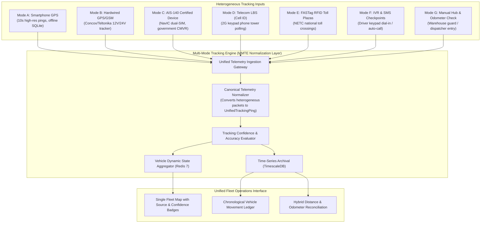
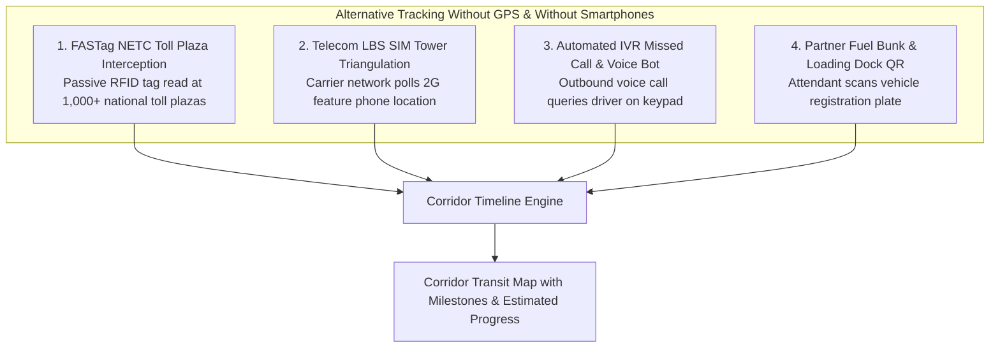
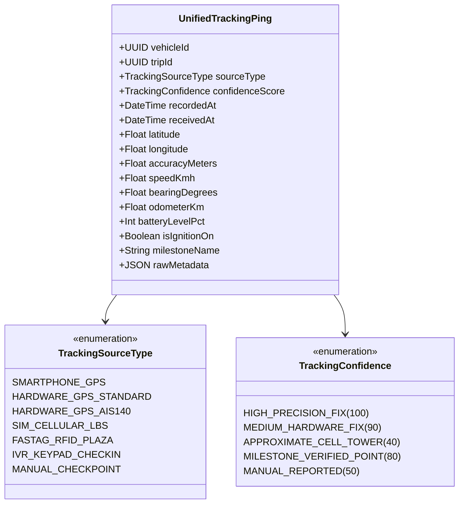
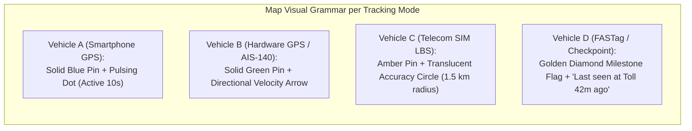

# 17. Multi-Mode Tracking Architecture: Unified Ingestion Engine

**Document Version:** 1.0.0  
**Status:** Approved Master Architecture  
**Core Architectural Innovation:** Decoupled, Multi-Source Telemetry Normalization Engine  
**Operational Scope:** Unifying Smartphone GPS, Hardwired GPS, AIS-140, Telecom LBS, FASTag RFID, IVR/SMS & Manual Checkpoints  

---

## 1. Problem Statement & Architectural Justification

Commercial road logistics in India spans extreme socioeconomic and operational diversity:
- **Vehicle Heterogeneity:** A single transport company may operate modern BharatBenz BS-VI trucks alongside 15-year-old Tata 1613 mechanical trucks, contracted market lorries, and sub-contracted container chassis.
- **Workforce Digital Divide:** While some drivers own modern 4G/5G smartphones, a substantial portion of commercial heavy vehicle drivers:
  1. Carry basic 2G keypad feature phones (Nokia 105, Samsung Guru, Itel).
  2. Experience battery exhaustion during 48-hour highway runs with limited in-cab charging options.
  3. Traverse remote network blindspots (ghats, mining corridors, forest tracts).
  4. Run out of prepaid cellular data or switch phones off during off-duty sleep periods.

> [!IMPORTANT]
> **Architectural Non-Negotiable:** Driver smartphone ownership must **never** be a prerequisite for registering an asset, assigning a driver, or tracking a vehicle. The platform must treat the **tracking data source as a dynamic, swappable plug-in per vehicle**, presenting a unified operational map to the fleet manager.



---

## 2. In-Depth Comparison of the 7 Tracking Modes

| Metric / Dimension | Mode A: Driver Smartphone GPS | Mode B: Dedicated Hardwired GPS | Mode C: AIS-140 Government Tracker | Mode D: Telecom SIM LBS (Cell ID) | Mode E: FASTag RFID Toll Plazas | Mode F: IVR & SMS Dial-In | Mode G: Manual Checkpoints |
| :--- | :--- | :--- | :--- | :--- | :--- | :--- | :--- |
| **Tracking Source** | Driver Android/iOS Phone | Vehicle Battery GPS Tracker | Certified AIS-140 Hardware | Telecom BTS Towers (2G) | NETC FASTag Plazas | Basic Keypad Phone | Human Hub Staff |
| **Positional Accuracy** | $\pm 5\text{ to }15\text{ meters}$ | $\pm 2.5\text{ to }5\text{ meters}$ | $\pm 2.5\text{ to }5\text{ meters}$ | $\pm 500\text{m to }3\text{ km}$ | Exact Plaza Coordinate | Town / Highway Name | Exact Geofence Gate |
| **Tracking Frequency** | Continuous (10s moving) | Continuous (10s moving) | Continuous (5–10s moving) | Periodic (Every 1–2 hours) | Event-Driven (Per toll gate) | Event-Driven (3–4 times/day) | Event-Driven (At docks) |
| **Hardware Upfront Cost**| **₹0 (Zero)** | ₹1,500 – ₹2,500 | ₹4,500 – ₹7,500 | **₹0 (Zero)** | **₹0 (Standard ₹100 tag)** | **₹0 (Zero)** | **₹0 (Zero)** |
| **Monthly Operating Cost**| Free / SaaS tier | ₹40 – ₹60 (M2M SIM) | ₹100 – ₹150 (Dual eSIM) | ₹30 – ₹60 (Telco API fees)| Free (Included in SaaS) | ₹20 – ₹40 (IVR mins/SMS) | Free |
| **Offline Capability** | High (Local SQLite queue) | High (Internal flash chip) | High (Internal flash memory)| None (Telco real-time)| Server buffer | Delayed manual record | Immediate manual log |
| **Power Dependency** | Driver phone battery | Vehicle 12V/24V battery | Vehicle battery + 4h backup | Driver basic phone | Completely Passive | Driver basic phone | None |
| **Tamper Vulnerability** | Driver can turn off phone | Driver can cut power wires | Tamper-proof enclosure | Driver can turn off phone | Tag tied to windshield | Human reporting bias | Human input error |
| **Driver Effort Required**| Low (Tap "Start Duty") | **Zero (Completely passive)**| **Zero (Completely passive)**| **Zero (Passive Telco polling)**| **Zero (Completely passive)**| Low (Answer IVR call) | Zero (Dock clerk logs) |
| **Target Fleet Segment** | Small owners, market trucks | Small/Medium Transporters | Hazardous, Interstate, Bus | Keypad-phone drivers | All Indian highway runs | Keypad-phone drivers | Rural unmapped routes |

---

## 3. Alternative Tracking Methods: Without GPS & Without Smartphones

A vital transport reality is tracking vehicles when **neither the driver has a smartphone nor does the lorry have an installed GPS tracker**. The platform provides three zero-hardware, zero-smartphone tracking alternatives:



### Method 1: FASTag NETC National Toll Plaza Interception
- **How it Works:** Every commercial vehicle in India is legally required to affix an active RFID FASTag on its front windshield. Over 1,000 National Highway and State Highway toll plazas are equipped with automated NETC transceivers.
- **The Telematics Bridge:** The platform connects directly to the NETC/NPCI aggregator API. When the truck passes through a toll plaza (e.g., *Sengurichi Toll Plaza on NH 45*), an instantaneous toll debit webhook fires.
- **Telemetry Generated:** Exact toll plaza GPS coordinates, plaza name, toll lane, vehicle class, and sub-second timestamp.
- **Accuracy & Value:** 100% reliable physical verification of the vehicle's position along national corridors without relying on any active electronics inside the vehicle.

### Method 2: Telecom Network-Based Location Services (LBS / SIM Tracking)
- **How it Works:** Commercial carriers (Airtel, Jio, Vodafone Idea) maintain real-time telemetry regarding which cellular Base Transceiver Station (BTS) tower a SIM card is connected to.
- **Driver Workflow:** During onboarding, the driver receives a one-time SMS: *"Bharath Swift Logistics requests your consent to share location for freight operations. Reply YES to accept."*
- **Operational Querying:** Once consented, the backend server initiates automated periodic queries (e.g., every 60 or 120 minutes) via telecom enterprise LBS APIs.
- **Accuracy:** $\pm 500\text{ meters}$ in urban clusters; $\pm 2\text{ to }4\text{ km}$ on rural highways. While unsuitable for corner-by-corner turn navigation, it provides positive confirmation of city boundaries, transit progress, and state border crossings for drivers using ₹1,200 basic keypad phones.

### Method 3: Automated IVR Interactive Keypad Check-Ins
- **How it Works:** The backend voice engine (Gupshup / Exotel / Twilio) initiates an automated outbound call to the driver's basic keypad phone at scheduled intervals (e.g., at 08:00 AM, 02:00 PM, and 08:00 PM):
  - *Automated Voice (Vernacular):* *"Vanakkam Murugan. This is Bharath Swift automated dispatch. Have you reached Krishnagiri? Press 1 for Yes, Press 2 if Delayed, Press 3 for Breakdown."*
  - *Driver Action:* Driver presses **'1'** on their Nokia keypad.
- **Telemetry Generated:** Verified driver checkpoint milestone, timestamp, and dialpad response code.

---

## 4. The Canonical Telemetry Normalization Engine

Regardless of whether telemetry originates from an iPhone 16 Pro running native satellite GPS, a Teltonika hardwired CAN-bus tracker, or an SMS gateway, the **Multi-Mode Tracking Engine normalizes every incoming packet into a unified data structure**.



### Canonical Data Schema: `UnifiedTrackingPing`
```typescript
export interface UnifiedTrackingPing {
  vehicleId: string;
  tripId?: string;
  driverId?: string;
  sourceType: 'SMARTPHONE_GPS' | 'HARDWARE_GPS_STANDARD' | 'HARDWARE_GPS_AIS140' | 'SIM_CELLULAR_LBS' | 'FASTAG_RFID_PLAZA' | 'IVR_KEYPAD_CHECKIN' | 'MANUAL_CHECKPOINT';
  confidenceScore: number; // 0 to 100
  recordedAt: Date;
  receivedAt: Date;
  latitude: number;
  longitude: number;
  accuracyMeters: number;
  speedKmh?: number;
  bearingDegrees?: number;
  odometerKm?: number;
  batteryLevelPct?: number;
  isIgnitionOn?: boolean;
  milestoneName?: string; // e.g. "Krishnagiri Toll Plaza", "Driver Voice Check-in"
  rawMetadata?: Record<string, any>;
}
```

---

## 5. Unified Live Map Display & Confidence Indicators

On the Fleet Owner Web Dashboard, all vehicles appear on a single, unified map view. However, the UI visually communicates the **tracking mode** and **confidence level** to avoid misleading the dispatcher:



### Visual Confidence Badges on the Fleet Map:
1. **Live Precision Satellite (Modes A, B, C):**
   - Marker: Solid green or blue directional truck icon with live velocity tag (`58 km/h`).
   - Inspector Badge: `● LIVE GPS · HIGH ACCURACY (±6m) · Reported 8s ago`.
2. **Cellular Approximate (Mode D - SIM LBS):**
   - Marker: Amber circular badge surrounded by a translucent radius circle illustrating the cell tower coverage area.
   - Inspector Badge: `▲ CELL TOWER LBS · APPROXIMATE (±1.8 km) · Polled 18m ago`.
3. **Milestone Waypoint (Modes E, F, G - FASTag / IVR / Manual):**
   - Marker: Golden diamond milestone icon anchored to the verified toll plaza or dock coordinate, with a dashed line projecting along the highway corridor.
   - Inspector Badge: `◆ FASTAG RFID CHECKPOINT · Sengurichi Toll Plaza · 34m ago`.

---

## 6. Dynamic Tracking Mode Switching & Historical Auditing

A vehicle's tracking mode is not fixed; it dynamically transitions across its operational lifecycle:
- *Example Lifecycle:*
  1. A lorry starts on **Mode B (Hardwired GPS)**.
  2. While in a remote workshop for repairs, the battery is disconnected $\rightarrow$ Fleet Manager switches the lorry to **Mode D (Driver SIM LBS)**.
  3. When an enterprise consignment requires government compliance, the owner equips the lorry with a portable **Mode C (AIS-140 unit)**.
  4. If the driver loses their phone, dispatch temporarily switches to **Mode E (FASTag toll monitoring)**.

All mode transitions are recorded in the `tracking_mode_history` table with timestamps, user IDs, reasons, and serial numbers, ensuring an unbroken chain of custody.

