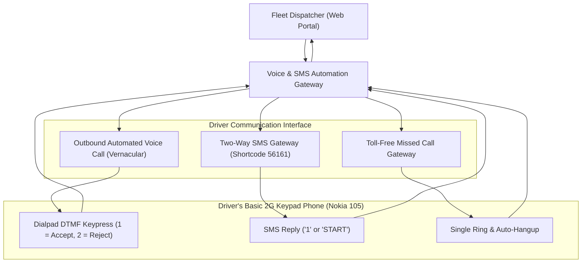
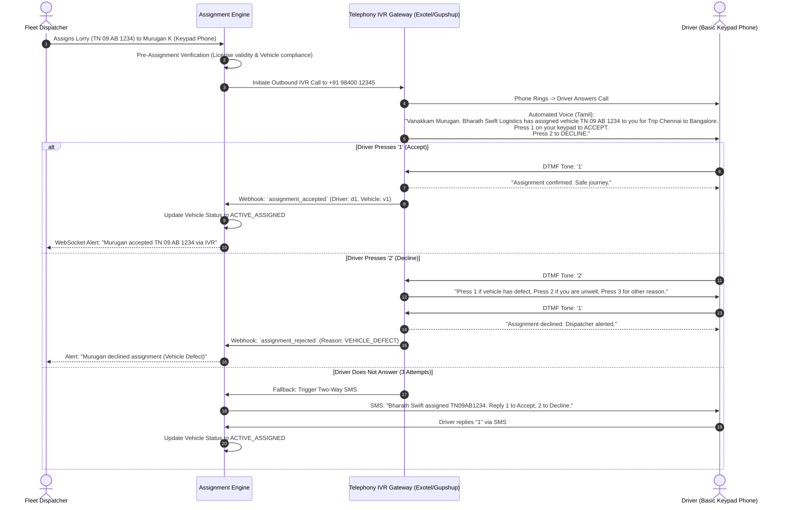
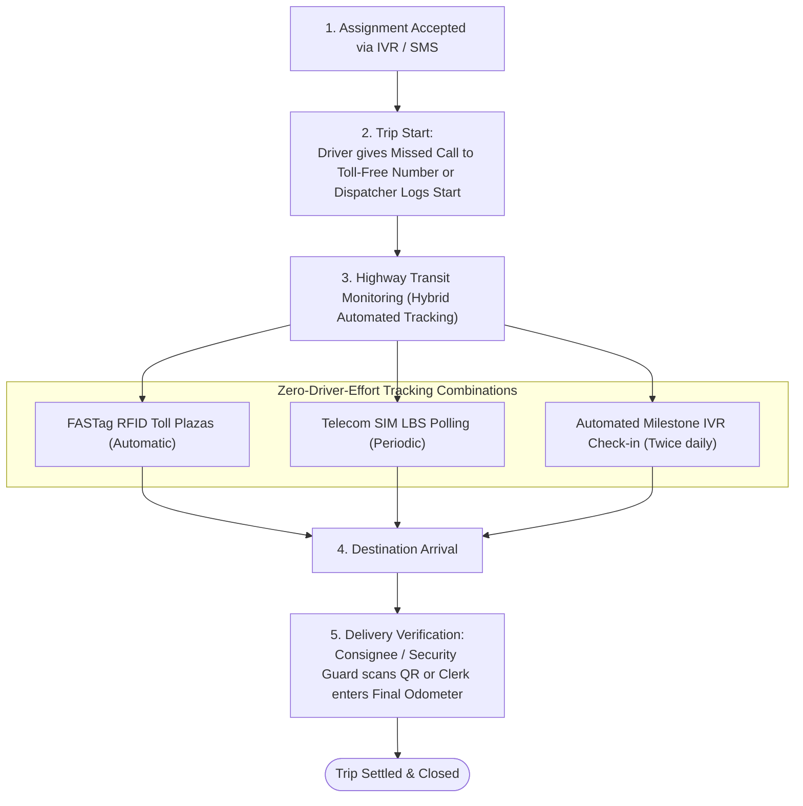
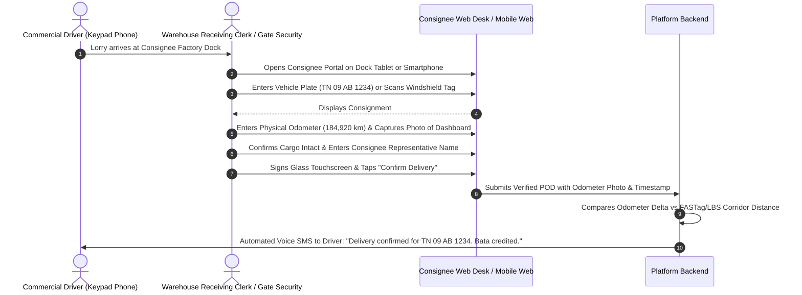
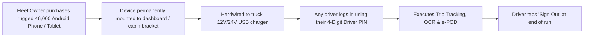

# 18. Smartphone-Less Driver Operational Workflows: SMS, IVR & Feature Phone Architecture

**Document Version:** 1.0.0  
**Status:** Approved Operational Specification  
**Target Workforce:** Commercial Heavy Vehicle Drivers with Basic 2G/3G Keypad Phones  
**Voice & Telephony Stack:** Exotel / Gupshup / Twilio Telephony Webhook Cluster  

---

## 1. Executive Summary & Workforce Accessibility Philosophy

Over **42% of interstate commercial truck drivers in India** rely primarily on basic keypad feature phones (Nokia 105, Samsung Guru, JioPhone, Lava) rather than smartphones, driven by:
1. Long battery endurance (5 to 7 days on a single charge vs 12 hours on a smartphone).
2. Resistance to physical highway drop damage and cabin vibrations.
3. Limited digital literacy and discomfort with multi-screen smartphone navigation.
4. Economic considerations (avoiding high upfront smartphone costs and recurring 4G data packs).

To ensure complete platform adoption, our architecture introduces **parallel operational workflows**: every critical touchpoint (Driver Onboarding, Vehicle Assignment, Trip Start, Checkpoint Reporting, Breakdown Logging, and Delivery Confirmation) operates seamlessly over **Interactive Voice Response (IVR), Automated Outbound Calling, and Two-Way SMS**, with zero smartphone dependency.

---

## 2. Driver Onboarding Without a Smartphone

When onboarding a driver who does not own a smartphone:
1. Fleet Manager enters driver's full legal name, basic mobile number (e.g., `+91 98400 12345`), Driving Licence number, and Preferred Dialect (Tamil, Hindi, Telugu, Kannada, Marathi, English).
2. In the driver profile, the manager toggles **Communication Channel:** `KEYPAD_FEATURE_PHONE (SMS / IVR)`.
3. The system dispatches an automated welcome voice call in the chosen dialect:
   > *"Vanakkam Murugan. You are registered with Bharath Swift Logistics on Fleet Tracker. You will receive trip assignments and updates by phone call and SMS."*

---

## 3. Dual-Handshake Assignment via IVR & SMS

The core dual-handshake assignment workflow functions with high reliability on basic keypad phones.

---

## 4. End-to-End Trip Lifecycle for Smartphone-Less Drivers

### 4.1 Trip Milestone Reporting Methods (No Smartphone Required)

1. **The Toll-Free Missed Call Gateway:**
   - Fleet company is assigned a dedicated virtual missed-call number (e.g., `1800-XXX-8899`).
   - When reaching designated highway hubs (e.g., crossing a state border or arriving at a transport nagar), the driver dials the number. The call auto-disconnects on the first ring (costing the driver ₹0).
   - The platform logs the timestamp, queries the telecom LBS API for the cell tower location, and registers a verified transit milestone.
2. **Automated Scheduled Milestone Calls (IVR Health Check):**
   - The platform initiates an automated 20-second call twice a day (e.g., 11:00 AM and 06:00 PM):
     > *"Vanakkam Murugan. Are you currently driving, stopped for food, or delayed? Press 1 for Driving, Press 2 for Meal Stop, Press 3 for Mechanical Delay."*
   - Driver presses **'1'** while driving or halted at a dhaba. The system updates the vehicle status without requiring complex data entry.
3. **Emergency SOS via Keypad Speed Dial:**
   - The driver programmatically stores the fleet emergency shortcode as **Speed Dial '9'** on their keypad phone.
   - Long-pressing '9' initiates an instant high-priority distress webhook, broadcasting an automated voice alarm to the fleet controller desk.

---

## 5. Physical Odometer & Delivery Verification (Without Driver Smartphone)

Because a driver with a basic keypad phone cannot capture high-resolution odometer photographs or collect digital touch signatures on a screen, the platform introduces **Collaborative Third-Party Verification**:

### The Three Operational Options:
- **Option A (Dock Clerk / Consignee):** The destination warehouse clerk opens the public delivery verification link sent to them, inspects the physical lorry odometer, takes a photo on their dock device, and signs the delivery receipt.
- **Option B (Branch Hub Dispatcher):** If delivering at a company transshipment hub, the local branch clerk conducts the physical pre-trip and post-trip vehicle inspection.
- **Option C (SMS Self-Declaration):** In remote unloading yards without dock terminals, the driver sends an SMS: `ODO 184920` from their registered phone number. The record is flagged as `PENDING_AUDIT` until physical paper challans are audited at the central office.

---

## 6. The Shared In-Cab "Company Smartphone" Model

For fleet operators who desire the rich capabilities of the Driver Mobile App (continuous satellite GPS, camera odometer capture, digital POD) but whose drivers do not own personal smartphones, the platform supports the **Shared Cabin Tablet / Smartphone Model**:

### Key Architectural Safeguards for Shared In-Cab Devices:
1. **Kiosk Lock Mode (Android Dedicated Device):**
   - The device is locked into single-app Kiosk Mode using Android Enterprise Device Owner policies (`setLockTaskPackages`).
   - Drivers cannot install third-party games, browse YouTube, or tamper with system settings.
2. **Fast PIN-Based Session Switching:**
   - Drivers do not need to remember complex passwords or receive SMS OTPs on the cabin device. They enter their 4-digit personal driver PIN, which loads their profile, dialect, and assigned trip in 2 seconds.
3. **Anti-Theft Hardwiring:**
   - The device is housed in a lockable dashboard cradle connected directly to the vehicle auxiliary circuit, ensuring continuous charging while preventing device removal from the cabin.

