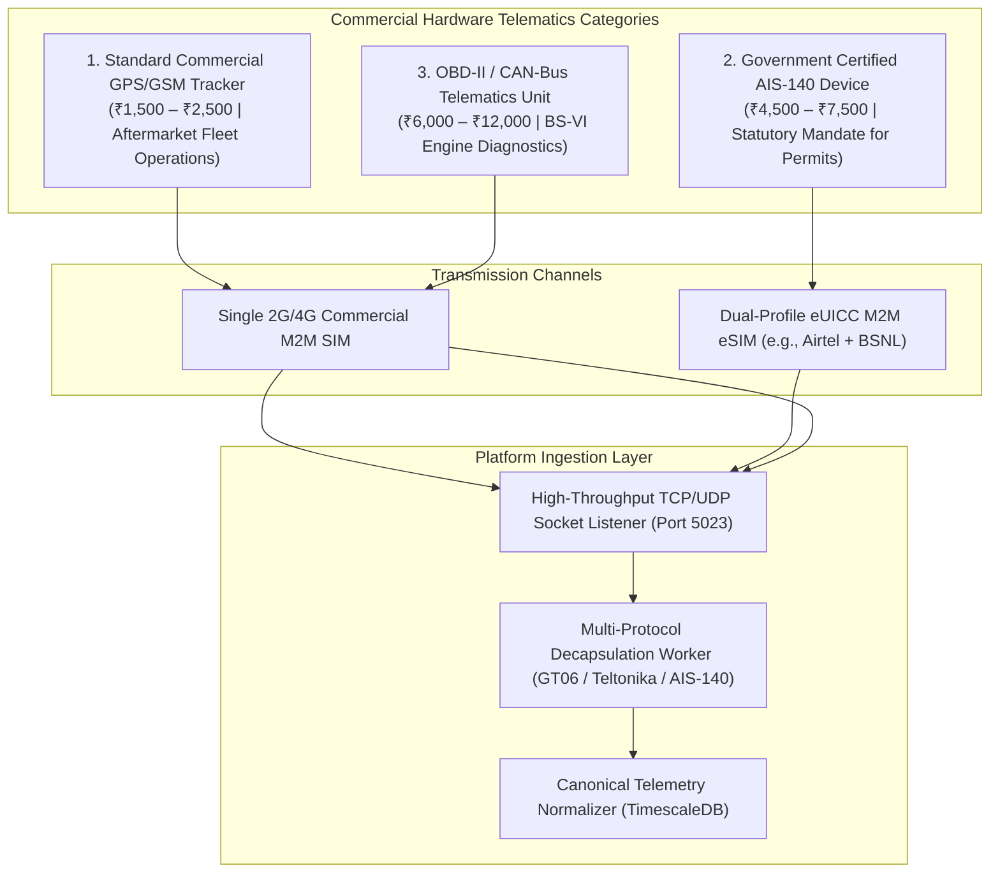
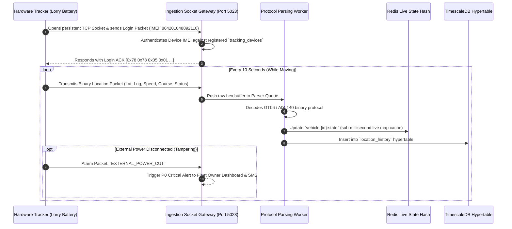
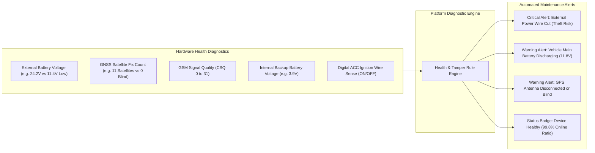

# 19. Hardware Telematics, AIS-140 Certification & Protocol Ingestion Architecture

**Document Version:** 1.0.0  
**Status:** Approved Hardware Engineering Specification  
**Focus:** Indian Telematics Market, AIS-140 Standards, Protocol Parsing & Health Monitoring  
**Target Protocols:** GT06 / Jimi IoT, Teltonika Codec 8/12, AIS-140 (MoRTH Protocol)  

---

## 1. Hardware Landscape: Standard GPS vs AIS-140 Certified Devices

While our primary platform innovation eliminates mandatory hardware via smartphone tracking, commercial fleet operators frequently require hardware telematics for 24/7 continuous ignition monitoring, vehicle immobilization, or statutory regulatory compliance.



---

## 2. In-Depth Breakdown: Standard GPS vs. AIS-140 Certified Hardware

### 2.1 Standard Commercial GPS/GSM Trackers
- **Target Vehicles:** Private trucks, intermediate commercial vehicles (LCVs), small fleet operators seeking continuous tracking without statutory filing.
- **Popular Indian Market Models:** Concox / Jimi IoT (GV40, GT06N, WeTrack2), Teltonika (FMB920, FMB120), Coban (TK103B), Micrologic.
- **Hardware Pricing:** **₹1,500 to ₹2,500 per device** (wholesale price in Delhi/Vashi transport nagars).
- **Physical Installation:**
  - Standard 4-wire loom connected behind the lorry dashboard:
    1. Red wire: Permanent $+12\text{V} / +24\text{V}$ battery terminal.
    2. Black wire: Ground chassis terminal.
    3. Orange wire: Ignition switch sense ($ACC$).
    4. Yellow wire: Relay trigger for remote engine cut-off/immobilization.
  - Installation time: 45 minutes by a commercial vehicle auto-electrician (cost: ₹300–₹500).
- **Communication Protocol:** Binary or ASCII stream over TCP/UDP (GT06 protocol or Teltonika Codec 8).

---

### 2.2 AIS-140 Government Certified Telematics
- **Statutory Mandate:** Formulated by the Automotive Research Association of India (ARAI) and mandated by the Ministry of Road Transport and Highways (MoRTH) under **Rule 125H of the Central Motor Vehicles Rules (CMVR)**.
- **Applicable Vehicle Classes:**
  1. All public service passenger vehicles (buses, tourist taxis).
  2. All commercial goods vehicles operating under **National Permits (Form 48)**.
  3. All hazardous cargo tankers (petroleum, chemical, cryogenic LNG carriers).
  4. Mining dumpers and interstate tippers in designated states.
- **Mandatory Technical Requirements (AIS-140 Standard):**
  - **Dual Constellation GNSS:** Must support India's indigenous **NavIC (IRNSS)** constellation in addition to US GPS.
  - **Dual Network eUICC (Embedded SIM):** Soldered M2M chip supporting two independent telecom providers (typically Airtel + BSNL / Vi) with automated OTA network fallback.
  - **Internal Backup Battery:** Minimum 450 mAh Li-ion battery providing $\ge 4\text{ hours}$ of autonomous tracking if vehicle battery is disconnected.
  - **Physical Panic Buttons (SOS):** Minimum 2 hardwired emergency buttons inside the cabin (1 for driver, 1 for co-driver) that broadcast immediate emergency packets to the State Emergency Response System (ERSS - Dial 112) and the national Vahan backend.
  - **Rugged Enclosure:** IP67 waterproof and dustproof casing resistant to high engine bay temperatures (up to $85^\circ\text{C}$).
- **Approved Hardware Suppliers:** Pricol, Rosmerta Technologies, Minda iConnect, WheelsEye AIS-140, Arya Omnitalk, Sensel Telematics.
- **Pricing:** **₹4,500 to ₹7,500 per device**, plus ₹1,200/year for government-compliant dual-SIM connectivity and ARAI certificate generation.

---

## 3. High-Throughput Hardware Protocol Parsing Architecture

To ingest telemetry from diverse hardware devices without bottlenecking the application server, the platform deploys a dedicated **Hardware Ingestion Gateway** written in NestJS / Go that terminates TCP socket connections on Port 5023.



### 3.1 GT06 Protocol Parser Implementation Pattern
```typescript
export class GT06ProtocolParser {
  // Protocol Header: 0x78 0x78 (Standard) or 0x79 0x79 (Extended)
  public static parseLocationPacket(buffer: Buffer): UnifiedTrackingPing | null {
    if (buffer.readUInt16BE(0) !== 0x7878 && buffer.readUInt16BE(0) !== 0x7979) {
      return null; // Invalid GT06 header
    }

    const length = buffer.readUInt8(2);
    const protocolNumber = buffer.readUInt8(3);

    if (protocolNumber === 0x12 || protocolNumber === 0x22) { // GPS Location Packet
      // Extract DateTime (Year, Month, Day, Hour, Min, Sec)
      const year = 2000 + buffer.readUInt8(4);
      const month = buffer.readUInt8(5) - 1;
      const day = buffer.readUInt8(6);
      const hour = buffer.readUInt8(7);
      const min = buffer.readUInt8(8);
      const sec = buffer.readUInt8(9);
      const recordedAt = new Date(Date.UTC(year, month, day, hour, min, sec));

      // Extract GPS Coordinate Bitfields (GT06 packed coordinates)
      const rawLat = buffer.readUInt32BE(11);
      const rawLng = buffer.readUInt32BE(15);
      const latitude = (rawLat / 1800000.0) * (buffer.readUInt8(20) & 0x04 ? 1 : -1);
      const longitude = (rawLng / 1800000.0) * (buffer.readUInt8(20) & 0x08 ? 1 : -1);
      const speedKmh = buffer.readUInt8(19);

      return {
        sourceType: 'HARDWARE_GPS_STANDARD',
        confidenceScore: 90,
        recordedAt,
        receivedAt: new Date(),
        latitude,
        longitude,
        speedKmh,
        accuracyMeters: 5.0,
      } as UnifiedTrackingPing;
    }
    return null;
  }
}
```

---

## 4. Hardware Health, Diagnostics & Anti-Tampering Monitoring

A critical failure point in physical fleet telematics is **unnoticed device failure** (blown fuses, cut antennas, dead internal batteries). The platform includes a dedicated **Device Health Monitor** that continuously tracks hardware telemetry:



### Automated Diagnostic Rules:
1. **Power Cut Alarm (`ALARM_POWER_CUT`):** When a driver or mechanic unplugs the tracker from the truck battery, the device switches to its internal backup battery and transmits a distress packet. The dashboard triggers an audio siren: *"External power disconnected on TN 09 AB 1234."*
2. **Vehicle Battery Drain Prevention:** If a truck is parked in a depot for $>7$ days, standard trackers can drain the vehicle's lead-acid battery. The device monitor detects battery voltage dropping below $12.1\text{V}$ ($24.2\text{V}$ on dual-battery trucks) and automatically commands the hardware to enter ultra-low-power **Deep Sleep Mode** via downlink SMS/TCP command.
3. **Satellite Signal Blindness:** If a device reports $0$ connected satellites for $>30$ minutes while the ignition is ON, the system flags a "GPS Antenna Disconnection / Fault" work order.

