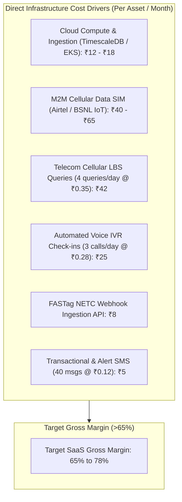
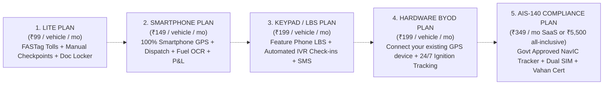

# 20. Multi-Mode Tracking Unit Economics, Operational Costs & Commercial Pricing

**Document Version:** 1.0.0  
**Status:** Approved Commercial Financial Model  
**Market Currency:** Indian Rupee (INR ₹)  
**Target Audience:** Small Lorry Owners (1-5 trucks), Fleet Operators (6-25 trucks), Large Enterprises (26-500+ trucks)  

---

## 1. Unit Cost Analysis across All 7 Tracking Modes

A sustainable commercial fleet management platform must align its software pricing with the underlying infrastructure costs of data ingestion, telecom gateways, and hardware logistics.



### Detailed Side-by-Side Cost Breakdown (Per Vehicle / Month)

| Cost Component | Mode A: Driver Smartphone GPS | Mode B: Hardwired GPS (BYOD) | Mode C: AIS-140 Certified Tracker | Mode D: Keypad Phone Telecom LBS | Mode E: FASTag & Manual Checkpoint |
| :--- | :--- | :--- | :--- | :--- | :--- |
| **Initial Upfront Hardware** | **₹0 (Zero)** | ₹1,500 – ₹2,200 | ₹4,500 – ₹6,500 | **₹0 (Zero)** | **₹0 (Zero)** |
| **Installation & Technician**| **₹0 (Self-serve)** | ₹300 – ₹400 | ₹500 – ₹700 (Cert upload)| **₹0 (Self-serve)** | **₹0 (Zero)** |
| **M2M SIM / Data Cost** | ₹0 (Uses phone plan)| ₹45 / month (Airtel M2M) | ₹95 / month (Dual eSIM) | ₹0 | ₹0 |
| **Telco LBS / API Queries** | ₹0 | ₹0 | ₹0 | ₹42 / month (4/day) | ₹0 |
| **IVR Minutes & Voice Bot** | ₹0 | ₹0 | ₹0 | ₹25 / month (Outbound) | ₹0 |
| **FASTag NETC Ingestion** | ₹8 / month | ₹8 / month | ₹8 / month | ₹8 / month | ₹8 / month |
| **Cloud Compute & Storage** | ₹14 / month | ₹14 / month | ₹18 / month | ₹8 / month | ₹6 / month |
| **Total Platform Direct COGS**| **₹22 / month** | **₹67 / month** | **₹121 / month** | **₹83 / month** | **₹14 / month** |
| **Target Retail SaaS Price** | **₹149 / month** | **₹199 / month** | **₹349 / month** | **₹199 / month** | **₹99 / month** |
| **Platform Gross Profit Margin**| **85.2%** | **66.3%** | **65.3%** | **58.3%** | **85.8%** |

---

## 2. Multi-Mode SaaS Subscription Packaging

To prevent confusion and eliminate double-charging, the platform offers modular subscription tiers based on the **primary tracking mode configured for each vehicle**:



### 2.1 The "Bring Your Own Device" (BYOD) SaaS Opportunity
Over 2 million commercial trucks in India already possess an installed GPS tracker from a defunct vendor or a dealer fitment. However, owners are dissatisfied with poor software, slow mobile apps, or lack of accounting.
- **The BYOD Offer:** The owner pays **₹199 / vehicle / month**. Our software simply points their existing device's IP/DNS to `track.fleettracker.in:5023`. The owner immediately unlocks our modern Next.js web portal, P&L reporting, driver assignment engine, and fuel tracking without buying new hardware.

---

## 3. Unit Economics & Fleet Owner ROI Analysis

Small fleet operators do not purchase software based on technology buzzwords; they purchase software strictly if it **saves them more money than it costs**.

### Financial Return on Investment (ROI) for a 4-Lorry Fleet Operator

```
+-----------------------------------------------------------------------+
|  MONTHLY COST vs SAVINGS (4 Heavy Commercial Vehicles · Multi-Axle)   |
+-----------------------------------------------------------------------+
|  Platform Subscription Cost:                                          |
|  - 4 Lorries @ ₹149/mo (Smartphone Plan)                = (-) ₹596    |
|                                                                       |
|  Proven Monthly Operational Savings Generated:                        |
|  1. Diesel Theft Prevention & Mileage Anomaly Auditing:               |
|     (4 trucks · 8,000 km/mo · 1.5% fuel efficiency gain)  = (+) ₹14,400 |
|  2. Elimination of Speeds > 65 km/h & Tyre Wear:        = (+) ₹4,800  |
|  3. Avoidance of RTO Late Penalties (FC / Insurance):   = (+) ₹2,500  |
|  4. FASTag Toll Misuse & Unauthorized Route Detours:    = (+) ₹3,200  |
+-----------------------------------------------------------------------+
|  NET MONTHLY CASH BENEFIT TO FLEET OWNER:               = (+) ₹24,304 |
|  RETURN ON INVESTMENT (ROI) RATIO:                      = 40.7x       |
+-----------------------------------------------------------------------+
```

---

## 4. Hardware Sourcing & Distribution Strategy (India)

When customers request physical hardware, the platform operates a **Capital-Light Hardware Fulfillment Model**:

1. **Strategic OEM Partnerships:**
   - Pre-negotiated bulk supply agreements with tier-1 Indian manufacturers: **Pricol, Rosmerta, and Jimi IoT (India distribution)**.
   - Devices are pre-flashed with custom firmware configured with our APN and ingestion endpoint (`track.fleettracker.in:5023`).
2. **Pan-India Auto-Electrician Partner Network:**
   - Rather than maintaining an expensive in-house field technician workforce, the platform certifies independent auto-electricians in major logistics clusters:
     - Namakkal, Salem, Sankagiri (Tamil Nadu)
     - Vashi, Kalamboli, Bhiwandi (Maharashtra)
     - Sanjay Gandhi Transport Nagar, Punjabi Bagh (Delhi/NCR)
     - Vijayawada, Guntur (Andhra Pradesh)
   - Certified electricians receive ₹350 per installation via direct UPI payout within 15 minutes of device activation confirmation.

