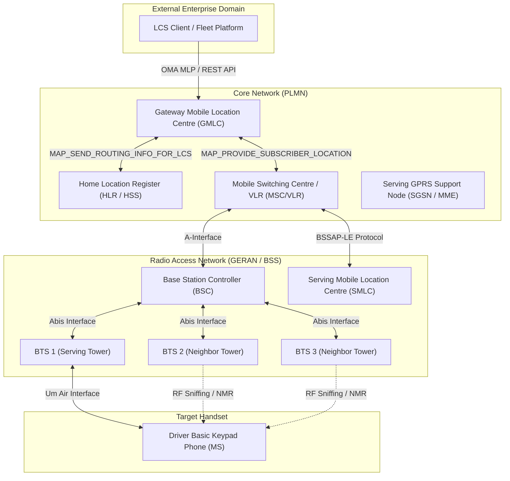
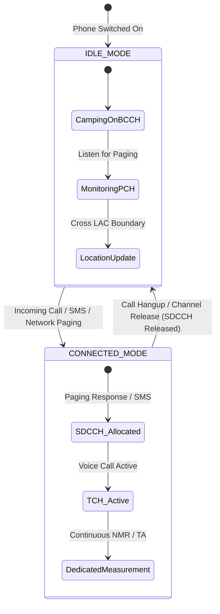
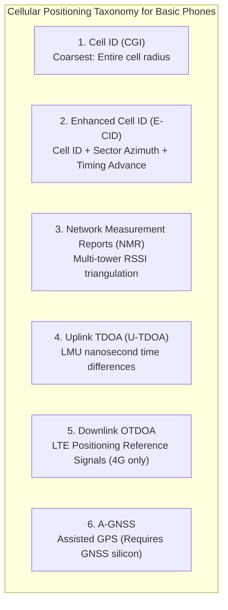
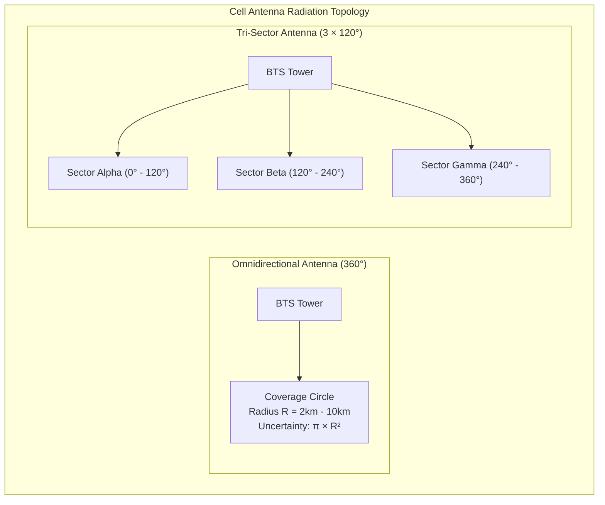
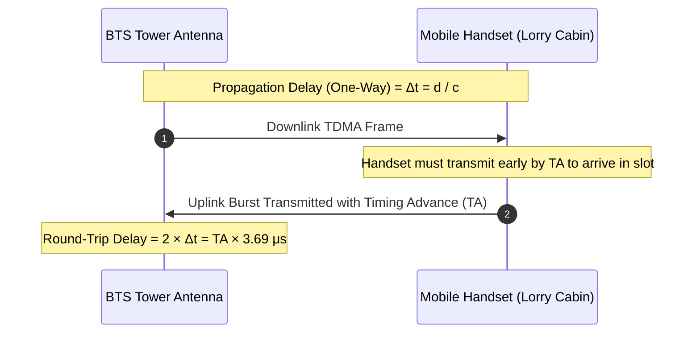
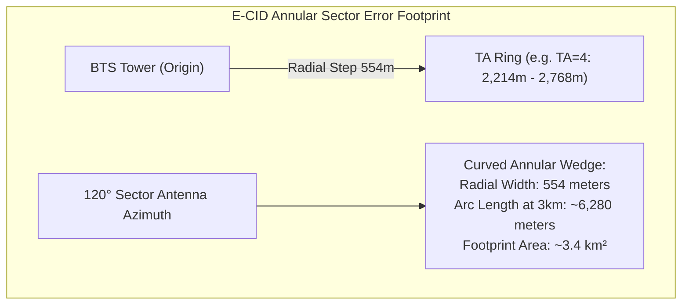
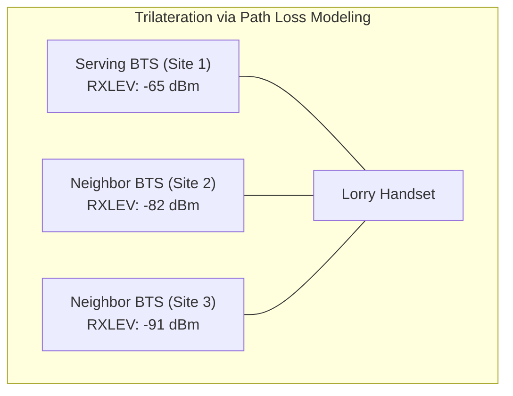
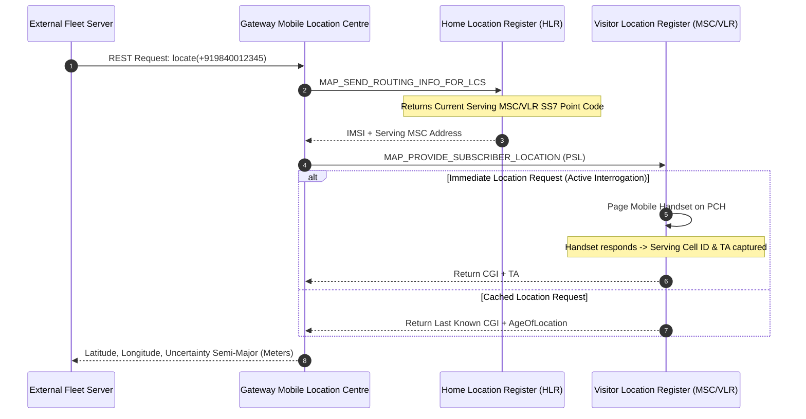
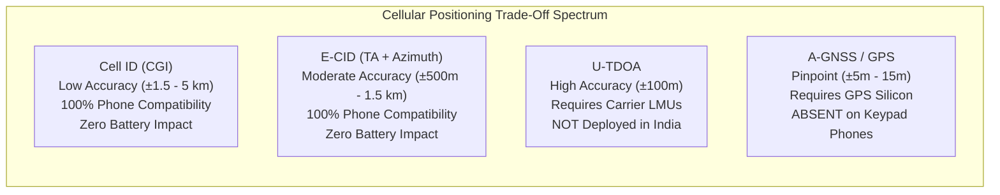

# 22. Cellular Network Positioning: In-Depth Technical Engineering Study

**Document Version:** 1.0.0  
**Status:** Approved Master Technical Study  
**Author:** Senior Telecommunications Engineer & Cellular Network Specialist  
**Standards Reference:** 3GPP TS 23.271 (LCS Architecture), 3GPP TS 43.059 (GERAN LCS), 3GPP TS 36.305 (E-UTRAN Positioning)  

---

## 1. 3GPP Location Services (LCS) Architecture

Under the Third Generation Partnership Project (3GPP) specifications, Location Services (LCS) enable a mobile network operator to determine the geographic position of a Mobile Station (MS) or User Equipment (UE) and expose this data to external Location Services Clients (LCS Clients) via standardized interfaces.

### 1.1 Core Network LCS Entities
1. **Gateway Mobile Location Centre (GMLC):**
   - The first point of contact for external enterprise applications (such as our transport platform).
   - Authenticates the request, verifies privacy authorization profiles, and requests routing information from the Home Location Register (HLR) or Home Subscriber Server (HSS).
   - Sends positioning requests to the serving MSC/VLR or SGSN/MME and returns the calculated coordinates to the external client.
2. **Serving Mobile Location Centre (SMLC / E-SMLC):**
   - Responsible for managing the overall coordination and execution of positioning techniques within the Radio Access Network (RAN).
   - Calculates the final position estimate, confidence radius, and error ellipse using measurements received from the Base Station Controller (BSC) or Base Transceiver Station (BTS).
3. **Base Station Controller (BSC) & Base Transceiver Station (BTS):**
   - Collects radio frequency (RF) measurements including the serving Cell ID (CID), antenna sector azimuth, Received Signal Level (RXLEV), and Timing Advance (TA).

---

## 2. Handset States and Radio Signaling Dynamics

A cellular phone's internal state directly governs whether a telecom network can determine its location immediately or must initiate active radio signaling.

### 2.1 The Idle State Challenge
* In **IDLE mode**, the phone does not transmit RF signals; it merely "listens" to the Broadcast Control Channel (BCCH) and Paging Channel (PCH) transmitted by nearby towers to conserve its battery.
* **Network Visibility in Idle Mode:** The network only knows the phone's **Location Area (LA)**, represented by a Location Area Code (LAC). A single LAC typically spans **10 to 100+ Base Transceiver Stations (BTS)**, encompassing 50 to 500+ square kilometers.
* **The Network DOES NOT know which specific cell tower the phone is camping on while it is idle.** The phone only communicates with the network when:
  1. It crosses into a new Location Area (triggering a Location Area Update - LAU).
  2. The periodic location update timer (T3212) expires (typically set by Indian operators between 60 minutes and 4 hours).
  3. An incoming/outgoing call or SMS occurs.

### 2.2 The Paging Mechanism (Forcing Tower Resolution)
To determine the specific tower camping an idle phone, the GMLC and MSC must trigger an active network event:
1. The MSC broadcasts a **Paging Request** message across all BTS towers within the current Location Area (LAC) on the PCH channel.
2. The keypad phone recognizes its International Mobile Subscriber Identity (IMSI) or Temporary Mobile Subscriber Identity (TMSI) and transmits a **Paging Response** on the Random Access Channel (RACH).
3. The BSC immediately assigns a Standalone Dedicated Control Channel (SDCCH).
4. At this exact millisecond, the serving BTS measures the **Timing Advance (TA)** and identifies the **Serving Cell Global Identity (CGI)**.
5. The SDCCH is released immediately after obtaining measurements without ringing the phone or alerting the driver.

---

## 3. Cellular Positioning Techniques Analyzed

---

### 3.1 Cell ID (Cell Global Identity - CGI)
Cell ID is the baseline positioning technique across all cellular standards.

* **Components of CGI:**
  $$\text{CGI} = \text{MCC} + \text{MNC} + \text{LAC} + \text{CI}$$
  - **MCC:** Mobile Country Code (`404` or `405` for India).
  - **MNC:** Mobile Network Code (e.g., `10` for Airtel, `860` for Jio, `04` for Vi).
  - **LAC:** Location Area Code (e.g., `4210` for Villupuram district).
  - **CI:** Cell Identity (unique integer identifying the specific antenna sector on a tower).

#### Accuracy Characteristics:
The positioning error is directly proportional to the cell coverage radius ($R$):
$$\text{Error Area}_{\text{Omni}} = \pi R^2$$
$$\text{Error Area}_{\text{Sector}} = \frac{1}{3} \pi R^2 = \frac{\pi R^2}{3}$$
* In urban centers (Chennai, Trichy): $R \approx 300\text{ m} - 800\text{ m}$ (Microcells). Uncertainty area: $\approx 0.1\text{ to }0.7\text{ km}^2$.
* On rural national highways (NH 45 between Villupuram and Trichy): $R \approx 3,000\text{ m} - 8,000\text{ m}$ (Macrocells). Uncertainty area: $\approx 9.4\text{ to }67\text{ km}^2$.

---

### 3.2 Timing Advance (TA) and Enhanced Cell ID (E-CID)
In GSM networks, the physical distance between the mobile handset and the BTS causes a round-trip propagation delay. To prevent Time Division Multiple Access (TDMA) time slots from overlapping at the base station receiver, the BTS instructs the mobile station to advance its transmission time. This parameter is the **Timing Advance (TA)**.

#### Mathematical Derivation of GSM Timing Advance:
In GSM, 1 bit period is:
$$T_{\text{bit}} = \frac{1}{270833.33\text{ Hz}} \approx 3.6923\ \mu\text{s}$$
The Timing Advance value is an integer ranging from $0$ to $63$. Each increment of $1\ \text{TA}$ corresponds to a round-trip delay of $1\ T_{\text{bit}}$:
$$2 \cdot \Delta t = \text{TA} \times T_{\text{bit}} = \text{TA} \times 3.6923 \times 10^{-6}\text{ seconds}$$
Using the speed of light in free space ($c \approx 2.9979 \times 10^8\text{ m/s}$):
$$d = \frac{c \cdot (2 \cdot \Delta t)}{2} = \frac{c \cdot \text{TA} \cdot T_{\text{bit}}}{2}$$
$$\Delta d_{\text{step}} = \frac{(2.9979 \times 10^8\text{ m/s}) \times (3.6923 \times 10^{-6}\text{ s})}{2} \approx 553.5\text{ meters}$$

#### E-CID Spatial Resolution:
Enhanced Cell ID (E-CID) combines:
1. **Serving BTS Coordinates:** $(X_{\text{BTS}}, Y_{\text{BTS}})$.
2. **Antenna Azimuth & Beamwidth:** Typically $120^\circ$ sector angle ($\theta_{\text{beam}}$).
3. **Timing Advance Band:** Annular ring segment bounded by $[d_{\text{min}}, d_{\text{max}}]$:
   $$d_{\text{min}} = \text{TA} \times 553.5\text{ m}$$
   $$d_{\text{max}} = (\text{TA} + 1) \times 553.5\text{ m}$$

* **Radial Accuracy:** $\pm 277\text{ meters}$.
* **Lateral / Angular Uncertainty:** At a distance of $4\text{ km}$ on a highway, the lateral arc length across a $120^\circ$ sector is:
  $$\text{Arc Length} = \frac{120^\circ \times \pi}{180^\circ} \times 4000\text{ m} \approx 8,377\text{ meters}$$
* **Engineering Impact:** While Timing Advance constrains the radial distance from the tower with decent accuracy ($\pm 277\text{m}$), the wide sector beamwidth means the truck could be anywhere along an $8\text{ km}$ wide arc across the landscape!

---

### 3.3 Multi-Cell Triangulation via Network Measurement Reports (NMR)
In GSM, the mobile station continuously monitors the signal strength of up to **6 neighboring non-serving cells** from the BCCH allocation list.

#### The Hata-Okumura Path Loss Model for Rural Indian Highways:
To convert Received Signal Level ($\text{RXLEV}$ in dBm) to distance ($d_i$), the network uses empirical RF propagation models:
$$L_p = 69.55 + 26.16 \log_{10}(f) - 13.82 \log_{10}(h_b) - a(h_m) + [44.9 - 6.55 \log_{10}(h_b)] \log_{10}(d) - C_{\text{rural}}$$
Where:
- $f = \text{Carrier frequency (900 MHz)}$
- $h_b = \text{BTS antenna height (30m to 45m)}$
- $h_m = \text{Mobile height in lorry cab (1.5m to 2.5m)}$
- $C_{\text{rural}} = 4.78 (\log_{10}(f))^2 - 18.33 \log_{10}(f) + 40.94$ (Rural correction factor)

#### Why Multi-Cell Triangulation Fails on Indian Keypad Phones in Logistics:
1. **Dedicated Mode Limitation:** A basic 2G phone **only transmits Network Measurement Reports (NMR) while in active dedicated mode** (during an active voice call or data transmission). When the phone is idle, neighbor cell measurements remain stored in the handset's internal baseband RAM and are **never transmitted to the network**.
2. **Lorry Cabin RF Attenuation (Faraday Cage Effect):** Heavy Indian commercial lorries have steel cabins, sheet metal roofs, and laminated windshields. This introduces a **12 dB to 22 dB insertion loss**. A 15 dB drop in received signal mimics an artificial distance increase of several kilometers under the logarithmic path-loss curve, skewing trilateration algorithms catastrophically.
3. **Sparse Highway Topology:** On rural highways, towers are laid out linearly along the road corridor. When three towers are almost colinear, the geometric dilution of precision (GDOP) approaches infinity, rendering trilateration mathematically unstable.

---

### 3.4 Uplink Time Difference of Arrival (U-TDOA)

* **Operating Principle:** Multiple neighboring BTS towers measure the exact time of arrival of the uplink burst transmitted by the handset. By computing the time difference of arrival between tower pairs:
  $$\Delta t_{i,j} = \frac{d_i - d_j}{c}$$
  Each pair defines a hyperbola of possible positions. The intersection of multiple hyperbolas yields the handset location.
* **Accuracy:** Capable of achieving **$50\text{ to }150\text{ meters}$** accuracy without handset GPS.
* **The Reality in Indian Telecom Networks:**
  > [!WARNING]
  > **U-TDOA is NOT available on Indian commercial networks.**  
  > U-TDOA requires installing specialized, atomic/GPS-synchronized hardware units called **Location Measurement Units (LMUs)** at every base station site. While deployed in the United States to meet mandatory FCC E911 Phase II public safety regulations, **no Indian telecom operator (Airtel, Vi, Jio, BSNL) has ever made the multi-hundred-crore capital investment to install LMUs on commercial highway towers**.

---

### 3.5 Downlink Observed Time Difference of Arrival (OTDOA)
* **Operating Principle:** Introduced in 3GPP LTE (4G) Release 9. The handset measures the Reference Signal Time Difference (RSTD) between Positioning Reference Signals (PRS) transmitted by synchronized eNodeBs. The handset reports RSTDs back to the E-SMLC via the LTE Positioning Protocol (LPP).
* **Why it does not work for ₹1,000 Keypad Phones:**
  1. Entry-level ₹1,000–₹1,500 feature phones are **2G GSM-only devices**. They do not possess an LTE baseband processor or LTE antenna RF front-ends.
  2. Even on 4G VoLTE keypad feature phones (like basic JioPhone or Nokia 110 4G), the proprietary low-cost firmware typically omits the complex 3GPP LPP protocol stack and PRS signal correlation engines to save manufacturing and licensing costs.
  3. Rural eNodeBs along Indian highways frequently operate with asynchronous frame timing and disabled PRS to optimize spectral bandwidth for user data throughput.

---

### 3.6 A-GNSS (Assisted GPS)
* **Operating Principle:** The cellular network delivers ephemeris data, Doppler shifts, and precise reference time via the mobile network to accelerate satellite acquisition (reducing Time-To-First-Fix from 45 seconds to 2 seconds).
* **Why it is Impossible on Standard Feature Phones:**
  - A-GNSS is **device-assisted** or **device-based**. It requires a physical GPS/GNSS receiver silicon chip, baseband correlator, and satellite antenna embedded inside the mobile handset.
  - Standard keypad phones (MediaTek MT6261D, Unisoc SC6531E) **physically lack GNSS hardware**. No amount of network signaling can generate a satellite fix if the receiving antenna and radio chip do not exist.

---

## 4. Core Network Signalling: SS7 / MAP & CAMEL Primitives

To interact with mobile stations programmatically, telecommunication operators use Mobile Application Part (MAP) over SS7/SIGTRAN protocol stacks.

### 4.1 Key MAP & CAMEL Protocol Operations
1. **`MAP_ANY_TIME_INTERROGATION` (ATI):**
   - Issued by a CAMEL gsmSCF (Service Control Function) to the HLR to query the subscriber's current location and state.
   - The HLR sends `MAP_PROVIDE_SUBSCRIBER_INFO` (PSI) to the serving VLR.
   - The VLR checks its subscriber table. If the `currentLocationRetrieved` parameter is set, the VLR initiates radio paging to obtain the real-time serving Cell ID and Timing Advance.
2. **`MAP_PROVIDE_SUBSCRIBER_LOCATION` (PSL):**
   - Standard 3GPP LCS primitive sent from the GMLC to the MSC/VLR.
   - Specifies the requested Quality of Service (QoS) including horizontal accuracy and maximum response delay.
3. **Type 0 SMS (Silent SMS / "Ping SMS"):**
   - Encoded with TP-PID (Protocol Identifier) = `01000000` (Short Message Type 0) or Data Coding Scheme (DCS) `0x16`.
   - The mobile handset's baseband processor acknowledges the SMS at the radio signaling layer (returning an acknowledgment burst to the BTS on the SDCCH channel) but **discards the message without displaying it, ringing, vibrating, or saving it to the SIM inbox**.
   - While technically capable of forcing a silent location update, **unauthorized transmission of Type 0 SMS by third parties is classified as network abuse and prohibited by Indian telecom security guidelines**. Legitimate enterprise tracking must strictly utilize authorized GMLC / CAMARA REST APIs.

---

## 5. Comparative Evaluation of Positioning Mechanisms

| Technical Parameter | Cell ID (CGI) | Enhanced Cell ID (E-CID) | Multi-Cell Triangulation (NMR) | Uplink TDOA (U-TDOA) | A-GNSS (Assisted GPS) |
| :--- | :--- | :--- | :--- | :--- | :--- |
| **3GPP Specification** | TS 43.059 / TS 23.271 | TS 43.059 / TS 36.305 | TS 43.059 | TS 43.059 | TS 44.031 / TS 36.355 |
| **Handset Requirements**| Basic 2G GSM Keypad | Basic 2G GSM Keypad | Basic 2G (Active Call Only) | Basic 2G GSM Keypad | GPS Chipset + Antenna |
| **Network Infrastructure**| Standard BTS / BSC / MSC | Standard BTS (TA Measurement)| Standard BTS | Carrier LMUs (Atomic Clocks)| Reference GNSS Receiver |
| **Highway Accuracy (NH 45)**| $\pm 2\text{ km to }8\text{ km}$ | $\pm 500\text{ m to }2.5\text{ km}$ | $\pm 1\text{ km to }3\text{ km}$ (Unstable)| $\pm 100\text{ m}$ (Hypothetical)| $\pm 5\text{ m to }15\text{ m}$ |
| **Urban Accuracy (Chennai)**| $\pm 300\text{ m to }1\text{ km}$ | $\pm 150\text{ m to }500\text{ m}$ | $\pm 200\text{ m to }600\text{ m}$ | $\pm 50\text{ m}$ (Hypothetical) | $\pm 5\text{ m to }15\text{ m}$ |
| **Supported on ₹1,000 Phone?**| **YES (100%)** | **YES (100%)** | **Only during active call** | **YES (Radio compatible)** | **NO (Hardware missing)** |
| **Availability in India** | **Live & Operational** | **Live & Operational** | **Internal Radio Resource only**| **NOT DEPLOYED IN INDIA**| **Requires Smartphone/GPS** |

---

## 6. Engineering Conclusions for Fleet Architecture

1. **Physical Reality of Basic Phones:** A ₹1,000 keypad phone acts purely as an RF transponder within the cellular network. Any attempt to extract latitude/longitude coordinates relies entirely on the operator's database of physical cell tower locations and antenna radiation azimuths.
2. **The Inescapable Spatial Bounds:** On rural transport corridors such as Chennai to Madurai, the minimum achievable error ellipse with E-CID is an annular sector of approximately **$\pm 500\text{ meters}$ radial width by $3\text{ to }6\text{ kilometers}$ arc length**.
3. **Architectural Imperative:** Because cellular network positioning cannot achieve sub-meter precision, fleet software must **never use raw cell coordinates directly on the map**. Instead, the platform must feed cell coordinates through a **Highway Corridor Snap-to-Road Algorithm** and fuse them with **NETC FASTag Toll Crossing Events**, yielding a robust, macro-accurate corridor digital twin.
