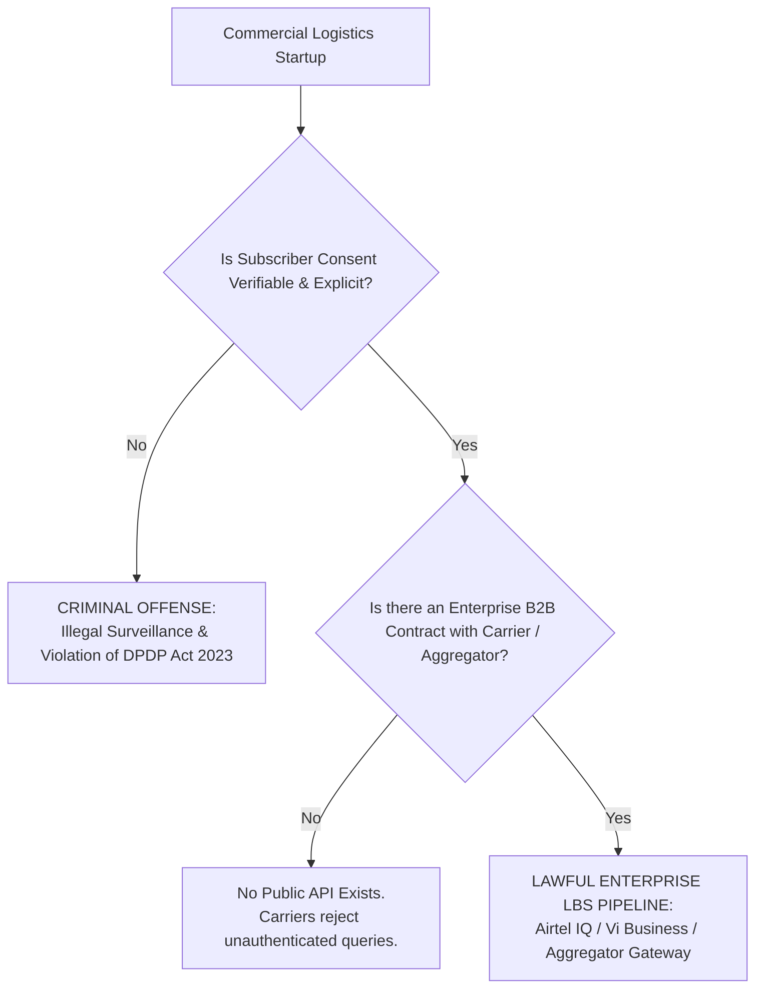
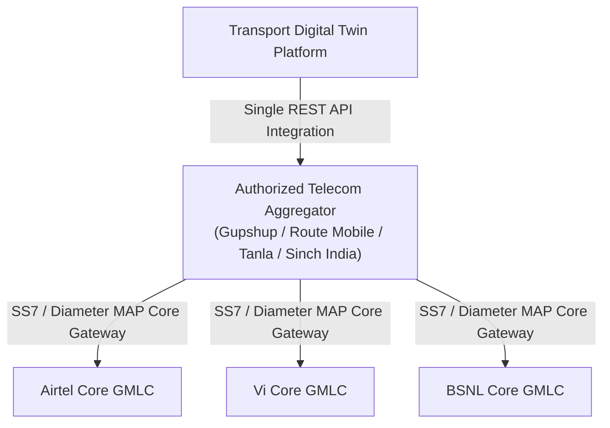
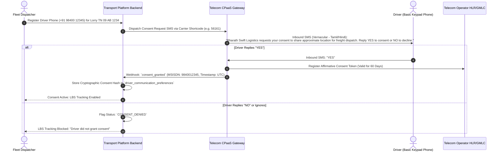

# 23. Indian Telecom Operator API Landscape, Regulatory Mandates & Commercial Feasibility

**Document Version:** 1.0.0  
**Status:** Approved Feasibility & Legal Research Report  
**Jurisdiction:** Republic of India (DoT, TRAI, DPDP Act 2023, Telecommunications Act 2023)  
**Target Carriers:** Bharti Airtel, Reliance Jio, Vodafone Idea (Vi), Bharat Sanchar Nigam Limited (BSNL)  

---

## 1. Executive Summary & Legal Framework

In India, accessing the real-time geographical location of a mobile subscriber is among the most strictly regulated data categories in the telecommunications sector. 

Under the **Telecommunications Act 2023**, the **Indian Telegraph Rules**, and the **Digital Personal Data Protection Act (DPDP Act 2023)**, unauthorized tracking of any mobile phone without affirmative, verifiable subscriber consent is a **criminal offense punishable by heavy financial penalties (up to ₹250 Crores under DPDP Act) and imprisonment**.



---

## 2. Carrier-by-Carrier Commercial Feasibility Analysis

### 2.1 Bharti Airtel (Airtel Business / Airtel IQ)
- **Enterprise Product:** Airtel Location-Based Services (LBS API) / Airtel IoT SIM Platform.
- **Capabilities:** Exposes serving Cell ID, Timing Advance, and reverse-geocoded landmark/district names for Airtel prepaid and postpaid numbers across all 22 Indian telecom circles.
- **Onboarding Process:**
  1. Corporate KYB (Know Your Business): Certificate of Incorporation, GSTIN, PAN, and signatory verification.
  2. Execution of an **Enterprise LBS Master Service Agreement (MSA)** containing strict indemnity clauses regarding driver consent.
  3. Minimum Monthly Billing Commitment: Typically **₹25,000 to ₹50,000 per month** minimum commitment for direct carrier connectivity.
- **API Protocol:** RESTful JSON API over HTTPS with IP whitelisting and HMAC-SHA256 signature authentication.

---

### 2.2 Vodafone Idea (Vi Business)
- **Enterprise Product:** Vi Location Services & Enterprise Fleet Telematics.
- **Capabilities:** Historically the most active Indian carrier in third-party logistics LBS tracking (widely used by early-stage transport aggregators across Western and Southern India). Provides cell centroid and coverage radius polygons.
- **Current Vi Feasibility:** Vi's enterprise division continues to support LBS for logistics contracts. However, Vi's ongoing network rationalization and spectrum re-farming have created spotty coverage in certain rural North Indian belts compared to Airtel.
- **Commercial Terms:** Direct enterprise onboarding requires a minimum volume of 500+ active monitored SIMs.

---

### 2.3 Reliance Jio (Jio Enterprise / Jio IoT)
- **Enterprise Architecture:** Jio operates an **all-IP 4G LTE and 5G standalone (SA) network**. Jio has **zero 2G or 3G legacy infrastructure**.
- **The 2G Handset Barrier:** **A pure 2G GSM keypad phone (e.g. older Nokia 105 or basic Chinese feature phones) CANNOT physically register on the Jio network.** Jio only works on 4G VoLTE-enabled handsets (such as the JioPhone or modern 4G feature phones).
- **Location APIs:** Jio does not offer an open, general-purpose commercial LBS API for third-party numbers. Jio's location capabilities are bundled exclusively inside their proprietary **JioTrack** hardware ecosystem or specialized government/enterprise M2M SIM bundles.

---

### 2.4 Bharat Sanchar Nigam Limited (BSNL)
- **Network Landscape:** BSNL maintains an extensive 2G/3G network across rural India, particularly in deep interior state highway corridors where private carriers have weaker density.
- **Enterprise Access:** BSNL's LBS infrastructure is largely managed through state tender allocations and empaneled third-party technical aggregators. Securing direct API integration with BSNL as a startup is bureaucratic and takes 6 to 12 months; it is universally accessed via licensed aggregators.

---

## 3. The Licensed Telecom Aggregator Pathway (Recommended for Startups)

Rather than negotiating 4 separate enterprise contracts with Airtel, Jio, Vi, and BSNL (requiring ₹1.5 Lakhs+ in aggregate monthly minimum commitments), Indian logistics startups access multi-carrier LBS through **authorized Class-A Telecom Aggregators**:



### Leading Indian Aggregators Providing Location & Telephony:
1. **Gupshup / Route Mobile:** Provides unified LBS APIs, Two-Way SMS shortcodes, and automated Outbound IVR voice dialers under a single unified billing wallet.
2. **Tanla Platforms / ValueFirst:** Major provider of CPaaS (Communication Platform as a Service) to Indian enterprise logistics companies.
3. **Sinch India:** Enterprise carrier connectivity with automated opt-in consent logging.

---

## 4. Mandatory Subscriber Consent Architecture (DPDP Act Compliance)

Under Section 6 of the **Digital Personal Data Protection Act 2023**, a mobile subscriber must provide **informed, affirmative consent** before their location can be processed. 

The platform implements an automated **Two-Way SMS Consent Handshake**:



---

## 5. Commercial Pricing & API Rate Limits (Empirical Industry Benchmarks)

| Cost Dimension | Direct Carrier Contract (Airtel / Vi) | Multi-Carrier Aggregator (Gupshup / Route Mobile) |
| :--- | :--- | :--- |
| **Setup & Integration Fee** | ₹50,000 – ₹1,00,000 (One-time security deposit) | ₹5,000 – ₹15,000 (One-time onboarding) |
| **Minimum Monthly Commitment** | ₹25,000 to ₹50,000 / month per carrier | **₹3,000 to ₹5,000 / month** (Prepaid wallet) |
| **Per-Location-Query Cost** | ₹0.20 to ₹0.35 per successful query | **₹0.35 to ₹0.55 per successful query** |
| **Consent Request SMS** | ₹0.12 per SMS | ₹0.12 to ₹0.15 per SMS |
| **Query Rate Limit (Frequency)**| Max 1 query every 30 minutes per MSISDN | Max 1 query every 30 to 60 minutes |
| **Daily Query Cap per SIM** | 12 to 24 queries per day | 12 to 24 queries per day |
| **Lead Time to Production** | 2 to 4 months (Legal & security audits) | **2 to 3 weeks** |

---

## 6. Technical API Specification for Keypad LBS Ingestion

The standard REST request structure for querying an authorized telecom aggregator:

```http
POST /api/v2/lbs/locate HTTP/1.1
Host: api.cpaas-aggregator.in
Authorization: Bearer <ENTERPRISE_API_TOKEN>
Content-Type: application/json

{
  "enterprise_id": "BHARATH_SWIFT_LOGISTICS",
  "msisdn": "919840000101",
  "consent_token": "CST_98400_20261106_VERIFIED",
  "request_reference_id": "REQ-TRP-8492-004",
  "include_address": true
}
```

### Standard Operator Response Payload:
```json
{
  "status": "SUCCESS",
  "msisdn": "919840000101",
  "timestamp": "2026-11-06T15:30:12Z",
  "location": {
    "latitude": 11.9401,
    "longitude": 79.4861,
    "accuracy_radius_meters": 2400,
    "confidence_percentage": 85,
    "cell_id": "404-45-1284-38291",
    "timing_advance": 4,
    "address": {
      "landmark": "Near Tindivanam Bypass",
      "highway": "NH 45 (GST Road)",
      "district": "Villupuram",
      "state": "Tamil Nadu"
    }
  }
}
```
