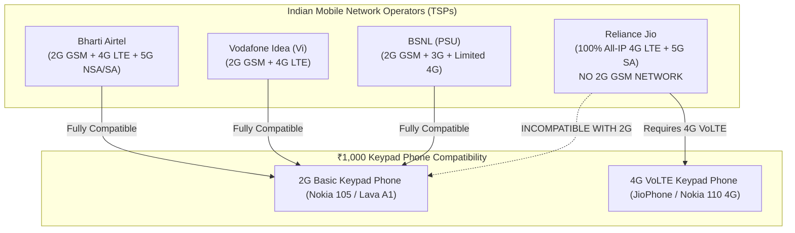
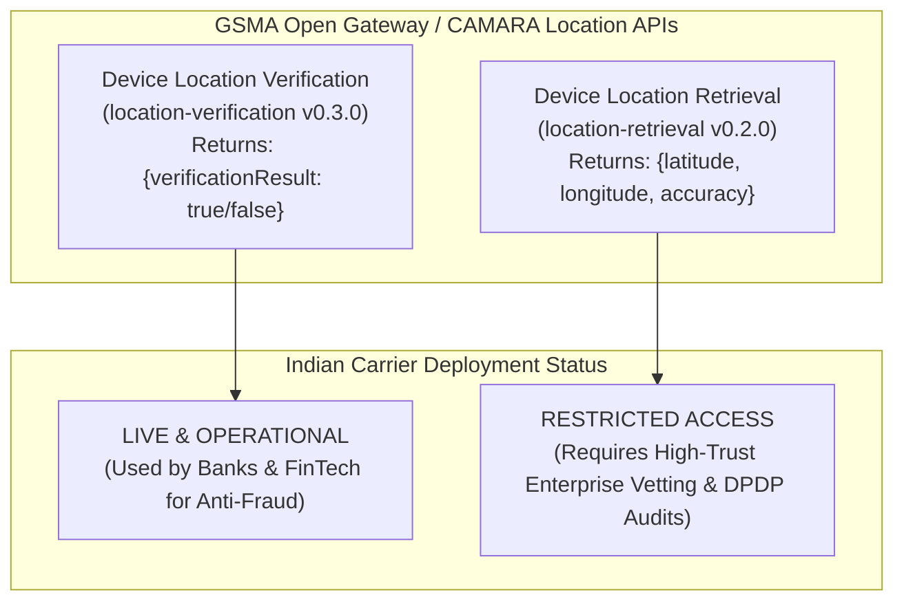
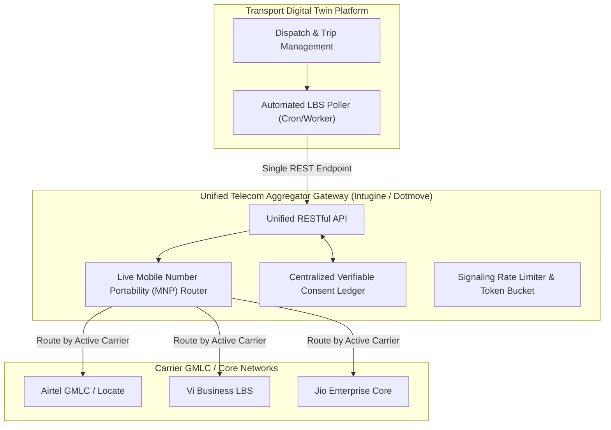
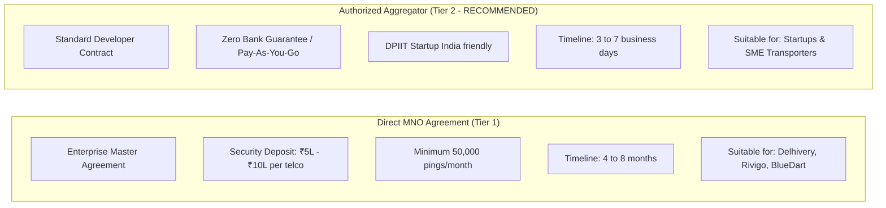

# 23. Indian Telecom Operator API Feasibility & Enterprise Integration

**Document Version:** 1.0.0  
**Status:** Approved Master Integration Specification  
**Author:** Indian Telecom Domain Expert & Enterprise Systems Architect  
**Regulatory Context:** TRAI, Department of Telecommunications (DoT), DPDP Act 2023, GSMA Open Gateway (CAMARA)  

---

## 1. Indian Mobile Network Operator (MNO) Landscape

In India, commercial mobile telecommunications is consolidated across three private telecom service providers (TSPs) and one state-owned public sector undertaking (PSU): **Bharti Airtel**, **Reliance Jio Infocomm**, **Vodafone Idea (Vi)**, and **Bharat Sanchar Nigam Limited (BSNL)**.



---

### 1.1 Carrier-by-Carrier Evaluation for Keypad Phone Tracking

#### 1. Bharti Airtel (Airtel IQ & Airtel Locate)
* **Radio Generations:** Active 2G GSM network (900 MHz band) alongside extensive 4G and 5G rollouts.
* **Keypad Compatibility:** **100% compatible** with all legacy ₹1,000 2G keypad devices across India.
* **Commercial Enterprise Capabilities:**
  - Operates **Airtel IQ**, a cloud communication and network API suite.
  - Offers enterprise Location-Based Services (LBS) via Gateway Mobile Location Centre (GMLC) interconnects.
  - Exposes RESTful APIs for authorized enterprise fleet tracking and asset visibility.
* **Access Model:** Requires formal enterprise Master Services Agreement (MSA), corporate KYC, and monthly minimum commitments (typically ₹25,000 to ₹50,000). Direct developer self-serve signup is not available; deals are handled through Airtel Enterprise sales desks.

#### 2. Reliance Jio Infocomm (Jio Enterprise LBS)
* **Radio Generations:** **100% All-IP 4G LTE and 5G Standalone (SA)**. Jio has **never built a 2G or 3G network**.
* **Keypad Compatibility:**
  > [!CRITICAL]
  > **Jio CANNOT connect an ordinary ₹1,000 2G keypad phone.**  
  > If a truck driver buys a ₹1,000 2G-only Nokia 105 or Samsung Guru and inserts a Jio SIM, **the phone will display "No Network / Emergency Calls Only"**. Jio SIMs require a device with 4G VoLTE support (Band 3, 5, or 40). While Jio sells its own affordable 4G feature phones (JioPhone / Jio Bharat for ₹999–₹1,499), standard third-party 2G feature phones will not register on Jio's network.
* **Enterprise Location APIs:** Exposes modern, high-performance REST APIs (and CAMARA-compliant endpoints). Location resolution on Jio is derived from eNodeB E-CID. Direct enterprise contracting requires high annual commitments.

#### 3. Vodafone Idea (Vi Business)
* **Radio Generations:** Strong 2G GSM footprint across Maharashtra, Gujarat, Tamil Nadu, Uttar Pradesh, and national highway corridors, alongside 4G LTE.
* **Keypad Compatibility:** **100% compatible** with 2G keypad devices.
* **Commercial Enterprise Capabilities:**
  - Vi Business has historically been the **largest provider of SIM-based tracking infrastructure to the Indian logistics industry**.
  - Highly mature GMLC infrastructure integrated with leading third-party logistics middleware aggregators.
* **Access Model:** Enterprise MSA required, though Vi actively partners with logistics telematics startups through specialized enterprise incubator and partner programs.

#### 4. Bharat Sanchar Nigam Limited (BSNL)
* **Radio Generations:** Legacy 2G GSM and 3G networks with extensive rural highway coverage across non-metro circles (excluding Delhi and Mumbai, which were served by MTNL).
* **Keypad Compatibility:** Compatible with 2G devices.
* **Commercial Enterprise Capabilities:**
  - Lacks modern cloud-native, developer-friendly REST APIs.
  - Integrations rely on legacy SMPP, proprietary socket interfaces, or manual government procurement channels.
  - Extremely bureaucratic onboarding with months-long tender/approval cycles. Most commercial aggregators avoid direct BSNL integration or treat it as best-effort.

---

## 2. GSMA Open Gateway & CAMARA Project in India

India's major operators (Bharti Airtel, Reliance Jio, and Vodafone Idea) are signatories to the **GSMA Open Gateway** initiative, adopting the open-source **CAMARA API** definitions to expose network capabilities in a federated, interoperable manner.



### 2.1 Location Verification vs. Location Retrieval

#### 1. Device Location Verification (`location-verification`)
* **Endpoint:** `POST /location-verification/v0/verify`
* **Function:** Checks whether a device is currently within a circle specified by the client (`latitude`, `longitude`, `radius`).
* **Response:** A simple boolean `{ "verificationResult": "TRUE" | "FALSE" }`.
* **Privacy Impact:** Very high privacy preservation; the operator **never reveals the driver's actual coordinates** to the application.
* **Logistics Limitation:** While excellent for verifying if a lorry has arrived inside a 5 km warehouse perimeter, it cannot be used to plot a continuous trajectory along NH 45.

#### 2. Device Location Retrieval (`location-retrieval`)
* **Endpoint:** `POST /location-retrieval/v0/retrieve`
* **Function:** Requests the current geographic coordinates of the mobile device.
* **Response:** Returns latitude, longitude, radius of uncertainty, and timestamp.
* **Regulatory Restrictions in India:** Subject to strict subscriber consent verification, DoT audit logs, and data localization mandates.

---

## 3. The Enterprise Aggregator Model (The Practical Route for Logistics)

Direct integration with three separate telecom operators (Airtel, Jio, Vi) requires:
- 3 separate Master Services Agreements (MSAs).
- 3 separate security deposits (totalling ₹15–30 Lakhs).
- 3 distinct proprietary or semi-proprietary protocol adapters.
- Complex routing logic to determine which carrier currently serves a ported mobile number (MNP - Mobile Number Portability).

### 3.1 The Logistics Middleware Architecture
To avoid this overhead, Indian logistics platforms integrate with **Authorized Telecom LBS Aggregators** (such as **Intugine Technologies**, **Dotmove**, and **MapmyIndia InTouch**).



---

## 4. Production API Specification & Payload Architecture

The following schemas define the production-grade HTTP REST interface utilized by leading Indian SIM tracking middleware.

### 4.1 Driver Tracking Registration & Consent Request
Initiates subscriber consent verification via TRAI-compliant SMS or IVR.

* **HTTP Method:** `POST`
* **Endpoint:** `https://api.telematics-gateway.in/v2/sim-tracking/consent/request`
* **Headers:**
  ```http
  Authorization: Bearer <ENTERPRISE_API_TOKEN>
  Content-Type: application/json
  X-Enterprise-ID: ENT_BHARATH_SWIFT_009
  ```

* **Request Body:**
```json
{
  "msisdn": "+919840012345",
  "driver_name": "Murugan K",
  "vehicle_registration": "TN09AB1234",
  "trip_id": "TRIP-2026-CHN-MDU-0842",
  "consent_channel": "SMS",
  "language": "ta",
  "validity_hours": 48,
  "callback_url": "https://api.trackourvehicle.in/webhooks/sim-consent"
}
```

* **SMS Triggered to Driver's Keypad Phone (Tamil in Latin/Unicode script):**
  > *"Bharath Swift Logistics requests your permission to share location for Trip TN09AB1234. Reply 1 to ACCEPT, 2 to REJECT. Help: 1800-XXX-XXXX."*

* **Webhook Payload Received upon Driver Consent:**
```json
{
  "event": "CONSENT_RECORDED",
  "msisdn": "+919840012345",
  "status": "APPROVED",
  "consent_timestamp": "2026-11-07T08:30:15+05:30",
  "consent_id": "CNS-IND-2026-894102",
  "carrier": "AIRTEL",
  "valid_until": "2026-11-09T08:30:15+05:30"
}
```

---

### 4.2 On-Demand Location Query
Queries the live network-derived position of the registered phone.

* **HTTP Method:** `POST`
* **Endpoint:** `https://api.telematics-gateway.in/v2/sim-tracking/locate`
* **Request Body:**
```json
{
  "msisdn": "+919840012345",
  "consent_id": "CNS-IND-2026-894102",
  "trip_id": "TRIP-2026-CHN-MDU-0842",
  "force_live_paging": true
}
```

* **Production JSON Response Payload:**
```json
{
  "status": "SUCCESS",
  "query_id": "LBS-QRY-20261107-99214",
  "timestamp": "2026-11-07T10:15:22+05:30",
  "carrier": "AIRTEL",
  "radio_access_technology": "2G_GSM",
  "network_status": "ATTACHED_IDLE",
  "location": {
    "latitude": 11.94012,
    "longitude": 79.48625,
    "accuracy_radius_meters": 1850,
    "confidence_percentage": 90,
    "geocoded_context": {
      "highway": "NH-45 (Grand Southern Trunk Road)",
      "nearest_landmark": "Vikravandi Toll Plaza Approach",
      "district": "Villupuram",
      "state": "Tamil Nadu",
      "country": "India"
    }
  },
  "cell_metadata": {
    "mcc": 404,
    "mnc": 10,
    "lac": 4210,
    "cell_id": 34912,
    "timing_advance": 3,
    "ta_distance_estimate_meters": 1660
  }
}
```

* **Error Handling & Network Fallbacks:**
  - `E_PHONE_SWITCHED_OFF`: Returns last known cached location with `age_of_location_minutes` parameter.
  - `E_NO_CONSENT`: Returned if driver has not replied or if 48-hour trip consent has lapsed.
  - `E_CARRIER_TIMEOUT`: Core network paging timeout (driver traversing deep signal blindspot).

---

## 5. Startup Feasibility, KYC & Onboarding Requirements

For an early-stage Indian logistics startup (or transport technology company), the path to deployment depends entirely on integration tier selection:



### 5.1 Documentation & KYC Checklist for Startup Onboarding
To clear compliance vetting with an aggregator or carrier:
1. **Certificate of Incorporation** (Private Limited Company / LLP registered with MCA).
2. **DPIIT Recognition Certificate** (Startup India certificate, if claiming fee waivers).
3. **Company GST Registration Certificate & PAN Card**.
4. **Director KYC:** PAN Card, Aadhaar Card, and Board Resolution authorising telecom API usage.
5. **Signed Privacy & Telecom Undertaking:** Binding commitment to:
   - Collect verifiable subscriber consent prior to initiating tracking.
   - Restrict tracking exclusively to active commercial freight transit.
   - Refrain from unauthorized data resale, behavioral profiling, or cross-border data transfer.
   - Comply with all audit directives issued by the Department of Telecommunications (DoT).

---

## 6. Integration Architecture Recommendations

1. **Adopt the Aggregator Route for Production:** Do not attempt bilateral carrier negotiations during MVP or early growth phases. Partnering with an authorized aggregator provides instant tri-operator coverage (Airtel + Vi + Jio) through a single REST API.
2. **Decouple Ingestion from Processing:** SIM tracking API queries experience variable network latency ($2\text{ to }12\text{ seconds}$ while the core network pages the phone). Implement an asynchronous queue architecture (RabbitMQ / BullMQ) to dispatch location queries without blocking main application worker threads.
3. **Strict Trip-Bound Consent:** Programmatically revoke tracking tokens immediately upon trip completion in the database, ensuring zero compliance liability under the DPDP Act 2023.
