# 24. Tracking Accuracy, Economics & Operational Trade-Offs

**Document Version:** 1.0.0  
**Status:** Approved Comparative Evaluation  
**Scope:** Rigorous Trade-off Analysis Across All Hardware, Smartphone & Keypad Tracking Modes  
**Fleet Scaling Benchmarks:** 100 Assets, 1,000 Assets, and 10,000 Assets  

---

## 1. Multi-Tier Accuracy & Spatial Resolution Matrix

The fundamental trade-off in fleet telematics is between **spatial precision** (where is the vehicle right now) and **capital friction** (what hardware or device must be installed).

```mermaid
quadrantChart
    title Telematics Landscape: Positional Precision vs Upfront Capital Cost
    x-axis Low Capital Friction (Zero Upfront Capex) --> High Capital Friction (Hardwired Capex)
    y-axis Coarse Spatial Precision (Kilometer Radius) --> Fine Spatial Precision (Sub-5m Satellite Fix)
    quadrant-1 "Enterprise Hardware Giants (AIS-140 / Can-Bus)"
    quadrant-2 "Smartphone-First Innovation (Zero Capex High-Res)"
    quadrant-3 "Keypad Telecom LBS (Zero Capex Coarse)"
    quadrant-4 "Obsolete Legacy Budget Hardware"
    "Dedicated Hardwired GPS (GT06)": [0.75, 0.90]
    "AIS-140 Certified Hardware": [0.92, 0.94]
    "Driver Smartphone Satellite GPS": [0.15, 0.88]
    "Keypad Telecom SIM LBS": [0.10, 0.28]
    "FASTag NETC Toll Webhooks": [0.08, 0.70]
    "Keypad IVR Check-in": [0.05, 0.18]
    "Target Hybrid Engine (LBS + FASTag)": [0.12, 0.78]
```

### Detailed Accuracy Breakdown by Environment

| Technology Mode | City / Urban Center | Semi-Urban Towns | Rural National Highway | Remote / Ghats | Speed & Heading Accuracy | Refresh Frequency |
| :--- | :--- | :--- | :--- | :--- | :--- | :--- |
| **Mode A: Smartphone Satellite GPS** | $\pm 5\text{ to }10\text{ m}$ | $\pm 5\text{ to }12\text{ m}$ | $\pm 5\text{ to }15\text{ m}$ | $\pm 10\text{ to }25\text{ m}$ | High ($\pm 0.5$ km/h, Doppler) | **Continuous (Every 10s)** |
| **Mode B: Hardwired GPS (GT06)** | $\pm 2.5\text{ to }5\text{ m}$ | $\pm 2.5\text{ to }5\text{ m}$ | $\pm 2.5\text{ to }5\text{ m}$ | $\pm 5\text{ to }10\text{ m}$ | Highest ($\pm 0.2$ km/h) | **Continuous (Every 10s)** |
| **Mode C: AIS-140 Certified Device** | $\pm 2.5\text{ to }5\text{ m}$ | $\pm 2.5\text{ to }5\text{ m}$ | $\pm 2.5\text{ to }5\text{ m}$ | $\pm 5\text{ to }10\text{ m}$ | Highest ($\pm 0.2$ km/h) | **Continuous (Every 5-10s)** |
| **Mode D: Keypad Telecom SIM LBS** | $\pm 400\text{ to }800\text{ m}$ | $\pm 1.2\text{ to }2.5\text{ km}$| **$\pm 2.5\text{ to }5\text{ km}$** | $\pm 8\text{ to }18\text{ km}$ | **ZERO (Cannot measure speed)**| **Periodic (Every 1 to 2 hrs)**|
| **Mode E: FASTag NETC Toll Gate** | **$\pm 2\text{ m}$ (Exact)** | **$\pm 2\text{ m}$ (Exact)** | **$\pm 2\text{ m}$ (Exact)** | Non-functional (Toll only) | **ZERO (Stationary point)** | **Event-Driven (Per toll gate)**|
| **Target Hybrid (LBS + FASTag + IVR)**| $\pm 2\text{ to }400\text{ m}$ | $\pm 2\text{ to }1.2\text{ km}$ | **$\pm 2\text{ m (Toll)} / \pm 3\text{km}$**| Corridors verified | **Interpolated Corridor Velocity**| **Blended (Event + 1h polling)**|

---

## 2. Fleet Scaling Economic Modeling (100, 1,000, and 10,000 Assets)

To assist transport enterprises in financial forecasting, the tables below project the total capital expenditure (CapEx) and operational expenditure (OpEx) across three fleet tiers.

### 2.1 Model 1: Small Fleet Enterprise (100 Commercial Lorries)

| Metric | Option 1: Hardwired AIS-140 Hardware | Option 2: Driver Smartphone App | Option 3: Keypad Phone Telecom LBS (Hourly) | Option 4: Hybrid Zero-Capex (LBS + FASTag) |
| :--- | :--- | :--- | :--- | :--- |
| **Initial Upfront Hardware CapEx** | **₹5,50,000** (₹5,500/truck) | **₹0 (Zero)** | **₹0 (Zero)** | **₹0 (Zero)** |
| **Installation & Auto-Electrician** | **₹40,000** (₹400/truck) | **₹0 (Zero)** | **₹0 (Zero)** | **₹0 (Zero)** |
| **Monthly Telecom / SIM / API Fees** | ₹12,000 (M2M Dual eSIM) | ₹0 (Uses driver data) | ₹4,200 (4 queries/day/SIM) | ₹5,000 (LBS + FASTag API) |
| **Platform Cloud Hosting COGS** | ₹1,800 / month | ₹2,200 / month | ₹800 / month | ₹1,400 / month |
| **Total Year 1 Total Cost of Ownership (TCO)**| **₹7,55,600** | **₹26,400** | **₹60,000** | **₹76,800** |
| **Annual TCO per Lorry** | **₹7,556 / lorry / year** | **₹264 / lorry / year** | **₹600 / lorry / year** | **₹768 / lorry / year** |

---

### 2.2 Model 2: Mid-Sized Fleet Operator (1,000 Commercial Lorries)

| Metric | Option 1: Hardwired AIS-140 Hardware | Option 2: Driver Smartphone App | Option 3: Keypad Phone Telecom LBS | Option 4: Hybrid Zero-Capex (LBS + FASTag) |
| :--- | :--- | :--- | :--- | :--- |
| **Initial Upfront Hardware CapEx** | **₹50,00,000** (Bulk ₹5,000) | **₹0 (Zero)** | **₹0 (Zero)** | **₹0 (Zero)** |
| **Installation & Auto-Electrician** | **₹3,50,000** (₹350/truck) | **₹0 (Zero)** | **₹0 (Zero)** | **₹0 (Zero)** |
| **Monthly Telecom / SIM / API Fees** | ₹1,10,000 / month | ₹0 | ₹35,000 / month (Volume rate) | ₹42,000 / month |
| **Platform Cloud Hosting COGS** | ₹15,000 / month | ₹18,000 / month | ₹7,000 / month | ₹12,000 / month |
| **Total Year 1 Total Cost of Ownership (TCO)**| **₹68,50,000** | **₹2,16,000** | **₹5,04,000** | **₹6,48,000** |
| **Annual TCO per Lorry** | **₹6,850 / lorry / year** | **₹216 / lorry / year** | **₹504 / lorry / year** | **₹648 / lorry / year** |

---

### 2.3 Model 3: Mega Logistics Enterprise (10,000 Commercial Lorries)

| Metric | Option 1: Hardwired AIS-140 Hardware | Option 2: Driver Smartphone App | Option 3: Keypad Phone Telecom LBS | Option 4: Hybrid Zero-Capex (LBS + FASTag) |
| :--- | :--- | :--- | :--- | :--- |
| **Initial Upfront Hardware CapEx** | **₹4,50,00,000** (₹4.5 Crores) | **₹0 (Zero)** | **₹0 (Zero)** | **₹0 (Zero)** |
| **Installation & Auto-Electrician** | **₹30,00,000** (₹30 Lakhs) | **₹0 (Zero)** | **₹0 (Zero)** | **₹0 (Zero)** |
| **Monthly Telecom / SIM / API Fees** | ₹10,00,000 / month | ₹0 | ₹2,80,000 / month (Wholesale) | ₹3,50,000 / month |
| **Platform Cloud Hosting COGS** | ₹1,20,000 / month | ₹1,50,000 / month | ₹60,000 / month | ₹95,000 / month |
| **Total Year 1 Total Cost of Ownership (TCO)**| **₹6,14,40,000** (₹6.14 Crores)| **₹18,00,000** (₹18 Lakhs) | **₹40,80,000** (₹40.8 Lakhs) | **₹53,40,000** (₹53.4 Lakhs) |
| **Annual TCO per Lorry** | **₹6,144 / lorry / year** | **₹180 / lorry / year** | **₹408 / lorry / year** | **₹534 / lorry / year** |

---

## 3. Operational Risk & Failure Mode Comparison

```mermaid
graph TD
    subgraph FailureModes["Real-World Operational Failure Modes"]
        F1["Failure 1: Driver Turns Off Device / Cuts Wires"]
        F2["Failure 2: Cellular Blindspot (0 Network Signal)"]
        F3["Failure 3: Battery Depletion"]
        F4["Failure 4: Location Spoofing / Tampering"]
    end

    subgraph HardwareResponse["Option 1: Hardwired GPS Device"]
        H1["Power cut alarm fires; Internal backup battery tracks for 4 hours"]
        H2["Buffers up to 50,000 pings in local flash memory; syncs on reconnect"]
        H3["Vehicle battery powered; draws from 12V/24V alternator"]
        H4["Requires physical GPS jammer to spoof"]
    end

    subgraph SmartphoneResponse["Option 2: Driver Smartphone App"]
        S1["Tracking stops; Admin alerted to unexpected duty termination"]
        S2["Satellite GPS continues calculating; buffered to local SQLite database"]
        S3["Battery warning sent at 15% and 5%; requires in-cab charging"]
        S4["isFromMockProvider flag + Kinematic jump filters reject fake GPS"]
    end

    subgraph KeypadResponse["Option 3: Basic Keypad Phone (LBS)"]
        K1["API returns 'Subscriber Unreachable / Detached from Network'"]
        K2["Zero tracking; Telco network cannot query an unattached phone"]
        K3["Phone battery lasts 5 to 7 days on single charge"]
        K4["Driver cannot spoof cell tower identity; completely network-derived"]
    end

    F1 --> H1
    F1 --> S1
    F1 --> K1

    F2 --> H2
    F2 --> S2
    F2 --> K2

    F3 --> H3
    F3 --> S3
    F3 --> K3

    F4 --> H4
    F4 --> S4
    F4 --> K4
```



---

## 4. Strategic Recommendation for Transport Operators

1. **For Dedicated Own Fleets on Hazardous / High-Value Cargo:**
   - **Recommendation:** Deploy **Mode C (AIS-140 Certified Hardware)**. When transporting petroleum, explosives, or ₹50 Lakh automotive cargo, the ₹5,500 capex per truck is justified by continuous ignition sensing, emergency panic buttons, and compliance with MoRTH Rule 125H.
2. **For General Long-Haul Fleet Operators with Smartphone Drivers:**
   - **Recommendation:** Deploy **Mode A (Smartphone-First Tracking)**. Yields sub-10m satellite GPS precision, driver photo odometer verification, and digital sign-on-glass e-POD with **zero hardware capex**.
3. **For Operators Employing Drivers with Basic Keypad Phones:**
   - **Recommendation:** Deploy the **Target Hybrid Model (Mode D Telecom LBS + Mode E FASTag Toll Webhooks + Mode F IVR Check-ins)**.
   - Provides verified corridor transit monitoring, automatic toll plaza arrival timestamps, and macro highway progression at less than **₹65 per truck per month**, eliminating the need to force the driver to purchase a smartphone.
