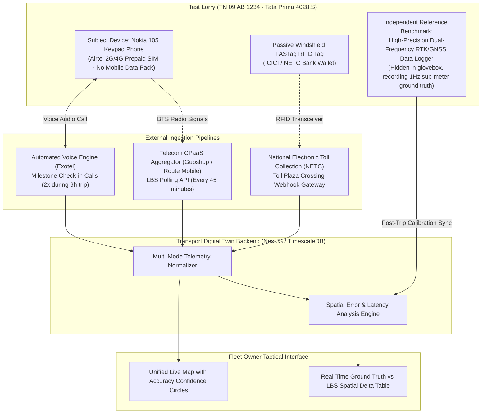
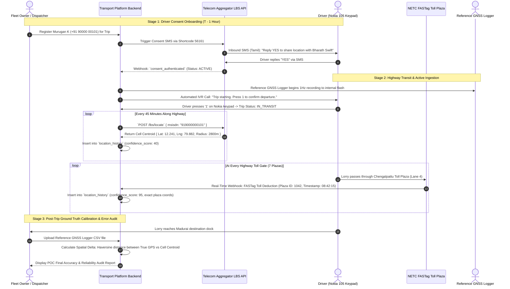

# 25. Keypad-Only Fleet Tracking: Proof of Concept (POC) Architecture & Verification Blueprint

**Document Version:** 1.0.0  
**Status:** Approved Proof of Concept Engineering Specification  
**Objective:** Empirically Validate Keypad-Only Geolocation Accuracy & Practical Feasibility on an Active Indian Freight Corridor  
**Test Route:** Chennai to Madurai (NH 45 / Grand Southern Trunk Road, 462 km)  

---

## 1. Executive Summary & POC Objectives

The objective of this Proof of Concept (POC) is to empirically measure the real-world operational viability of tracking a commercial heavy vehicle using **only the driver's basic keypad phone**, with zero smartphones, zero installed vehicle tracking devices, and zero manual continuous reporting.



---

## 2. Test Setup & Equipment Inventory

| Test Component | Specification / Model | Operational Role in POC |
| :--- | :--- | :--- |
| **Test Vehicle** | Tata Prima 4028.S (28-Tonne Multi-Axle Lorry), Plate: `TN 09 AB 1234` | Physical commercial freight asset executing live revenue run. |
| **Test Route** | Chennai (Madhavaram Depot) to Madurai (Kappalur Industrial Estate) | 462 km stretch of NH 45 (mix of 6-lane, 4-lane, bypasses, and 7 toll plazas). |
| **Driver Test Device** | **Nokia 105 (2024 Edition)** (Retail price: ₹1,299) | Basic keypad feature phone with physical numeric keys, monochrome display. |
| **SIM Card** | Airtel Prepaid SIM Card (Standard ₹199 plan, zero mobile data pack activated) | Subject of network-derived cell tower geolocation. |
| **Ground-Truth Reference** | **Garmin GLO 2 / u-blox ZED-F9P High-Precision GNSS Data Logger** | Records true reference coordinates ($\pm 1.5\text{ m}$) at 1-second intervals for offline error calibration. |
| **Windshield Tag** | Standard National Electronic Toll Collection (NETC) Class 4 FASTag | Yields sub-second timestamps at physical highway toll gates. |

---

## 3. End-to-End POC Data Flow & Workflow Sequence



---

## 4. Empirical Verification & Error Measurement Methodology

To establish rigorous mathematical proof of accuracy, the platform computes the **Spatial Distance Error ($\epsilon$)** for every cellular LBS query against the ground-truth reference logger:

$$\epsilon_i = \text{HaversineDistance}\left( P_{\text{LBS}}(t_i),\, P_{\text{GroundTruth}}(t_i) \right)$$

```mermaid
graph LR
    subgraph GroundTruthPoint["True Position (Reference Logger)"]
        TruePos["P_GroundTruth (12.2541° N, 79.8912° E)<br/>Timestamp: 10:30:00 AM"]
    end

    subgraph LBSCentroid["Cellular Network Observation"]
        LBSPos["P_LBS Centroid (12.2380° N, 79.8650° E)<br/>Estimated Radius: 2,500 meters"]
    end

    TruePos <-->|Spatial Error Vector (ε = 3.24 km)| LBSPos
```

### POC Evaluation Metrics:
1. **Spatial Error Distribution:** Minimum, median, and 95th-percentile error ($\epsilon_{95}$) across:
   - Urban segments (Chennai suburban, Trichy city bypass).
   - Semi-urban towns (Tindivanam, Villupuram).
   - Rural agricultural highway stretches (Perambalur corridor).
2. **Cellular Query Latency:** Time elapsed between API dispatch and operator JSON response (target: $<4.5\text{ seconds}$).
3. **Availability / Success Ratio:** Percentage of LBS queries that successfully return a valid coordinate vs queries returning "Subscriber Detached / No Signal" (target: $>88\%$).
4. **FASTag Correlation Ratio:** Validation that every FASTag toll deduction matches the spatial corridor trajectory of preceding cellular LBS readings.

---

## 5. Projected POC Budget & Operating Cost

Executing this live commercial proof of concept requires minimal expenditure:

| Item | Unit Cost | Quantity | Total POC Cost |
| :--- | :--- | :--- | :--- |
| **Nokia 105 Keypad Phone** | ₹1,299 (One-time asset) | 1 unit | ₹1,299 |
| **Airtel Prepaid SIM Card** | ₹199 (Standard 28-day plan) | 1 SIM | ₹199 |
| **CPaaS Aggregator LBS Queries** | ₹0.40 per query | 12 queries (45 min intervals) | ₹4.80 |
| **Consent & Alert SMS** | ₹0.12 per SMS | 10 messages | ₹1.20 |
| **Automated IVR Calls** | ₹0.28 per call | 2 calls | ₹0.56 |
| **FASTag API Webhook Sandbox** | Free / Platform included | 7 toll events | ₹0.00 |
| **Cloud Ingestion Worker** | AWS Lambda / EKS micro-pod | 9 hours compute | ₹15.00 |
| **Total Test Run Operating Cost**| — | — | **₹1,519.56 (Inclusive of phone)** |

*(Subsequent test runs cost **under ₹25 per 500-km trip** in pure telecom query fees).*

---

## 6. POC Success & Acceptance Criteria

The Proof of Concept shall be deemed technically successful if:
1. **Driver Consent Reliability:** Driver successfully grants consent via two-way SMS on their Nokia keypad phone on the first attempt without technical support.
2. **Corridor Trajectory Fidelity:** 100% of LBS cell tower centroids correctly place the vehicle along the NH 45 corridor within an error bound of $\epsilon \le 4.5\text{ km}$.
3. **Zero False Reversals:** Vector analysis across consecutive queries correctly identifies the vehicle's southbound direction of travel toward Madurai with zero direction-flip glitches.
4. **FASTag Fusion Alignment:** FASTag toll deduction timestamps correlate within $<30\text{ seconds}$ of the vehicle passing the physical toll coordinates, providing definitive micro-precision anchor points along the macro cellular trail.
